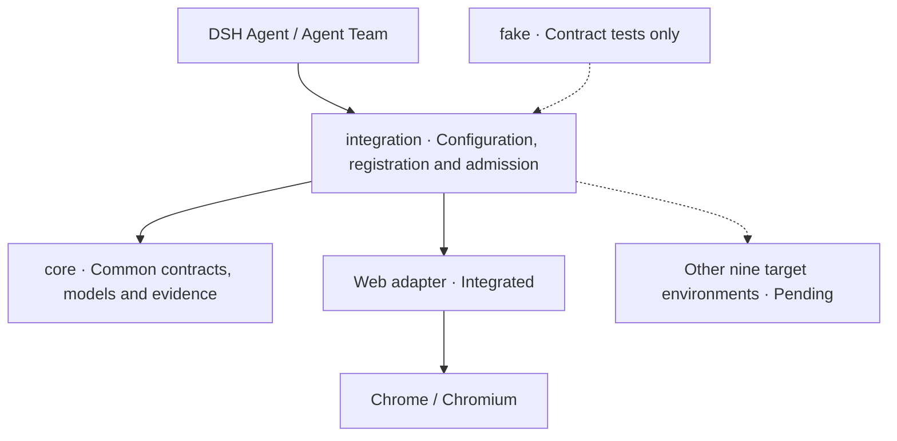

# dsh-agent-team-ui-testing

**English** | [简体中文](README_zh.md)

**AI-native infrastructure for UI debugging and automated testing across ten target environments.**

Give a single Agent or an Agent Team in [DeepSeekHarness (DSH)](https://github.com/deepseek-ai/deepseek-harness) a common way to connect to targets, invoke capabilities, collaborate with humans and collect evidence. Agents operate real interfaces, observe results and produce findings humans can review.

**Learn more: [Complete documentation and help (docs/index.md)](docs/index.md)**

[Getting started (getting-started.md)](docs/getting-started.md) · [Beginner walkthrough (tutorial.md)](docs/tutorial.md) · [Developer follow-up (tutorial-advanced.md)](docs/tutorial-advanced.md) · [Architecture (architecture.md)](docs/architecture.md)


<p>
  <a href="https://www.npmjs.com/package/dsh-agent-team-ui-testing"></a>
  <a href="https://github.com/bloodarea/dsh-agent-team-ui-testing/stargazers"></a>
  <a href="LICENSE"></a>
  <a href="https://nodejs.org/">= 22"></a>
  <a href="docs/browser-runtime.md"></a>
  <a href="docs/tools.md"></a>
  <a href="https://github.com/deepseek-ai/deepseek-harness"></a>
  <a href="https://github.com/bloodarea/dsh-agent-team-ui-testing/releases"></a>
</p>

> **Current progress: pre-release. The shared cross-environment foundation is implemented; Web / Chromium is the first real target integration.** Real adapters for the remaining nine target environments are pending. Available features and verification boundaries are documented in [capability tiers (capability-tiers.md)](docs/capability-tiers.md) and [verification (verification.md)](docs/verification.md).

## Vision and target environments

The project brings Web, desktop, mobile, terminal, mini program, game and 3D applications into a common debugging and testing system. The upper layer describes targets, operations, observations and evidence; each adapter supplies the real capabilities of its platform.

| Target environment | Intended scope | Current real adapter |
| --- | --- | --- |
| Web | Browser pages and Web applications | Chrome / Chromium integrated, with 37 `browser_*` tools |
| Linux | Native desktop, Electron, Tauri and similar applications | Pending |
| Windows | Native desktop, .NET, WinUI, Electron, Tauri and similar applications | Pending |
| macOS | Native desktop, Electron, Tauri and similar applications | Pending |
| Android | Native applications, WebView, Flutter, React Native and similar containers | Pending |
| TUI | Interactive terminal applications | Pending |
| HarmonyOS | HarmonyOS applications and containers | Pending |
| Mini programs | Platform-specific mini program containers | Pending |
| Games | Unity, Unreal, Godot, Cocos and similar runtimes | Pending |
| 3D | Three-dimensional applications and editing tools | Pending |

Linux, Windows and macOS here are native desktop testing targets. The current Web adapter already runs on all three host systems. Web also has a wired Edge driver, but a real Edge launch remains unverified; Firefox is not supported. See [browser runtime configuration (browser-runtime.md)](docs/browser-runtime.md).

## Implemented cross-environment foundation

The project has evolved from the earlier `dsh-agent-team-browser` into a plugin organized around target environments, capabilities and shared infrastructure. Common contracts, configuration, dispatch and data models have been separated from the Web implementation:

| Implemented part | Responsibility and boundary |
| --- | --- |
| Three adapter contracts | `TargetAdapter` owns target sessions and lifecycle, `CapabilityAdapter` declares and executes capabilities, and `P0Provider` supplies shared data services |
| Environment-neutral core | `core/` contains identity, geometry, clocks, evidence, errors, adapter registration and configuration models, without browser implementation dependencies |
| Host configuration and dispatch | `integration/` resolves global, workspace and session configuration, selects adapters through the registry and checks configuration revisions and execution admission |
| Config-driven tools and Skills | Registration determines tool declaration scope; execution checks the current session's environment and capabilities; environment-specific Skills are discovered by environment |
| P0-A–E common models | Images and frames, networking, display spaces, canvas and annotations, targets and leases have shared models; acquisition and control remain environment-specific |
| Six-axis readiness | Engineering support, user enablement, dependencies, connection, target binding and capability readiness are reported separately |
| Independent algorithms and contract fixtures | Image, network and dynamic analysis retain independently testable logic modules; `targets/fake` verifies common contracts and is not a real platform adapter |

Web CDP integration, page queues and tool handling still have implementations in the Host entry point. `engines/` remains a reserved boundary for optional self-developed executors. Every new target still needs platform adaptation, execution wiring and real acceptance testing.

### How the foundation connects to targets



The agent interprets the goal, chooses methods and judges results. The plugin connects, executes, observes and preserves evidence. The target runtime runs the application. Environments can use different protocols while sharing capability and evidence semantics. See the [execution chain (architecture.md)](docs/architecture.md#调试执行链路) for communication, backend and runtime responsibilities, and [adapter interfaces (adapters.md)](docs/adapters.md) for the full object contracts.

### Common capability categories

| Capability tier | Question it answers |
| --- | --- |
| T1 · State and interface debugging | What is the current state, and where is an interface or runtime step failing? |
| T2 · Structure and interaction debugging | Which object should be operated, is it interactable, and what changed afterward? |
| T3 · Output and presentation debugging | Do layout, colour, shape or image differences match expectations? |
| T4 · Process and behaviour debugging | How does state change over time, and do transitions, motion and workflows meet requirements? |

Choose and combine T1–T4 by question. They do not require every environment to expose DOM, JavaScript or browser tabs. P0 provides shared data across tiers; the three adapter contracts define integration responsibilities. Definitions, routing and current implementations are in [capability tiers (capability-tiers.md)](docs/capability-tiers.md).

## Web capabilities available today

- **37 agent tools:** state inspection, structured interaction, static vision, dynamic behaviour, networking, tabs and annotations. Parameters are in the [tool reference (tools.md)](docs/tools.md).
- **A shared human/agent debug panel:** live preview, size controls, canvas pan and zoom, element references in chat and shared annotations. See the [debug panel (debug-panel.md)](docs/debug-panel.md).
- **Team page collaboration:** page groups are scoped by workspace, provider and team root, with per-agent work/observation selections, ownership, and Lead acquire/release/transfer controls. See [multi-tab access (multi-tab.md)](docs/multi-tab.md).
- **Capture and visual evidence:** validated PNGs, explicit regions and scale, annotation overlays, pixel comparison and managed baselines. See [capture (capture-p0.md)](docs/capture-p0.md) and [Chrome T3 (capability-tiers.md)](docs/capability-tiers.md#web-chrome-t3).
- **Network and dynamic debugging:** requests, WebSocket, SSE, tracing and evidence export; bounded frame capture, seven motion analyses, WAAPI control and restore, and visual/network event correlation. See [network debugging (network-p0.md)](docs/network-p0.md) and [Chrome T4 (capability-tiers.md)](docs/capability-tiers.md#web-chrome-t4).

The current Web implementation defaults to headless and also offers a headed mode. Browser dependencies, providers and profile behaviour are covered in [browser runtime configuration (browser-runtime.md)](docs/browser-runtime.md); enablement and diagnostics are in [environment settings (settings.md)](docs/settings.md).

## Getting started

The current Web adapter needs DSH, Node.js 24.9+ and a local Chrome / Chromium binary. The plugin itself requires Node.js 22+; a DSH host follows the stricter requirement.

```sh
dsh plugin --profile web add dsh-agent-team-ui-testing
```

Install into the profile you use, then restart DSH. For the first exercise, open the debug view from the current session's right sidebar and keep the chat visible.

- **New users:** follow the [beginner walkthrough (tutorial.md)](docs/tutorial.md) to query an order, pick elements, annotate and save results through conversation. A runnable local demo is included.
- **Developers:** read the [developer follow-up (tutorial-advanced.md)](docs/tutorial-advanced.md) for tool calls, result verification and network, visual and dynamic debugging.
- **All help topics:** open the [documentation index (docs/index.md)](docs/index.md) and browse installation, panel operations, capabilities, diagnostics and architecture.

Other installation sources and version pinning are documented in [browser runtime configuration (browser-runtime.md)](docs/browser-runtime.md#其他安装方式).

## Usage and verification boundaries

- **Support and availability are separate:** the shared foundation exists; real adapters and local dependencies determine which targets can execute. A capability declaration, an enabled setting and a passing test are different conclusions.
- **Visual and temporal conclusions have limits:** current T3/T4 use deterministic algorithms with no built-in VLM/OCR. Insufficient sampling and untested scenarios must remain explicit. See [capabilities and limits (capability-tiers.md)](docs/capability-tiers.md#web-chrome).
- **Page isolation does not isolate login state:** Web page state is managed per Runtime; cookies and storage are shared within a browser profile. Review captures before sharing and do not assume all sensitive content has been removed.
- **Evidence needs independent verification:** dispatched input, a successful interface call or a delivered image attachment does not by itself prove business success, a visual assertion or full-resolution image visibility to the model. See [verification and reports (verification.md)](docs/verification.md).

## Next directions

- Integrate real adapters for the other nine target environments, including their executors, observations and real acceptance tests.
- Continue separating Web-specific implementation from the Host entry point using the existing common contracts; expand `engines/` when a self-developed executor is needed.
- Harden Web execution and extend dynamic, real-browser and long-running validation.
- Build on existing team ownership and control mechanisms to improve multi-agent collaboration, human takeover and release quality.

## Related projects

| Project | Role |
| --- | --- |
| [`dsh-agent-team-presets`](https://github.com/bloodarea/dsh-agent-team-presets) | Reusable team/role configurations, model routes and tool policies |
| **`dsh-agent-team-ui-testing`** | UI target integration, capability execution, evidence and human/agent collaboration |

The projects are complementary. A single DSH Agent can use this plugin independently.

## Contributing

Contributions to common contracts, real target adapters, reproducible UI scenarios and evidence boundaries are welcome. When reporting an issue, include DSH and target runtime versions, reproduction steps, expected and actual results, and sanitized evidence. Read [verification and contributing (verification.md)](docs/verification.md) before making development changes.

## License

Released under the [MIT License](LICENSE). Copyright (c) 2026 bloodarea. Incorporated third-party code must retain applicable notices.

---

**Repository:** [bloodarea/dsh-agent-team-ui-testing](https://github.com/bloodarea/dsh-agent-team-ui-testing) · **Maintainer:** [bloodarea](https://github.com/bloodarea) · **Status:** pre-release
