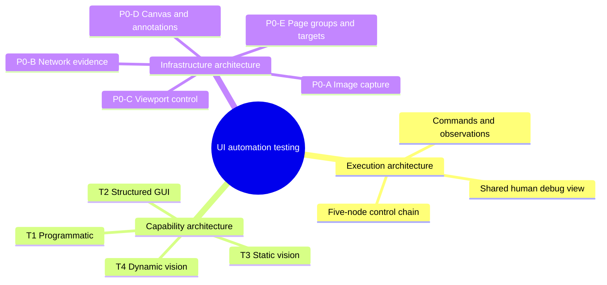
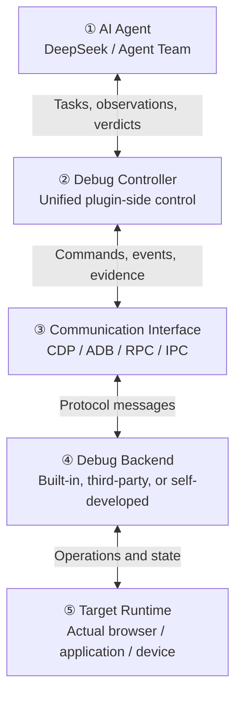
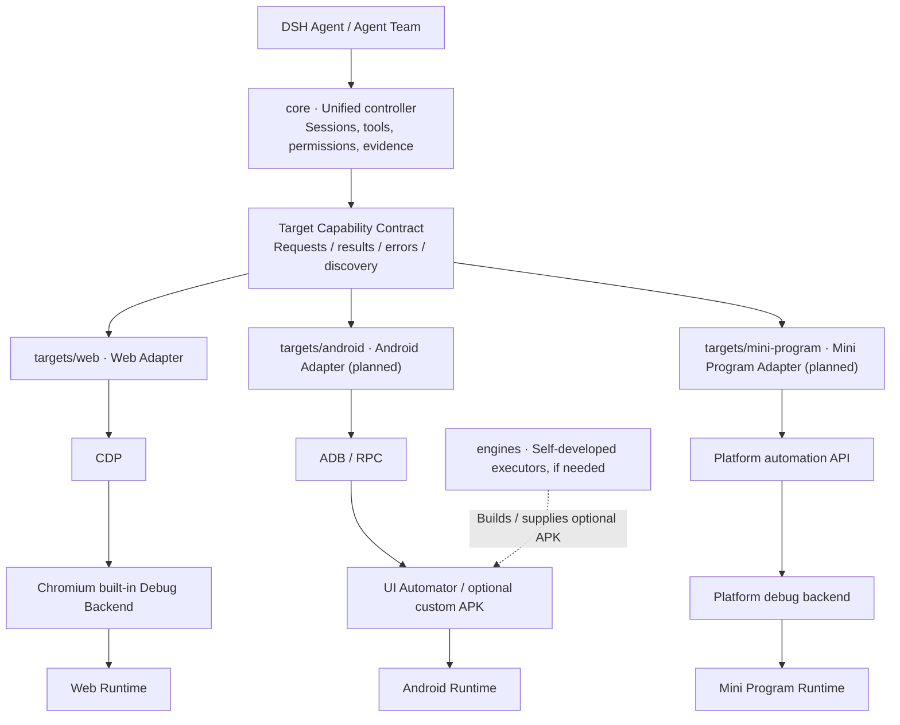
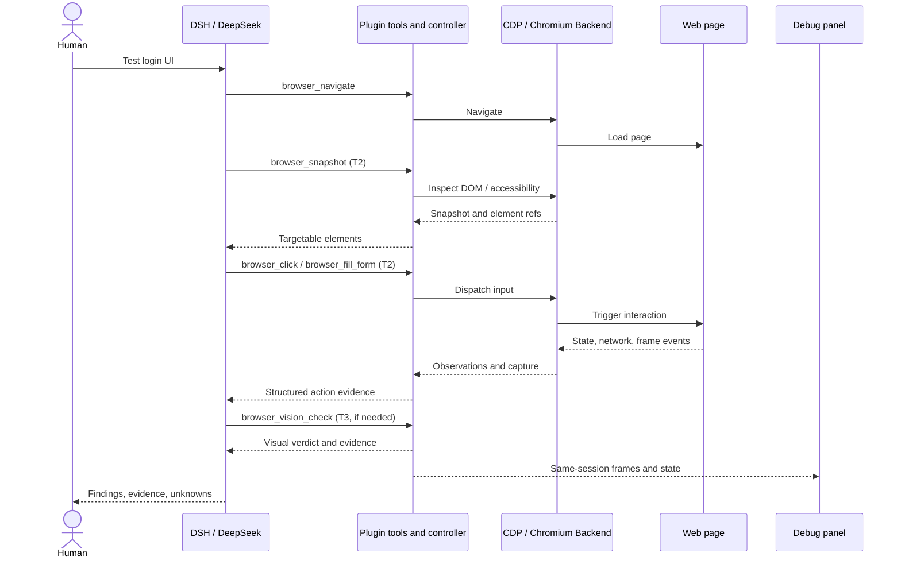

# dsh-agent-team-ui-testing


**AI-native frontend GUI testing for DeepSeekHarness.**

Let AI agents operate, inspect, test and verify real user interfaces — with evidence humans can review.

**English** | [简体中文](README_zh.md)

<p>
  <a href="https://www.npmjs.com/package/dsh-agent-team-ui-testing"></a>
  <a href="https://github.com/bloodarea/dsh-agent-team-ui-testing/stargazers"></a>
  <a href="LICENSE"></a>
  <a href="https://nodejs.org/">= 22"></a>
  <a href="docs/getting-started.md"></a>
  <a href="docs/tools.md"></a>
  <a href="https://github.com/deepseek-ai/deepseek-harness"></a>
  <a href="https://github.com/bloodarea/dsh-agent-team-ui-testing/releases"></a>
</p>

> **Status: pre-release.** The Web/Chromium channel is implemented across all four tiers: 37 agent tools plus a debug panel for programmatic inspection, structured GUI actions, static visual analysis, dynamic frame/timing analysis, network capture, multi-tab page groups, shared viewport control, a hybrid canvas, an element picker and client-side annotations. Other environments are planned and stay disabled in the runtime picker. **Install:** `dsh plugin --profile web add dsh-agent-team-ui-testing`. Capabilities, limits and verification are documented in [docs/capability-tiers.md](docs/capability-tiers.md) and [docs/verification.md](docs/verification.md).

## What is this?

**dsh-agent-team-ui-testing** is a UI testing infrastructure plugin for [DeepSeekHarness (DSH)](https://github.com/deepseek-ai/deepseek-harness). It lets an AI agent — or a coordinated Agent Team — drive a real application, inspect what the application exposes, verify expected behavior, collect reviewable evidence and report actionable failures.

The runtime is built around a shared Chromium instance with one isolated page per DSH workspace, a typed tool surface, and a human-facing debug panel. The same session can be inspected programmatically, operated through structured DOM/accessibility data, captured as screenshots, or analyzed visually.

The project grows out of the earlier `dsh-agent-team-browser` idea. The shared browser workspace remains the first adapter of a broader, capability-aware UI testing runtime.

## Why build it?

Coding agents can produce UI code without being able to answer: **“Does the finished application actually work and look right?”** A 200 response, a running process or a single screenshot is not proof of a working user journey.

This project focuses on:

- **Real UI feedback** — exercise user journeys on rendered interfaces, not only source code.
- **Structured-first automation** — prefer APIs, DOM and accessibility data; use vision when structure is insufficient.
- **Evidence-based results** — record what ran, what was observed, what passed, what failed and what remains unverified.
- **Human control** — authorized access, scoped sessions and a panel humans can watch or take over.
- **Low disruption** — prefer background browser operations over hijacking the desktop foreground.

## What works today

- **Shared browser runtime** — one browser per host and per runtime provider (the system Chrome/Chromium or Edge binary; the plugin does not bundle or install a browser), headless by default with an optional headed mode in the Web view (off-screen hidden window + persistent profile); each DSH workspace gets its own page, URL, viewport, history, network buffer and lease. Cookies and storage are shared by the profile of the active provider.
- **Runtime providers** — the web target environment defaults to `chrome` and also has a wired `edge` provider: its own executable candidates, its own `DSH_UI_TESTING_EDGE` override, its own profile directory and a post-connect product-identity check, reusing the same CDP stack. **A real Edge launch is not verified**: while Edge stays disabled its dependency axis is `not-probed` (disabled providers are never probed); once enabled on a machine without an Edge binary it reports `failed / executable-missing` on the Edge card, and enabling it opens no page. In the settings page the group header is the target-environment switch and each card is a runtime-provider switch; turning the total switch off greys the per-provider switches out while keeping their saved values.
- **37 agent tools** across programmatic, structured GUI, static vision, dynamic behavior, network debugging, per-workspace tab management and annotations.
- **Multi-tab page group (P0-E)** — page groups are keyed by (workspace, provider, team root): one team root shares a primary page plus up to three child tabs, while a different independent session or root gets its own group it can neither see nor write. Child tabs (max three) are counted per (workspace, provider) across roots; global live pages stay 8. Per-agent work/observation selections, long-lived ownership and Lead acquire/release/transfer control come on top of the short per-tab lease.
- **Dynamic behavior (T4)** — real CDP screencast plus a screenshot-loop path, a bounded frame store with integrity counters, seven deterministic motion analyses, WAAPI motion control with restore, region-only frame delivery, and six-direction frame↔network event correlation.
- **Debug panel** — live preview, responsive size controls, shared viewport state, a hybrid canvas, and a client-side annotation layer that agents can read back.
- **Element picker** — select an element in the panel preview to append its node description to the chat as an `@` reference chip; the model receives the full text block and the page is not modified.
- **Evidence and safety** — typed errors, structured action evidence, validated PNG capture, managed visual baselines, network evidence and optimistic concurrency for shared state.

### Agent tools

| Group | Tools | What it covers |
| --- | --- | --- |
| **Programmatic** (10) | `browser_navigate` `browser_eval` `browser_screenshot` `browser_input` `browser_network` `browser_computed_style` `browser_http_request` `browser_viewport` `browser_state` `browser_capabilities` | Navigation, JavaScript, console/network inspection, independent HTTP requests, computed styles, screenshots, raw mouse/wheel/keyboard input, shared viewport state and capability reporting |
| **Annotations** (1) | `browser_annotation` | Read/draw/erase/clear the annotation document the human sees in the debug panel: six shape types with colour, stroke width and fill/stroke style, append-only draws, revision CAS and a hard foreground requirement |
| **Page group** (1) | `browser_tabs` | Primary + up to three child tabs per (workspace, provider, root), per-tab short leases, per-agent work/observation selection, ownership + Lead control (acquire/release/transfer) and tab lifecycle (list/current/select/open/close/wait/acquire/release/transfer) |
| **Structured GUI** (7) | `browser_snapshot` `browser_click` `browser_type` `browser_scroll` `browser_fill_form` `browser_node_state` `browser_wait_for` | Snapshot → ref targeting, trusted input, forms, node state and waits, with structured evidence and typed errors |
| **Static vision** (6) | `browser_vision_image` `browser_vision_find` `browser_vision_compare` `browser_vision_act` `browser_vision_baseline` `browser_vision_check` | Crop/zoom/preprocess/annotate PNGs, deterministic colour/component/edge/template finders, YIQ diff, coordinate input, managed baselines and visual assertions |
| **Dynamic** (5) | `browser_dynamic_session` `browser_motion_observe` `browser_motion_analyze` `browser_motion_control` `browser_dynamic_correlate` | Bounded frame capture with integrity counters, region-only frame delivery, seven motion/transition analyses, WAAPI pause/seek/rate/restore, and six-direction frame↔network correlation |
| **Network** (7) | `browser_network_session` `browser_network_events` `browser_network_detail` `browser_network_trace` `browser_network_control` `browser_network_evidence` `browser_network_subscribe` | Capture, timeline, analysis, business-step traces, interception/throttling/replay/mock, JSONL/HAR evidence and per-agent subscriptions |

### Debug panel

The panel is the human window into the same runtime the agent uses.

- **Live preview** of the workspace page, driven by a screencast with a polling fallback.
- **Size bar** — 宽屏 / 横屏 / 平板 / 手机 presets as a segmented control, X/Y canvas position, width × height, display scale, and a `拖拽 | 适应窗口 | 默认` mode selector. Preset clicks reset X/Y and keep the chosen display mode; the selected preset shows a green dot and is mutually exclusive with drag mode.
- **Hybrid canvas** — the viewport can be positioned like a canvas: a signed origin, negative coordinates and blank areas, a dark checkerboard in the panel (pure white in screenshots), drag-to-pan and screen-anchored wheel zoom.
- **Annotation mode** — six shapes (circle/ellipse, rectangle, line, arrow, brush and text), plus eraser, fill/outline, colour, width and clear-canvas controls. Drawings are anchored in canvas coordinates and the page receives no input while annotating. When a user refers to annotations, drawings, circles, boxes, arrows or handwriting, agents read `browser_state.annotations` and call `browser_screenshot {includeAnnotations:true}` to see the overlay. The screenshot renders the Host-accepted, submitted document with the same shape semantics and region/scale mapping as the panel; drafts, toolbars and selection controls are excluded. `includeAnnotations` is a boolean, default `false`; default screenshots and T3/T4 source images omit panel annotations. See [capture and annotation boundaries](docs/capture-p0.md).
- **Shared state** — agent and panel read the same viewport; updates use `expectedRevision`, and conflicts are reported instead of silently overwriting.

### Evidence and safety

- Every structured action can return evidence: target identity, before/after state, dispatch facts, network deltas and typed errors.
- Screenshots are validated PNGs with explicit scale and canvas-space regions; capture can be staged or persisted under a controlled root.
- Visual baselines are immutable revisions with compare-and-swap HEAD updates and tombstones.
- Network evidence supports JSONL (lossless) and HAR 1.2 export with default redaction and explicit truncation counters.
- Frame evidence keeps the original `sourceTimestamp`, separate encoded and RGBA hashes, and dropped/evicted/gap counters; motion analyses are deterministic and report budget exhaustion or timeout as `BLOCKED` instead of pretending to pass.
- Runtime access is scoped to a DSH workspace; mutating page work is serialized through a lease and a serial queue.
- Navigation is restricted to approved targets (loopback by default; private ranges blocked unless explicitly enabled), with DNS, redirect and popup checks.

## Architecture design philosophy

> **In one sentence:** the AI agent decides *what to test and how to judge it*; the plugin *connects, controls, observes, and preserves evidence*; and the target runtime *actually runs the application*. **Web / Chromium is the implemented target today.** The three adapter contracts (`TargetAdapter` / `CapabilityAdapter` / `P0Provider`), the `core/` + `targets/` split, host-authoritative config, per-step tool admission and environment-aware Skill discovery are implemented for Web; the `engines/` boundary and other platform adapters remain planned.

### Three perspectives on the same test



| Perspective | Question it answers | Implemented Web example |
| --- | --- | --- |
| **Execution architecture** | Who requests an action, who executes it, and how does the result return? | DSH Agent → plugin → CDP → Chromium → page, with results flowing back |
| **Capability architecture** | Which method provides sufficient evidence for the question? | T1 programmatic, T2 structured GUI, T3 single-frame vision, T4 temporal/frame vision |
| **Infrastructure architecture** | How are capture, network data, viewports, evidence, and shared state managed reliably? | P0-A–P0-E plus workspace sessions, leases, safety, and evidence mechanisms |

These are **three views of one system**, not three separate applications or sequential network layers. A single `browser_click` travels through the execution chain, exercises a T2 capability, and relies on shared infrastructure to retain reviewable information.

### The five-node debug chain: from agent to running application



1. **AI Agent** interprets the goal, selects T1–T4 methods, and evaluates whether evidence satisfies acceptance criteria. It may be DeepSeek in DSH or a coordinated Agent Team.
2. **Debug Controller** is the plugin's unified entry point for tools, authorization, workspace and target selection, sessions, concurrency, state, and evidence.
3. **Communication Interface** transports commands and events using CDP, ADB, RPC, IPC, or other platform-specific mechanisms. **The upper-level capability contract is standardized; the wire protocol need not be.**
4. **Debug Backend** executes commands and observes the runtime. It may be Chromium's built-in DevTools backend, an existing OS automation facility, or a future self-developed companion program.
5. **Target Runtime** actually hosts the application under test: Chromium, Android, desktop OS, game runtime, etc. It normally exists outside the plugin.

These are **logical responsibilities, not five mandatory processes**. Commands flow down; observations, frames, logs, and errors flow up. The human **debug panel is a side-channel view and control surface** for the same managed session, rather than a second independent copy of the tested page.

### Cross-environment reuse: `core`, `targets`, and `engines`

The five-node chain describes runtime responsibilities. These three module boundaries describe code ownership and reuse; they do **not** correspond one-to-one with the five nodes.



| Proposed module boundary | Responsibility | Relationship to the five nodes |
| --- | --- | --- |
| **`core/`** | Unified tools, session/lease control, capability selection, shared P0 processing, evidence, errors, permissions, debug-view state | Primarily node ② |
| **`targets/`** | Environment adapters translate common capability requests into CDP/ADB/etc., normalize results, and honestly report supported/unsupported operations | Bridges node ② to nodes ③–⑤ |
| **`engines/`** | **Self-developed** executors that need separate builds or deployment, such as a possible Android accessibility Companion APK | Optional implementation of node ④ |

`targets/web` does not mean vendoring Chrome or Playwright. Nor does `engines/android` imply an APK is required: ADB / UI Automator may be sufficient for initial Android automation. **`core/` and `targets/` are now real directories**: `core/` owns the contracts, config, identity/geometry/clock, evidence and six-axis readiness; `targets/web` is the real Web adapter and `targets/fake` is a test-only contract fixture. `engines/` remains the reserved boundary for self-developed executors. The CDP integration and the 37 tool implementations still live in `index.js` (composition root / Web implementation), but admission, config and execution all go through the adapter boundary.

### Capability architecture: choose T1 / T2 / T3 / T4 as needed

Tiers classify **testing methods and the evidence they can supply**. They are **selection and fallback levels**, not a mandatory T1→T2→T3→T4 pipeline. Prefer the least expensive reliable method; escalate or combine methods only when the evidence is insufficient.

| Tier | Question | Implemented Web example | Representative agent tools |
| --- | --- | --- | --- |
| **T1 · Programmatic** | Is the API, program state, or runtime behavior correct? | CDP/HTTP/JavaScript, console, computed styles, page state | `browser_eval`, `browser_http_request`, `browser_network` |
| **T2 · Structured GUI** | Which element is present, and can it be operated correctly? | DOM/accessibility snapshots, `ref` targeting, forms, trusted input | `browser_snapshot`, `browser_click`, `browser_fill_form` |
| **T3 · Static vision** | Does one frame show a layout, color, or pixel-level defect? | PNG preprocessing, color/template matching, managed baselines and diffs | `browser_vision_find`, `browser_vision_compare`, `browser_vision_check` |
| **T4 · Dynamic vision** | Are transitions, animations, drags, and time-dependent behavior correct? | CDP screencast / screenshot loop, frame timing, deterministic motion analysis, frame↔network correlation | `browser_dynamic_session`, `browser_motion_analyze`, `browser_dynamic_correlate` |

**A successful T1 call is not a UI pass; a dispatched click is not proof of a successful login.** Select the observations relevant to the acceptance criteria. Current T3/T4 algorithms are deterministic and do not embed VLM/OCR; the AI agent can reason over the returned evidence. Adapters must report what their runtimes actually support, not invent UI trees or network telemetry to fill all four tiers.

### Infrastructure architecture: P0 is the shared foundation

P0 supports multiple tiers. T3 and T4 both depend on image capture; T1 and T4 can consume network events. **P0-A–P0-E are the names of today's Web facilities; cross-platform reuse requires separating portable data models from browser-specific semantics.**

| Infrastructure | Implemented Web form | Portable boundary / important caveat |
| --- | --- | --- |
| **P0-A · Image capture** | CDP screenshots, validated PNGs, canvas-space regions, dimensions, evidence storage | Common capture/Frame model and coordinate mapping; acquisition remains adapter-specific |
| **P0-B · Network evidence** | CDP events, timelines/traces, JSONL/HAR, throttling and mocks | Common event/evidence model; other devices/processes may expose less traffic |
| **P0-C · Viewport control** | Shared viewport dimensions and display scale, revisions/conflicts, input-coordinate constraints | Common display-space/coordinate mapping; physical screens cannot always be freely resized |
| **P0-D · Hybrid canvas and annotations** | Preview canvas, pan/zoom, anchored annotations readable by agents | Shared human/agent observations; capture-to-input coordinate mapping must remain accurate |
| **P0-E · Page group management** | Workspace primary + up to three child tabs, leases, `selectedTab` | Generalize target/window/session selection; other platforms may have no browser tabs |

Workspace authorization, serialized mutations, evidence validation, typed errors, state revisions, and human reviewability are further cross-cutting concerns shared by the execution and capability layers.

### Walk through an implemented Web testing path

Example request: “Check that the login form can be operated, observe feedback after submission, and retain evidence.” This is an **illustrative call path**, not a claim that a real login test has passed.



Mapped to the three perspectives: **execution** carries `browser_*` calls to Chromium and observations back; **capabilities** select T2 here and optionally T1 network checks, T3 single-frame vision, or T4 temporal analysis; **infrastructure** preserves captures, network evidence, and shared state so the human can inspect the same session. In the real implementation, `browser_http_request` uses an independent HTTP path—not every T1 operation goes through CDP. Panel preview is delivered via screencast and WebSocket, with HTTP polling as a fallback.

### What stays invariant for the next target?

- **Stable upper-level semantics:** agents request operations, observations, captures, events, and evidence through a common vocabulary; Web-only features remain target-specific extensions.
- **Adapters translate, never pretend:** Android may use ADB / UI Automator or an optional companion APK; Mini Program may use a platform's developer tools and automation interfaces. Unsupported capabilities must be reported explicitly.
- **Reuse analysis, vary acquisition:** T3 pixel comparison, T4 frame analysis, and P0 evidence models are candidates for reuse; CDP capture and Android screen capture use different backends.
- **Distinguish code ownership from deployment:** `targets/` lives on the controller side, `engines/` holds optional self-developed executors, and real Chrome / Android / Mini Program runtimes live outside the repository.
- **Load targets on demand:** future target selection should avoid needlessly injecting disabled platforms' tool schemas, skill content, or runtime dependencies into the AI agent's context.

**Implementation boundary:** Web / Chromium currently provides 37 tools and T1–T4/P0-related features, subject to the coverage and limitations in [capability tiers](docs/capability-tiers.md), [architecture](docs/architecture.md), and [verification](docs/verification.md). T4 acceptance is still partial. The cross-environment contracts, host-authoritative config, config-driven tool/Skill isolation and six-axis readiness are implemented and tested for Web plus a test-only fake adapter; real desktop, Android, Mini Program and other platform adapters remain proposed work.

## Getting started

**Requirements:** a DSH installation and a local Chrome/Chromium binary for the default `chrome` runtime provider. Edge is supported as a second runtime provider with its own executable candidates and its own `DSH_UI_TESTING_EDGE` override; its driver code is wired to the same CDP stack, but a real Edge launch has not been verified on this machine — enabling Edge without an Edge binary makes its dependency axis report `failed / executable-missing` (a disabled provider stays `not-probed`) and opens no page. The plugin does not bundle or install a browser; it launches the system binary it resolves (see [docs/getting-started.md](docs/getting-started.md)). A headed Web view additionally needs `DISPLAY` or `WAYLAND_DISPLAY` on POSIX hosts; Windows hosts always provide a window system, so headed mode needs no such variable there. The plugin requires Node.js 22+ (native `WebSocket`); the current DSH release itself requires Node.js 24.9+, so a real DSH host follows the stricter version.

The plugin ships as a DSH plugin bundle and is published on npm as `dsh-agent-team-ui-testing`. There is no compatibility matrix beyond the Node.js and DSH requirements above.

```sh
# npm form (recommended): follows semver, so dsh-market can prompt for updates
dsh plugin --profile web add dsh-agent-team-ui-testing

# floating GitHub form: also receives updates, but only when package.json version is bumped
dsh plugin --profile web add github:bloodarea/dsh-agent-team-ui-testing

# pinned tag: reproduces exactly one release and never receives update prompts
dsh plugin --profile web add github:bloodarea/dsh-agent-team-ui-testing#vX.Y.Z
```

1. Install the package into the DSH profile being used.
2. Restart DSH after the first install so the plugin bundle is registered.
3. Open the debug view from **更多 → 调试视图**, or from the plugin card in the right sidebar. **First time here? The [screenshot walkthrough](docs/tutorial.md) takes you from opening the panel to a verified agent action in seven short steps.**
4. Changes to `client.js` only need a panel refresh; changes to `index.js`, the tool surface or bundled skills need a DSH restart.

For plugin development, link or copy this repository into the profile instead of installing the npm package.

Requirements, install steps and panel usage are in [docs/getting-started.md](docs/getting-started.md).

A typical agent flow is: navigate to the target, inspect state with `browser_state`/`browser_eval`, perform structured actions with the T2 tools, capture screenshots or run T3 checks, inspect network traffic with the network tools, escalate to the dynamic tools (`browser_dynamic_session` → `browser_motion_observe` → `browser_motion_analyze`/`browser_dynamic_correlate`) when the question is about motion, timing or a frame sequence, and use the shared viewport/canvas/annotation state when the task involves layout, framing or visual feedback.

## Current limits

- **Web target only.** Web/Chromium is the only implemented target environment and runs on Linux, macOS and Windows hosts. Desktop applications, Android, Mini Program, TUI, HarmonyOS, games and 3D are planned targets and stay disabled in the runtime picker.
- **Vision is deterministic, not semantic.** T3 judges single PNGs and T4 judges frame sequences with deterministic algorithms: no VLM/OCR, no semantic naming, so "what does this text mean" and "looks right to a human" stay out of scope.
- **T4 verification is partial.** Of the 44 dynamic-behavior criteria, 12 pass, 20 are partial, 0 fail and 12 were not run — the suite exits non-zero only because required checks were not run, not because they failed. Close/dispose restore, WebGPU rendering, media seeking/stalling, header-verified identity, 16 ms flicker coverage and long-lived connections remain unverified.
- **Shared browser profile.** Cookies and storage are shared by the Chromium profile; only page, URL, viewport, history, network buffer and leases are isolated per workspace.
- **Screenshots are not redacted.** Review their content before sharing.
- **Attachments are not provider visibility.** A returned image attachment does not prove the model received it at full resolution.
- **Network capture is partial at the edges.** Same-page iframe and dedicated workers are covered; OOPIF is partial; shared and service workers are not collected; HAR is a 1.2 subset; body/header redaction is not a general secret detector.
- **Viewport display is a 1× screencast.** A display scale above 100% magnifies the bitmap rather than adding pixel density; request an explicit screenshot scale when resolution matters. Resize input barriers are best-effort, while canvas offsets use a fail-closed barrier.
- **Shared state is optimistic.** `browser_viewport get` is a cache diagnostic; `stale` means “not recently observed”, and a lost `expectedRevision` race returns `VIEWPORT_CONFLICT` instead of replaying the patch.

## Roadmap

- Harden the Web channel and close the remaining dynamic-behavior criteria (12 not run, 20 partial).
- Gradually extract a common capability contract and `core/targets/engines` module boundaries while preserving existing Web tools; build the cross-environment test core (typed sessions, observations, assertions, reports).
- Validate desktop (Windows/Linux/macOS), Android, Mini Program, TUI, HarmonyOS, game and 3D adapters by demand and platform feasibility.
- Add multi-agent scheduling, human takeover and release hardening.

## Documentation

| File | Contents |
| --- | --- |
| [docs/index.md](docs/index.md) | Documentation index |
| [docs/tutorial.md](docs/tutorial.md) | **Beginner walkthrough (with screenshots)**: open the panel, load a page, inspect, click, pick an element, annotate and collect evidence |
| [docs/getting-started.md](docs/getting-started.md) | Requirements, install, debug panel and first calls |
| [docs/tools.md](docs/tools.md) | All 37 tools, parameters and error classes |
| [docs/capability-tiers.md](docs/capability-tiers.md) | T1–T4 selection model, P0 infrastructure and known limits |
| [docs/viewport-control.md](docs/viewport-control.md) | Shared viewport, hybrid canvas and annotations |
| [docs/capture-p0.md](docs/capture-p0.md) | Screenshots, image delivery and file lifecycle |
| [docs/multi-tab.md](docs/multi-tab.md) | Per-workspace tab group, per-tab leases and agent tab selection |
| [docs/element-picker.md](docs/element-picker.md) | Panel element picking and `@` element reference chips |
| [docs/network-p0.md](docs/network-p0.md) | Network capture, tracing, control and evidence |
| [docs/t2-structured-gui.md](docs/t2-structured-gui.md) | Snapshot/ref, trusted input and form filling |
| [docs/t3-vision.md](docs/t3-vision.md) | Static vision algorithms, baselines and verdicts |
| [docs/t4-dynamic-behavior.md](docs/t4-dynamic-behavior.md) | Frame capture, motion analysis, control and correlation |
| [docs/architecture.md](docs/architecture.md) | Runtime, module responsibilities and extension points |
| [docs/verification.md](docs/verification.md) | Reproducible tests, result interpretation and contributing |


## Relationship to other projects

| Project | Role |
| --- | --- |
| [`dsh-agent-team-presets`](https://github.com/bloodarea/dsh-agent-team-presets) | Reusable team and role configurations, model routes and tool policies |
| **`dsh-agent-team-ui-testing`** | UI testing targets, sessions, automation, evidence and governed human/agent control |

They are complementary but do not require each other; the runtime supports a single DSH agent without the presets plugin.

## Contributing

Reproducible DSH integration findings, platform feasibility tests, accessibility/DOM fallback cases, security threat models and concrete UI acceptance scenarios are the most useful contributions.

When filing an issue, include the DSH version/commit, platform and runtime versions, reproduction steps, expected and observed results, and sanitized evidence. Never upload credentials, personal device data or unredacted authenticated traffic.

## License

Released under the [MIT License](LICENSE). Copyright (c) 2026 bloodarea. Third-party code incorporated later must retain its applicable notices.

---

**Repository:** [bloodarea/dsh-agent-team-ui-testing](https://github.com/bloodarea/dsh-agent-team-ui-testing) · **Maintainer:** [bloodarea](https://github.com/bloodarea) · **Status:** pre-release
