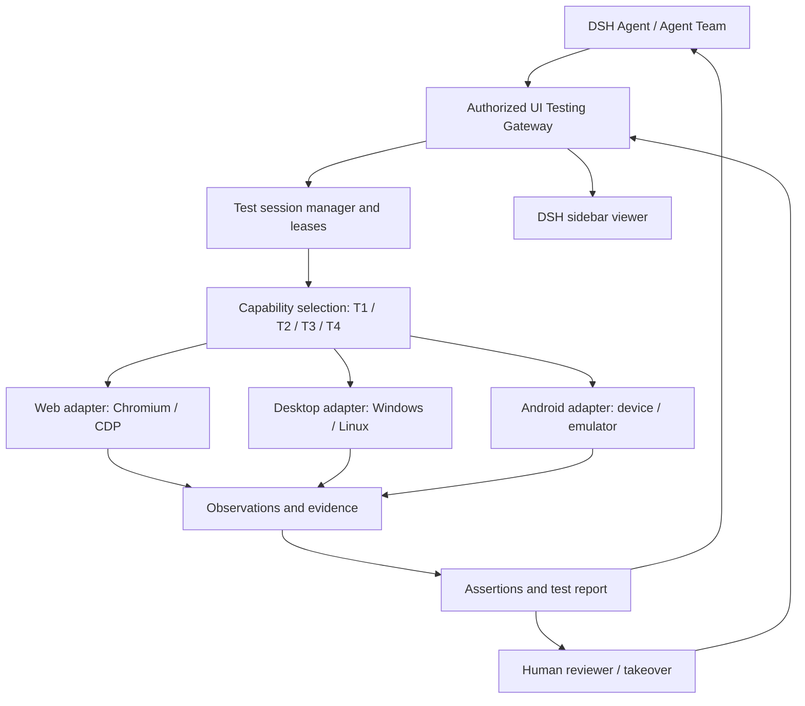

# dsh-agent-team-ui-testing

**AI-native, cross-platform UI testing for DeepSeekHarness.**  
Help AI agents operate, inspect, test, and verify Web, desktop, Android, TUI and 3D interfaces — with evidence humans can review.

**English** | [简体中文](README_zh.md)

> [!IMPORTANT]
> **Project status: architecture / pre-release.** The Web channel — **T1 programmatic, T2 structured GUI and T3 static vision** (22 agent tools) — is implemented and covered by acceptance suites that drive a real Chromium. The other eight planned environments are not implemented and stay disabled in the runtime picker. The plugin is linked locally, not published to npm: there is no released package, compatibility matrix or official release. Verification state, counts and open gaps: [docs/status.md](docs/status.md).

## What is this?

**dsh-agent-team-ui-testing** is a UI testing infrastructure plugin for [DeepSeekHarness (DSH)](https://github.com/deepseek-ai/deepseek-harness). It lets an AI agent — or a coordinated Agent Team — interact with a real application, inspect its state, verify expected behavior, capture evidence and report actionable failures.

The project evolves from the earlier **`dsh-agent-team-browser`** concept, whose focus was shared Chromium workspaces. The browser workspace remains part of the plan and becomes one adapter inside a broader UI testing runtime.

## Why build it?

Coding agents can produce UI code without being able to answer: **"Does the finished application actually work and look right?"** A 200 response, a launched process or a single screenshot is not evidence of a working user journey. The project aims to provide:

- **Real UI feedback:** exercise user journeys on rendered interfaces, not only source code.
- **Structured-first automation:** use API, DOM and accessibility interfaces where they are reliable, and visual methods when they are not.
- **Evidence-based results:** record what ran, what was observed, what passed, what failed and what remains unverified.
- **Cross-platform sessions:** one testing contract across platforms, while keeping platform-specific capabilities and limits.
- **Agent collaboration with human control:** coordinate authorized access across agents and let humans observe or take over.
- **Low disruption:** avoid stealing foreground input when the target and OS allow it; disclose operations that require focus.

## Key design principles

1. **Test outcomes are first-class.** Operating the UI is a means to verify an expected behavior; the conclusion must carry evidence and explicit limits.
2. **Prefer structured information.** Use supported application, event, DOM or accessibility interfaces before relying on fragile screen coordinates.
3. **Do not claim an unperformed test passed.** An API-only check cannot by itself prove visual appearance or end-to-end UI behavior.
4. **Separate execution from presentation.** Closing a DSH sidebar viewer must not destroy its test target or abort a permitted background session.
5. **Isolation by default.** A browser context, native desktop session or Android device belongs to an authorized scope; identities and access are checked by the runtime.
6. **Keep human-facing complexity low.** Agents may use detailed adapters and evidence internally; humans should receive concise findings, failure locations and reviewable artifacts.

## Implemented today: Web (Chromium)

One plugin runs a single shared headless Chromium per host and gives every DSH workspace its own page, URL, viewport, history, network buffer and lease; cookies and storage are shared per Chromium profile. The agent surface is **22 tools** across three capability tiers:

| Tier | Tools | Capabilities |
| --- | --- | --- |
| **T1** programmatic | `browser_navigate` `browser_eval` `browser_screenshot` `browser_input` `browser_network` `browser_computed_style` `browser_http_request` `browser_state` `browser_capabilities` | Navigation, JavaScript execution, console/network inspection, independent HTTP requests, computed styles, screenshots, raw mouse/wheel/keyboard events, capability reporting |
| **T2** structured GUI | `browser_snapshot` `browser_click` `browser_type` `browser_scroll` `browser_fill_form` `browser_node_state` `browser_wait_for` | Snapshot → ref targeting, trusted CDP actions, forms, node state and waits; every call returns structured evidence and typed errors |
| **T3** static vision | `browser_vision_image` `browser_vision_find` `browser_vision_compare` `browser_vision_act` `browser_vision_baseline` `browser_vision_check` | Crop/zoom/preprocess/annotate PNGs, deterministic colour/component/edge/template finders, YIQ diff, coordinate input, managed baselines, regression and layout/occlusion/overflow/truncation/colour/missing-component assertions |

T3 is an in-house, dependency-free JavaScript stack (own PNG codec, YIQ diff and finders; no Sharp, Pixelmatch or Argos). `browser_capabilities` reports what the host actually serves — six `web.t3.*` entries plus the `web.t3.static-vision` aggregate — while `web.t4.*` remains `unsupported`.

### Screenshots and evidence files

`browser_screenshot` accepts optional continuous `scale` (1–4) and a `region` in document CSS pixels. PNGs are staged in a plugin-instance directory by default (mode 0600, never overwriting an existing file) and removed when the plugin is disposed; pass `out`, `persist:true`, or set `DSH_UI_TESTING_CAPTURE_DIR` to keep them under a persistent root. Screenshots are not redacted — review the content before sharing. T3 baselines live under `<root>/output/vision-baselines/<scopeHash>/` with immutable revisions, HEAD compare-and-swap and tombstones.

### Current limits

- **Static only.** T3 judges single PNGs with deterministic pixel algorithms: no VLM/OCR or semantic naming, and no proof about animation, flicker or intermediate frames (T4 is unimplemented).
- **Shared profile.** Cookies and storage are shared by the one Chromium profile; only page, URL, viewport, history, network buffer and leases are isolated per DSH workspace.
- **Attachments are not provider visibility.** A returned image attachment does not prove the model received it at full resolution.
- **Some checks are unobservable.** Blink truncates CDP mouse coordinates to integers and inert subtrees do not participate in hit-testing, so those sub-checks are recorded as NOT_APPLICABLE instead of passed.
- **Web only.** Desktop, Android, TUI, HarmonyOS, games and 3D are planned; the runtime picker keeps them disabled.

The repository also ships acceptance suites that drive a real Chromium in-process (`tests/acceptance/`) and pure-algorithm unit tests for the PNG codec, YIQ diff and baselines. Current results and open gaps: [docs/status.md](docs/status.md).

## Planned scope

Nine runtime environments are planned; only Web is implemented so far.

| Environment | Current status | Candidate integration approach | Intended coverage |
| --- | --- | --- | --- |
| **Web** (Chromium) | **T1 + T2 + T3 implemented**; T4 not implemented (debug view available) | Chromium, Chrome DevTools Protocol (CDP), DOM/accessibility APIs | Navigation, forms, responsive layouts, console/network inspection, screenshots, interactions, static visual analysis and coordinate input |
| **Windows desktop** | Planned, not implemented (picker disabled) | Windows UI Automation (UIA) and platform-approved input/capture mechanisms | Native controls, window state, user journeys, screenshots |
| **Linux desktop** | Planned, not implemented (picker disabled) | Accessibility interfaces and compositor/desktop-specific automation | Native controls and GUI workflows; actual coverage depends on X11/Wayland and permissions |
| **macOS desktop** | Planned, not implemented (picker disabled) | macOS Accessibility (AXUIElement) plus system capture/input APIs (TCC authorization required) | Native controls, window state, user journeys, screenshots; full unattended automation is not an initial commitment |
| **Android** | Planned, not implemented (picker disabled) | ADB, UI hierarchy/UiAutomator-style capabilities, device screenshots/input | Activities, navigation, controls, permission-aware device workflows |
| **TUI** | Planned, not implemented (picker disabled) | Pseudo-terminal (PTY/termios) and terminal buffer capture (to be validated) | Terminal sessions, key input, screen-content assertions |
| **HarmonyOS** | Planned, not implemented (picker disabled) | HDC and platform UI inspection/input interfaces (to be evaluated) | Application/atomic-service UI, navigation, controls, device workflows |
| **Games** | Planned, not implemented (picker disabled) | Engine/platform debug and input interfaces (evaluated per engine) | Runtime state, input, scene and frame evidence |
| **3D** | Planned, not implemented (picker disabled) | WebGL/graphics APIs and scene-state access (to be evaluated) | Viewpoint/scene assertions, frame evidence |

These technologies are **candidates, not selected dependencies or verified integrations**. Only the Web target has a capability-tier model (T1–T4); the other environments have none yet, and an adapter must report its available operations instead of pretending every platform supports the same functions.

**Not included in the initial commitment:** iOS automation, fully unattended macOS automation (accessibility/TCC constraints), unrestricted OS control, bypassing CAPTCHA or application security restrictions, guarantees of background input on every native application, or generic game/3D automation (evaluated per engine and graphics stack).

## Target capabilities (planned)

Beyond the implemented Web channel, the following areas describe the target capability set:

| Area | Planned behavior |
| --- | --- |
| **Test session management** | Create, select, resume where feasible and terminate scoped target sessions; keep them distinct from DSH conversation sessions |
| **Action and observation tools** | Small, typed operations for launching, finding, clicking, typing, inspecting, waiting and capturing evidence |
| **Assertions and reports** | Link expected state, actual observation, pass/fail/blocked/unverified status and supporting artifacts |
| **Multi-agent coordination** | Parallel work on independent targets; serialize conflicting mutations with scoped ownership/leases |
| **Human observation/takeover** | Display target state through an authorized DSH viewer; hand control between agent and human where supported |
| **Browser workspace** | Multiple tabs with explicit access and write leases; optional cookie sharing inside one authorized context |
| **Responsive testing** | Set a tab's CSS viewport and DPR independently from the sidebar width |
| **Debugging** | Inspect permitted console, runtime, network and application errors; protect secret-bearing data |
| **Visual verification** | Compare UI states or screenshots under controlled conditions, reporting uncertainty instead of concealing it |
| **Animation verification** | Sample state and frames over time; check transitions, timing and layout stability against explicit criteria |
| **Reproducibility** | Record environment metadata, steps, artifacts, failure evidence and replay limitations |

## T1–T4: capability-aware selection and stepwise fallback

**T1–T4 are selection and fallback levels, not a pipeline that must be walked in order.** They are this plugin's own **debugging-capability tiers**, not an industry standard: every level is callable on its own and can serve as the fallback source of the level above it. The four levels are currently defined **for the Web target only**; desktop, Android, TUI, HarmonyOS, games and 3D have no agreed tier model yet.

| Level | Formal name | Core technology | Primary debugging capability | Trigger / escalation | Relative cost |
| --- | --- | --- | --- | --- | --- |
| **T1** | Programmatic debugging | CDP, HTTP, Fetch, JavaScript, Network, Console | API requests, network capture, JS execution, exception detection, resource loading, state inspection, performance data | Default first choice; escalate to T2 when page elements must be operated | Low |
| **T2** | Structured GUI debugging | DOM, Accessibility Tree, ARIA, Snapshot, Locator, Ref | Element targeting, clicking, typing, scrolling, forms, interaction tests, node state, structured evidence | Escalate to T3 when reliable structured targeting cannot complete the operation, or visual judgement is required | Low–medium |
| **T3** | Static visual debugging | Screenshot, Computer Vision, coordinate actions, image diff | UI layout, colour, occlusion, styling defects, Canvas, charts, operating on static screenshots | Escalate to T4 when continuous motion, animation or time-state judgement is required | High |
| **T4** | Dynamic visual debugging | Screencast, frame sequences, timestamps, visual reasoning, mouse/keyboard events | Animation, dragging, complex dynamic widgets, transition states, continuous frame analysis | Highest level: on failure emit diagnostics and leave the verdict to the agent or a human | Highest |

Scope and completion bar per level ("Primary references" is a comparison shortlist, not a set of selected dependencies):

| Level | Primary references | Implementation strategy | Completion bar |
| --- | --- | --- | --- |
| **T1** | [Playwright](https://playwright.dev/) MCP, agent-browser, [Chrome DevTools MCP](https://github.com/ChromeDevTools/chrome-devtools-mcp) | Reuse directly | Complete page and API diagnosis without visual understanding, and hand the same browser session to T2 |
| **T2** | ego-lite, agent-browser, [Playwright MCP](https://github.com/microsoft/playwright-mcp) | Reuse + unified node protocol | Reliable structured discovery, targeting, action and verification loop on ordinary Web pages, plus explicit detection of when vision is needed |
| **T3** | Playwright MCP Vision, agent-browser, [Sharp](https://sharp.pixelplumbing.com/), [Pixelmatch](https://github.com/mapbox/pixelmatch), [Argos](https://argos-ci.com/) | Pure-JS in-house implementation (PNG + YIQ + deterministic finders); the references are comparison only | Visual targeting and actions on a static frame with accurate before/after verification; escalate to T4 when continuous time information is needed |
| **T4** | agent-browser video recording, in-house dynamic-visual scheduling, CDP Animation, [rrweb](https://www.rrweb.io/), FFmpeg / [OpenCV](https://opencv.org/) on demand | Reuse capture, own the temporal verification | Judge the result of a dynamic interaction from a frame sequence and emit timestamped, reproducible evidence |

Fallback chain: the agent picks the lowest-cost suitable level; after **action verification + defect attribution + evidence output**, it escalates or jumps when the current level cannot produce the required evidence. The strategy obeys four rules:

1. **Choose by need.** Network faults start at T1, button interaction at T2, layout errors may go straight to T3.
2. **Stepwise escalation is the default, skipping is allowed.** When continuous dynamic frames are clearly required, go straight to T4.
3. **Separate tool failure from product defects.** A broken locator may be retried or escalated; a failed business assertion must be recorded as a defect and never masked by a fallback.
4. **Reuse evidence across levels.** T1 network data, T2 element refs, T3 screenshots and T4 key frames all belong to the same debugging task.

A successful T1 call is never silently treated as a visual test pass: UI-specific acceptance criteria still require UI-level observations.

## From a test request to verifiable evidence

1. **Specify:** describe the target, user journey, expected behavior, environment and acceptance criteria.
2. **Prepare:** start or attach to an authorized browser, desktop or Android test session.
3. **Execute:** use the best supported structured action path, falling back as needed.
4. **Observe:** capture UI state, accessibility/DOM data, logs, screenshots or timed frames relevant to the assertion.
5. **Assert:** prefer deterministic checks; for subjective visual judgments, include tolerance, uncertainty and review requirements.
6. **Report:** produce passed/failed/blocked/unverified outcomes and a reproducible failure summary.
7. **Retest:** after the development agent changes the application, rerun affected cases and report regressions.

**Example goal (illustrative, not a published tool syntax):**

> Launch the application. Open Settings, switch to dark mode, verify the persisted preference and the rendered interface, then navigate away and back. Report the actual checks run, screenshots, relevant logs, any mismatch, and any check that could not be performed.

### Evidence and verdicts

Test records carry a target/environment identity, case and step, action source, timestamp, expected result, observed result, status and references to artifacts. Deterministic assertions, reviewed evidence and platform limitations must stay distinguishable: a model confidence score is not proof. Screenshots are explicit capture requests and are not redacted, so check their content before sharing.

### Animation and visual behavior

A single static screenshot cannot establish that an animation is correct. Where the platform permits, the runtime should capture a bounded frame or state sequence with timestamps and defined criteria (duration range, start/end state, unexpected layout shift, missing transition). Rendering variability, reduced-motion settings, frame capture gaps and device performance must be documented. Ambiguous results are marked **unverified / review needed** instead of passed.

## Architecture (planned)



### Preserve the shared-browser foundation

- An authorized **Browser Workspace** can contain multiple tabs, with explicit per-tab access and write leases.
- Tabs within one chosen `BrowserContext` can share applicable cookies and same-origin storage; separate contexts remain isolated by default. Sharing cookies never guarantees universal sign-in.
- An agent's DSH Session, the browser runtime and the sidebar viewer have **different lifecycles**. Switching the viewed tab must not switch or recreate background browser tasks.
- Each tab owns its logical viewport; shrinking the DSH sidebar must not turn a `1920 × 1080` page into a mobile viewport. The viewer scales/crops the output and maps human input back to the actual target coordinates.
- Browser automation uses background CDP operations rather than hijacking the desktop's foreground pointer or keyboard.

Desktop and Android adapters follow the same **authorized session and evidence principles**, but do not pretend to share Chromium-specific cookies, DOM capabilities or focus guarantees.

### Multi-agent ownership and permissions

- Read-only observations may run concurrently when authorized.
- Independent targets can be tested concurrently subject to machine/device capacity.
- Mutating operations on the **same target** require a coordinated write owner/lease; expired actors must not keep writing.
- A human takeover pauses or revokes conflicting agent control before granting a bounded human operation scope.
- Agent or team identity comes from trusted DSH runtime context, not user-supplied `agentId` strings.
- Tool availability does not override resource authorization: a preset can permit a tool while the runtime still verifies access to a specific target.

## Security and privacy

The testing runtime may encounter authenticated pages, private screens, developer tools or device data. It follows least privilege, explicit target authorization, bounded collection and safe defaults:

- Do not export cookies, access tokens, authorization headers, passwords or private request bodies by default.
- Require clear authorization for sensitive application/device actions or intrusive debugging.
- Redact test logs and screenshots where feasible; describe redaction gaps.
- Do not silently bypass OS protections, application security checks, CAPTCHA or consent prompts.
- Avoid recording unrelated host windows or cross-team data.
- Keep replay and recovery capabilities bounded; never promise to recreate arbitrary in-memory state.

## Roadmap

These are **planned work items**, not claims of completion. Ordering may change after DSH and platform feasibility audits.

- [ ] **R0 — Feasibility:** audit DSH plugin/sidebar interfaces, upstream licenses, test target capabilities and security boundaries.
- [ ] **R1 — Web foundation:** retain workspace/context/tab management, background Chromium execution and viewer independence.
- [ ] **R2 — Test core:** add typed test sessions, T1–T4 capability selection, actions, observations, assertions and evidence reports. _(Web T1–T3 delivered: programmatic channel, structured GUI and static vision, each with an acceptance suite. T4 and the cross-environment test core remain open.)_
- [ ] **R3 — Collaboration:** implement agent/team authorization, target ownership, human takeover and concurrent test scheduling.
- [ ] **R4 — Desktop:** validate Windows/Linux adapters, accessibility/input/capture options, permissions and focus constraints.
- [ ] **R5 — Android:** validate device/emulator lifecycle, UI hierarchy, interaction, screenshots and failure reporting.
- [ ] **R6 — Visual tests:** verify responsive UI, state comparison, timed animation observations and uncertainty handling.
- [ ] **R7 — Hardening:** run security, privacy, resource, crash/recovery and cross-platform regression tests.
- [ ] **R8 — Release:** publish a reproducible build, pinned DSH compatibility, verified installation instructions and acceptance evidence.

The remaining planned environments (macOS desktop, TUI, HarmonyOS, games, 3D) have no separate milestones yet; they are ordered later by demand and platform feasibility, and stay disabled in the runtime picker. A milestone is complete only after its implementation and tests are publicly verifiable.

## Installation and development

**No published installation command or released version yet.** The plugin is currently used as a local link into a DSH checkout; packaging, DSH compatibility and install instructions will be documented once verified. See [docs/dsh-integration.md](docs/dsh-integration.md) for integration notes and pitfalls.

The acceptance suites used in development are Node scripts that drive a real, local Chrome/Chromium; run them serially:

```bash
node tests/acceptance/run.mjs            # T1 programmatic
node tests/acceptance/t2-structured.mjs  # T2 structured GUI
node tests/acceptance/t3-vision.mjs      # T3 static vision
node tests/acceptance/capture-p0.mjs     # screenshot capture infrastructure
```

The repository ships no product screenshots; the legacy `banner.png` / `banner_zh.png` assets were removed and nothing here should be presented as a capability demo.

### Known constraints

- DSH APIs and extension points may change; adapters must be validated against pinned versions.
- Windows and Linux GUI automation differ significantly; Wayland restrictions and focus rules may limit unattended operation.
- Android testing depends on device/emulator availability, debugging permissions, platform API level and app security settings.
- Automated visual judgments require defined acceptance criteria and may need human review.
- A browser tab, an OS application and an Android activity do not expose interchangeable capabilities.

## Documentation

| File | Contents |
| --- | --- |
| [docs/index.md](docs/index.md) | Index of all project memory |
| [docs/status.md](docs/status.md) | Current implementation status, verification evidence and open gaps |
| [docs/capability-tiers.md](docs/capability-tiers.md) | T1–T4 tier model, completion bars and selection strategy |
| [docs/t1-m0-m2-contract.md](docs/t1-m0-m2-contract.md) | T1 tool, lease, error and evidence contract |
| [docs/t2-structured-gui.md](docs/t2-structured-gui.md) | T2 contract, ref protocol and tool semantics |
| [docs/t3-vision.md](docs/t3-vision.md) | T3 contract, algorithms and verdict rules |
| [docs/capture-p0.md](docs/capture-p0.md) | Screenshot capture contract |

## Relationship to other projects

| Project | Role |
| --- | --- |
| [`dsh-agent-team-presets`](https://github.com/bloodarea/dsh-agent-team-presets) | Reusable team and role configurations, model routes and tool policies |
| **`dsh-agent-team-ui-testing`** | UI testing targets, sessions, automation, evidence, verification and governed human/agent control |

The projects are complementary but **do not require each other**. The UI testing runtime is intended to support a single DSH agent without an Agent Team plugin.

## Contributing

Early contributions are most useful when they provide reproducible DSH integration findings, platform-specific feasibility tests, accessibility/DOM fallback cases, security threat models or concrete UI acceptance scenarios.

When filing an issue, include the exact DSH version/commit, platform and runtime versions, reproduction steps, expected result, observed result and sanitized evidence. Do not upload credentials, personal device data or unredacted authenticated traffic.

## License and acknowledgements

**The repository's license has not yet been confirmed in the available published materials.** Check the repository's actual `LICENSE` file before reuse or redistribution; any third-party code incorporated later must retain applicable notices and license terms.

Thanks to the DeepSeekHarness ecosystem and the browser/UI automation communities for the prior art that informs this design. Candidate references include [Chrome DevTools Protocol](https://chromedevtools.github.io/devtools-protocol/) and existing DSH browser integrations; these references are not automatically runtime dependencies.

---

**Repository:** [bloodarea/dsh-agent-team-ui-testing](https://github.com/bloodarea/dsh-agent-team-ui-testing) · **Maintainer:** [bloodarea](https://github.com/bloodarea) · **Status:** Architecture / pre-release
