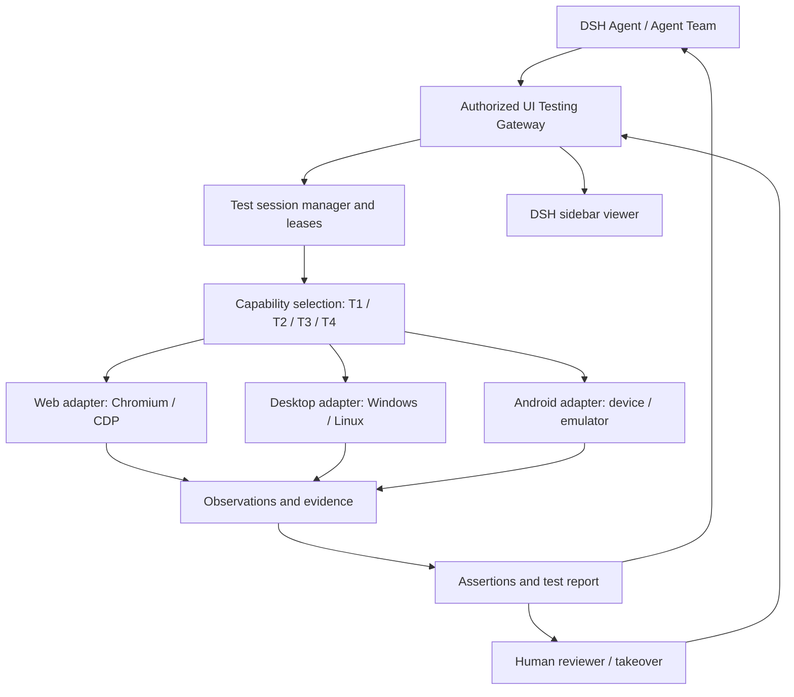

# dsh-agent-team-ui-testing

**AI-native, cross-platform UI testing for DeepSeekHarness.**  
Help AI agents operate, inspect, test, and verify Web, desktop, Android, TUI and 3D interfaces—with evidence humans can review.

**English** | [简体中文](README_zh.md)

> [!IMPORTANT]
> **Project status: architecture / pre-release.** This repository now contains a working **Web T1 + T2 debug-view plugin** (linked locally, not published to npm; verification state in [docs/status.md](docs/status.md)); other runtime environments remain planned. All other capabilities below are **planned** unless explicitly marked otherwise. There is still no published installation package, compatibility matrix, or official release. This README describes intended behavior, not completed tests.

## What is this?

**dsh-agent-team-ui-testing** is a proposed UI testing infrastructure plugin for [DeepSeekHarness (DSH)](https://github.com/deepseek-ai/deepseek-harness). Its purpose is to let an AI agent—or a coordinated Agent Team—interact with a real application, inspect its state, verify expected behavior, capture evidence, and report actionable failures.

The project evolves from the earlier **`dsh-agent-team-browser`** concept, whose original focus was shared Chromium workspaces. **The browser workspace remains part of the plan**, but becomes one adapter within a broader UI testing runtime.

**Planned runtime environments (9):** Web, Windows desktop, Linux desktop, macOS desktop, Android, TUI, HarmonyOS, games, and 3D. The **Web T1 programmatic channel and Web T2 structured-GUI channel** are implemented (T1 verified on an isolated DSH instance; T2 verified by the in-process real-Chromium acceptance suite — its real-host session remains NOT_RUN). The other eight environments are **planned and not implemented**, and stay disabled in the runtime picker.

The `dsh-agent-team-*` name denotes the project family. **Agent Team and [`dsh-agent-team-presets`](https://github.com/bloodarea/dsh-agent-team-presets) are optional:** a single agent should be able to use the testing runtime independently.

## Why build it?

Coding agents can create UI code without being able to reliably answer the question: **“Does the finished application actually work and look right?”** A working API response, a successfully launched process, or one screenshot is not sufficient evidence of a working user journey.

This project aims to provide:

- **Real UI feedback:** exercise user journeys on actual rendered interfaces, not only inspect source code.
- **Structured-first automation:** use application and accessibility/DOM interfaces when appropriate; use visual reasoning when necessary.
- **Cross-platform test sessions:** present a consistent testing contract while retaining platform-specific capabilities and limitations.
- **Evidence-based results:** record what was executed, what was observed, what passed, what failed, and what remains unverified.
- **Agent collaboration with human control:** coordinate authorized access across agents and let a human observe or take over where supported.
- **Low disruption:** avoid stealing foreground input when the target and OS allow it; disclose and explicitly coordinate any operation that requires focus.

## Planned scope

| Environment | Current status | Candidate integration approach | Intended coverage |
| --- | --- | --- | --- |
| **Web** (Chromium) | **T1 + T2 implemented** with per-DSH-workspace page isolation (one shared Chromium/profile; Cookie/storage shared); T3–T4 not implemented (debug view available) | Chromium, Chrome DevTools Protocol (CDP), DOM/accessibility APIs | Navigation, forms, responsive layouts, console/network inspection, screenshots and interactions |
| **Windows desktop** | Planned, not implemented (picker disabled) | Windows UI Automation (UIA) and platform-approved input/capture mechanisms | Native controls, window state, user journeys, screenshots |
| **Linux desktop** | Planned, not implemented (picker disabled) | Accessibility interfaces and compositor/desktop-specific automation | Native controls and GUI workflows; actual coverage depends on X11/Wayland and permissions |
| **macOS desktop** | Planned, not implemented (picker disabled) | macOS Accessibility (AXUIElement) plus system capture/input APIs (TCC authorization required) | Native controls, window state, user journeys, screenshots; full unattended automation is not an initial commitment |
| **Android** | Planned, not implemented (picker disabled) | ADB, UI hierarchy/UiAutomator-style capabilities, device screenshots/input | Activities, navigation, controls, permission-aware device workflows |
| **TUI** | Planned, not implemented (picker disabled) | Pseudo-terminal (PTY/termios) and terminal buffer capture (to be validated) | Terminal sessions, key input, screen-content assertions |
| **HarmonyOS** | Planned, not implemented (picker disabled) | HDC and platform UI inspection/input interfaces (to be evaluated) | Application/atomic-service UI, navigation, controls, device workflows |
| **Games** | Planned, not implemented (picker disabled) | Engine/platform debug and input interfaces (evaluated per engine) | Runtime state, input, scene and frame evidence |
| **3D** | Planned, not implemented (picker disabled) | WebGL/graphics APIs and scene-state access (to be evaluated) | Viewpoint/scene assertions, frame evidence |

These technologies are **candidates, not selected dependencies or verified integrations**. Apart from Web T1/T2, no capability-tier model is defined for the other environments (T1–T4 currently apply to Web only). An adapter must report its available operations instead of pretending every platform supports the same functions.

**Not included in the initial commitment:** iOS automation, fully unattended macOS automation (accessibility/TCC constraints), unrestricted OS control, bypassing CAPTCHA or application security restrictions, guarantees of background input on every native application, or generic game/3D automation (evaluated per engine and graphics stack).

## Implemented Web capture infrastructure (P0)

The existing `browser_screenshot` accepts optional continuous `scale` 1–4, `region:{x,y,width,height}` in **document CSS pixels**, `persist:boolean=false`, and a persistent-root-relative `.png` `out`. It uses one CDP PNG clip with DSF fixed at 1; output dimensions are `round(css × scale)`, limited to 16 million pixels. PNG structure/CRC, dimensions, full uniform/transparent pixel checks, JSON coordinate mapping, safe file publication and attachment metadata comparisons are recorded in `capture.version=1`. Uniform content produces a warning, not a visual failure. The tool count remains 16; T3/T4 visual judgement is not implemented. The staging revision passed **14/14 and 142/142** ([final report](tests/acceptance/runs/capture-p0-2026-11-01T05-52-05-302Z-104057/report.json)); T1 passed22/22/324/324 ([report](tests/acceptance/runs/2026-11-01T05-49-22-590Z-100191/run-report.json)) while a later run with only the persist description changed recorded **21 PASS / 1 FAIL and 323/324 required checks passed, exit1** ([report](tests/acceptance/runs/2026-11-01T05-59-53-185Z-105978/run-report.json)). The sole failure is the P21 loadingFailed snapshot check, which observed only three successful network entries, matching the [baseline failure](tests/acceptance/runs/2026-11-01T04-30-43-916Z-53146/run-report.json). Lead classified this as an existing intermittent environment flake rather than a P0 regression; the failed run remains FAIL. Run acceptance serially, although serialization cannot guarantee the flake disappears. Final-code T2 remained **37 PASS / 1 NOT_RUN and 260/260**, exit0 ([report](tests/acceptance/runs/2026-11-01T06-01-14-788Z-107358/run-report.json)). Historical pre-staging verification passed **13/13 and 117/117 twice** ([run one](tests/acceptance/runs/capture-p0-2026-11-01T05-15-01-055Z-85097/report.json), [run two](tests/acceptance/runs/capture-p0-2026-11-01T05-15-05-476Z-85616/report.json)); earlier counts below are historical. See the [capture contract](docs/capture-p0.md).

Original PNG/base64 bytes and hashes are preserved. `persist:boolean` defaults to false. Files now default to plugin-instance staging at `<tmp>/dsh-ui-testing-capture-*`, with an absolute path, mode 0600 and no-clobber publication; normal plugin disposal removes staging. An explicit `out`, `persist:true`, or nonempty `DSH_UI_TESTING_CAPTURE_DIR` requests persistent storage under the absolute env root or trusted workspace root; invalid env roots never fall back. Persistent paths are root-relative and survive disposal. `file.pathKind/persistence/root/ephemeral` distinguish the modes; capabilities `observed.file` includes only persistence and relativePath (null for staging), never an absolute path. Legacy calls without cwd also stage by default; persistent requests without a root fail with OUTPUT_PATH_INVALID(root_unknown). Staging failure returns the image with file=null and capture_file_unavailable. Real unwritable-tmp failure and SIGKILL leftovers remain unverified. Attachment metadata does not establish provider visibility or final resolution.

Three consecutive real-Chromium/fake-context runs each passed **13/13 probes and 115/115 required checks**, with zero failed checks ([latest report](tests/acceptance/runs/capture-p0-2026-11-01T04-58-32-550Z-66980/report.json)); the T1 regression passed **22/22 and 324/324** ([report](tests/acceptance/runs/2026-11-01T04-59-29-531Z-68121/run-report.json)). After exposing `capture.anomaly.maxDelta`, the suite passed **13/13 and 117/117** ([incremental report](tests/acceptance/runs/capture-p0-2026-11-01T05-09-04-665Z-79630/report.json)); the earlier 115-check reports precede that addition. These reports do not establish P0 loading after a real-host restart or provider vision, both **NOT_RUN**. Higher density does not add canvas/WebGL source detail. C13 found unchanged before/after viewport, scroll and fixture rectangles, including a fixed element; transient layout effects and local filesystem TOCTOU remain outside that evidence.

## Key design principles

1. **Test outcomes are first-class.** Operating the UI is a means to verify an expected behavior. The result must include evidence and explicit limits.
2. **Prefer structured information.** Use supported application, event, DOM, or accessibility interfaces before relying on fragile screen coordinates.
3. **Do not claim an unperformed test passed.** API-only checks cannot by themselves prove visual appearance or end-to-end UI behavior.
4. **Separate execution from presentation.** Closing a DSH sidebar viewer must not implicitly destroy its test target or abort a permitted background test session.
5. **Isolation by default.** A browser context, native desktop session, or Android device belongs to an authorized testing scope; identities and access are checked by the runtime.
6. **Keep human-facing complexity low.** Agents may use detailed adapters and evidence internally; humans should receive concise findings, failure locations, and reviewable artifacts.

## Planned capabilities

The following list is a **target specification**, not an implemented feature list.

| Area | Planned behavior |
| --- | --- |
| **Test session management** | Create, select, resume where feasible, and terminate scoped target sessions; distinguish them from DSH conversation sessions |
| **Action and observation tools** | Provide small, typed operations for launching, finding, clicking, typing, inspecting, waiting, and capturing evidence |
| **Assertions and reports** | Link expected state, actual observation, pass/fail/blocked/unverified status, and supporting artifacts |
| **Multi-agent coordination** | Allow parallel work on independent targets; serialize conflicting mutations with scoped ownership/leases |
| **Human observation/takeover** | Display target state through an authorized DSH viewer; hand control between an agent and a human where supported |
| **Browser workspace** | Retain shared Chromium context/tab design, optional cookie-sharing within one authorized context, and per-tab ownership |
| **Responsive testing** | Set a browser tab's CSS viewport and DPR independently from the sidebar width |
| **Debugging** | Inspect permitted console, runtime, network, and application errors; protect secret-bearing data |
| **Visual verification** | Compare UI states or screenshots under controlled conditions, with uncertainty reported instead of concealed |
| **Animation verification** | Sample state and frames over time, check transitions/timing/layout stability against explicit acceptance criteria |
| **Reproducibility** | Record environment metadata, steps, test artifacts, failure evidence, and replay limitations |

## T1–T4: capability-aware selection and stepwise fallback

This is the structured-first strategy we intend to follow. **T1–T4 are selection and fallback levels, not a pipeline that must be walked in order.** They are this plugin's own **debugging-capability tiers**, not an industry standard: every level must be callable on its own and can serve as the fallback source of the level above it. The four levels are currently defined **for the Web target only**; desktop, Android, TUI, HarmonyOS, games, 3D and other targets have no agreed tier model yet, and their implementation paths must not be inferred from this Web stack.

| Level | Formal name | Core technology | Primary debugging capability | Trigger / escalation | Relative cost |
| --- | --- | --- | --- | --- | --- |
| **T1** | Programmatic debugging | CDP, HTTP, Fetch, JavaScript, Network, Console | API requests, network capture, JS execution, exception detection, resource loading, state inspection, performance data | Default first choice; escalate to T2 when page elements must be operated | Low |
| **T2** | Structured GUI debugging | DOM, Accessibility Tree, ARIA, Snapshot, Locator, Ref | Element targeting, clicking, typing, scrolling, forms, interaction tests, node state, structured evidence | Escalate to T3 when reliable structured targeting cannot complete the operation, or visual judgement is required | Low–medium |
| **T3** | Static visual debugging | Screenshot, Computer Vision, coordinate actions, image diff | UI layout, colour, occlusion, styling defects, Canvas, charts, operating on static screenshots | Escalate to T4 when continuous motion, animation or time-state judgement is required | High |
| **T4** | Dynamic visual debugging | Screencast, frame sequences, timestamps, visual reasoning, mouse/keyboard events | Animation, dragging, complex dynamic widgets, transition states, continuous frame analysis | Highest level: on failure emit diagnostics and leave the verdict to the agent or a human | Highest |

Scope and completion bar per level ("Primary references" is a comparison shortlist, not a set of selected dependencies or finished integrations):

| Level | Primary references | Implementation strategy | Completion bar |
| --- | --- | --- | --- |
| **T1** | [Playwright](https://playwright.dev/) MCP, agent-browser, [Chrome DevTools MCP](https://github.com/ChromeDevTools/chrome-devtools-mcp) | Reuse directly | Complete page and API diagnosis without visual understanding, and hand the same browser session to T2 |
| **T2** | ego-lite, agent-browser, [Playwright MCP](https://github.com/microsoft/playwright-mcp) | Reuse + unified node protocol | Reliable structured discovery, targeting, action and verification loop on ordinary Web pages, plus explicit detection of when vision is needed |
| **T3** | Playwright MCP Vision, agent-browser, [Sharp](https://sharp.pixelplumbing.com/), [Pixelmatch](https://github.com/mapbox/pixelmatch), [Argos](https://argos-ci.com/) | Reuse algorithms, own the verdicts | Visual targeting and actions on a static frame with accurate before/after verification; escalate to T4 when continuous time information is needed |
| **T4** | agent-browser video recording, in-house dynamic-visual scheduling, CDP Animation, [rrweb](https://www.rrweb.io/), FFmpeg / [OpenCV](https://opencv.org/) on demand | Reuse capture, own the temporal verification | Judge the result of a dynamic interaction from a frame sequence and emit timestamped, reproducible evidence |

Fallback chain: the agent receives a debugging task and picks the lowest-cost suitable level; after **action verification + defect attribution + evidence output**, it escalates or jumps when the current level cannot produce the required evidence. The fallback strategy obeys four rules:

1. **Choose by need.** Network faults start at T1, button interaction at T2, layout errors may go straight to T3.
2. **Stepwise escalation is the default, skipping is allowed.** When continuous dynamic frames are clearly required, go straight to T4.
3. **Separate tool failure from product defects.** A broken locator may be retried or escalated; a failed business assertion must be recorded as a defect and never masked by a fallback.
4. **Reuse evidence across levels.** T1 network data, T2 element refs, T3 screenshots and T4 key frames all belong to the same debugging task.

An adapter advertises its capabilities. The agent selects the **lowest-cost dependable method suitable for the assertion** and can escalate when a method is unavailable or inconclusive. UI-specific acceptance criteria still require UI-level observations; a successful T1 call is never silently treated as a visual test pass.

## From a test request to verifiable evidence

A typical intended flow:

1. **Specify:** describe the target, user journey, expected behavior, environment, and acceptance criteria.
2. **Prepare:** start or attach to an authorized browser, desktop, or Android test session.
3. **Execute:** use the best supported structured action path, falling back as needed.
4. **Observe:** capture UI state, accessibility/DOM data, logs, screenshots, or timed frames relevant to the assertion.
5. **Assert:** prefer deterministic checks; for subjective visual judgments, include tolerance, uncertainty, and review requirements.
6. **Report:** produce passed/failed/blocked/unverified outcomes and a reproducible failure summary.
7. **Retest:** after the development agent changes the application, rerun affected test cases and report regressions.

**Example goal (illustrative, not a published tool/API syntax):**

> Launch the application. Open Settings, switch to dark mode, verify the persisted preference and the rendered interface, then navigate away and back. Report the actual checks run, screenshots, relevant logs, any mismatch, and any check that could not be performed.

### Evidence and verdicts

Planned test records should carry a target/environment identity, test case and step, action source, timestamp, expected result, observed result, status, and references to relevant artifacts. This is a planned evidence policy. The implemented Web P0 screenshot is an explicit capture request, preserves unredacted PNG content, stages a file by default and persists only for out/persist:true/nonempty env; users must account for that content before sharing artifacts.

A visual model may offer a finding or confidence estimate, but **a confidence score alone is not proof**. Deterministic assertions, reviewed evidence, and platform limitations must remain distinguishable.

### Animation and visual behavior

A single static screenshot cannot establish that an animation is correct. Where the platform permits, the runtime should capture a bounded sequence of frames or state observations, along with timestamps and defined criteria (e.g., duration range, start/end state, unexpected layout shift, or missing transition). Rendering variability, reduced-motion settings, frame capture gaps, and device performance must be documented. Ambiguous results should be marked **unverified/review needed** instead of passed.

## Architecture (planned)

### Preserve the shared-browser foundation

The initial browser design remains important:

- An authorized **Browser Workspace** can contain multiple tabs, with explicit per-tab access and write leases.
- Tabs within one chosen `BrowserContext` can share applicable cookies and same-origin storage; separate contexts remain isolated by default. Sharing cookies never guarantees universal sign-in.
- An agent's DSH Session, the browser runtime, and the sidebar viewer have **different lifecycles**. Switching the viewed tab must not switch or recreate background browser tasks.
- Each tab owns its logical viewport; shrinking the DSH sidebar must not unexpectedly change a `1920 × 1080` page into a mobile viewport. The viewer scales/crops the output and maps human input back to the actual target coordinates.
- Browser automation should use background CDP operations rather than hijack the desktop's foreground pointer or keyboard.

Desktop and Android adapters follow the same **authorized session and evidence principles**, but do not pretend to share Chromium-specific cookies, DOM capabilities, or focus guarantees.

### Multi-agent ownership and permissions

- Read-only observations may run concurrently when authorized.
- Independent targets can be tested concurrently subject to machine/device capacity.
- Mutating operations on the **same target** require a coordinated write owner/lease; expired actors must not keep writing.
- A human takeover pauses or revokes conflicting agent control before granting a bounded human operation scope.
- Agent or team identity comes from trusted DSH runtime context, not user-supplied `agentId` strings.
- Tool availability does not override resource authorization. An Agent Team preset can permit a tool, while this runtime must still verify access to a specific target.

## Security and privacy

The testing runtime may encounter authenticated pages, private screens, developer tools, or device data. It should follow least privilege, explicit target authorization, bounded collection, and safe defaults:

- Do not export cookies, access tokens, authorization headers, passwords, or private request bodies by default.
- Require clear authorization for sensitive application/device actions or intrusive debugging.
- Redact test logs and screenshots where feasible; describe redaction gaps.
- Do not silently bypass OS protections, application security checks, CAPTCHA, or consent prompts.
- Avoid recording unrelated host windows or cross-team data.
- Keep replay and recovery capabilities bounded; never promise to recreate arbitrary in-memory state.

## Roadmap

These are **planned work items**, not claims of completion. Ordering may change after DSH and platform feasibility audits.

- [ ] **R0 — Feasibility:** audit DSH plugin/sidebar interfaces, upstream licenses, test target capabilities, and security boundaries.
- [ ] **R1 — Web foundation:** retain workspace/context/tab management, background Chromium execution, and viewer independence.
- [ ] **R2 — Test core:** add typed test sessions, T1–T4 capability selection, actions, observations, assertions, and evidence reports. _(Sub-scope delivered: P0 capture infrastructure (continuous density, document clip, PNG validation, safe evidence files; default staging / explicit persistence; 14/14 probes and 142/142 required checks) + Web T1 programmatic + Web T2 structured GUI (snapshot/ref, click, type, scroll, forms, node state, wait, structured evidence) with the 38-condition T2 acceptance suite; T3–T4 and the cross-environment test core remain open.)_
- [ ] **R3 — Collaboration:** implement agent/team authorization, target ownership, human takeover, and concurrent test scheduling.
- [ ] **R4 — Desktop:** validate Windows/Linux adapters, accessibility/input/capture options, permissions, and focus constraints.
- [ ] **R5 — Android:** validate device/emulator lifecycle, UI hierarchy, interaction, screenshots, and failure reporting.
- [ ] **R6 — Visual tests:** verify responsive UI, state comparison, timed animation observations, and uncertainty handling.
- [ ] **R7 — Hardening:** run security, privacy, resource, crash/recovery, and cross-platform regression tests.
- [ ] **R8 — Release:** publish a reproducible build, pinned DSH compatibility, verified installation instructions, and acceptance evidence.

The remaining planned environments (macOS desktop, TUI, HarmonyOS, games, 3D) have no separate milestones yet; they are evaluated and ordered later by demand and platform feasibility, and are currently **not implemented** and disabled in the runtime picker.

A milestone is complete only after its implementation and tests are publicly verifiable. No test should be marked passed without actual execution evidence.

## Installation and development

**No verified public installation command or released version is available yet.** Build commands, DSH compatibility, runtime dependencies, supported operating-system versions, and the release artifact format will be documented after implementation and test verification.

The existing repository may still contain legacy `banner.png` and `banner_zh.png` assets from the browser-workspace concept. They are **not product screenshots** and should not be presented as evidence of the new cross-platform UI testing system. New visual assets can be added after the updated design is reviewed.

### Known constraints

- DSH APIs and extension points may change; adapters must be validated against pinned versions.
- Windows and Linux GUI automation differ significantly; Wayland restrictions and focus rules may limit unattended operation.
- Android testing depends on device/emulator availability, debugging permissions, platform API level, and app security settings.
- Automated visual judgments require defined acceptance criteria and may need human review.
- A browser tab, an OS application, and an Android activity do not expose interchangeable capabilities.

## Relationship to other projects

| Project | Role |
| --- | --- |
| [`dsh-agent-team-presets`](https://github.com/bloodarea/dsh-agent-team-presets) | Reusable team and role configurations, model routes, and tool policies |
| **`dsh-agent-team-ui-testing`** | UI testing targets, sessions, automation, evidence, verification, and governed human/agent control |

The projects are complementary but **do not require each other**. The UI testing runtime is intended to support a single DSH agent without an Agent Team plugin.

## Contributing

Early contributions are most useful when they provide reproducible DSH integration findings, platform-specific feasibility tests, accessibility/DOM fallback cases, security threat models, or concrete UI acceptance scenarios.

When filing an issue, include the exact DSH version/commit, platform and runtime versions, reproduction steps, expected result, observed result, and sanitized evidence. Do not upload credentials, personal device data, or unredacted authenticated traffic.

## License and acknowledgements

**The repository's license has not yet been confirmed in the available published materials.** Please check the repository's actual `LICENSE` file before reuse or redistribution; any third-party code incorporated later must retain applicable notices and license terms.

Thanks to the DeepSeekHarness ecosystem and browser/UI automation communities for the prior art that informs this design. Candidate references include [Chrome DevTools Protocol](https://chromedevtools.github.io/devtools-protocol/) and existing DSH browser integrations; these references are not automatically runtime dependencies.

---

**Repository:** [bloodarea/dsh-agent-team-ui-testing](https://github.com/bloodarea/dsh-agent-team-ui-testing) · **Maintainer:** [bloodarea](https://github.com/bloodarea) · **Status:** Architecture / pre-release
