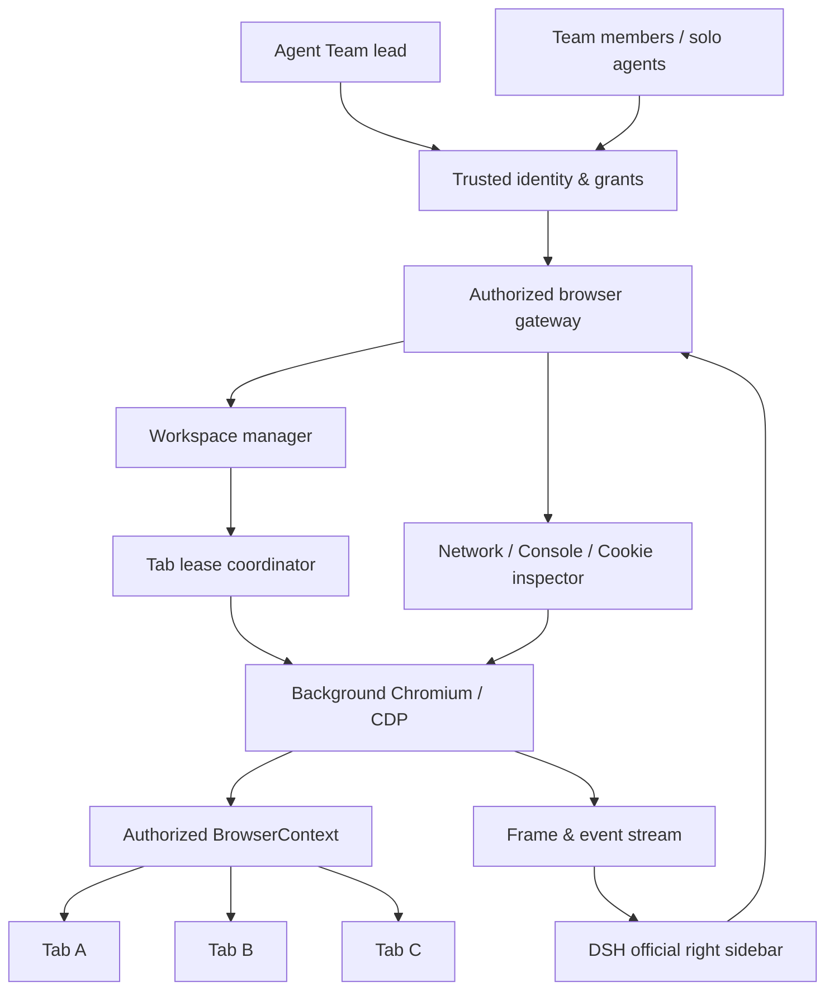

# dsh-agent-team-browser

**English** | [中文](README_zh.md)

> **Status: architecture / pre-release.** This repository is being designed and implemented. The banner is conceptual artwork, not a screenshot of a released plugin. Features described as *planned* below are **not claims of working functionality**. Installation instructions, a tested compatibility range, and a release tag will be published **after** implementation and acceptance testing. Do not install a similarly named community package assuming it is this project.

## Summary

**dsh-agent-team-browser** is a planned native **shared browser workspace for DeepSeekHarness (DSH)**. It is designed to integrate with DSH's official right sidebar and support **individual agents, Agent Teams, and human operators**—without requiring an external browser window to take foreground focus.

One persistent browser workspace can contain multiple tabs. Authorized agents can work in different tabs concurrently, share an intentionally selected login context, and hand the **same tab** to another agent or a human through explicit control leases. The sidebar works like a monitor: switching the viewed tab does not switch, pause, or recreate the agents' background browser tasks.

**Design principle:** **The team lead decides *who should do what*; the plugin enforces *who may do what, when, and on which browser resource*.**

## Project introduction

> One browser workspace. Multiple agents. Human control when it matters.

This project continues the `dsh-agent-team-*` naming family started by [bloodarea/dsh-agent-team-presets](https://github.com/bloodarea/dsh-agent-team-presets). The name emphasizes Agent Team collaboration, **not** an Agent Team-only dependency: it must also work for a single agent and for a person using the sidebar directly.

The design deliberately separates three things that are often coupled together:

| Layer | Responsibility | Lifetime |
| --- | --- | --- |
| **DSH Agent Session** | Who invokes a tool, including lead and teammates | Owned by DSH |
| **Browser Workspace** | Browser contexts, tabs, permissions, retained state | Owned by this plugin |
| **Sidebar Viewer** | Which tab a user is watching or controlling | Owned by the DSH UI |

Closing the sidebar **must not** close a browser tab. Opening a teammate's distinct DSH Session **must not** create another browser just because its Session ID changed. When a team finishes, workspace retention and access revocation follow the workspace's explicit policy rather than the lifespan of the team chat.

## Why this plugin?

Conventional browser MCPs, wrappers, and desktop automators often optimize for one agent controlling one visible browser. This project addresses six gaps:

1. **Host focus disruption.** Browser automation should not hijack the operating system's foreground mouse, keyboard, or active window.
2. **No coherent multi-agent ownership.** Multiple agents need one authorized workspace, not accidental duplication or concurrent navigation of the same tab.
3. **Sidebar-size-dependent viewport.** A narrow sidebar must not silently turn a `1920 × 1080` desktop test into a mobile layout.
4. **Weak human-in-the-loop control.** A person must be able to watch, take over one tab, resolve a difficult interaction, then return control to an agent.
5. **Insufficient developer visibility.** Network requests, responses, console messages, and cookies need inspectable, permission-aware tooling.
6. **Wrong lifecycle boundary.** Browser tabs should not disappear because a teammate's DSH Session was disposed or a sidebar pane was hidden.

**Design principle:** the official DSH sidebar owns presentation; this plugin owns browser resources, identity-aware access, and concurrency safety. Browser execution remains independent from the presentation surface.

## Planned capabilities

The following describes the **target specification**, not a completed feature list.

| Capability | Intended behavior |
| --- | --- |
| **Native sidebar workspace** | Register a new Browser Workspace tab in the official DSH right sidebar, without replacing the built-in browser. |
| **Silent browser runtime** | Headless Chromium + Chrome DevTools Protocol (CDP); automation does not manipulate the host OS pointer or foreground window. |
| **Multi-agent access** | Different DSH Sessions can bind to one authorized Browser Workspace by trusted Team/member identity. |
| **Shared login state** | Tabs inside the same authorized `BrowserContext` share applicable cookies and same-origin storage. |
| **Tab-level collaboration** | Separate tabs execute concurrently; one tab's multi-step writes require an exclusive lease. |
| **Human takeover** | Observe the same page as an agent, request control, and return it without spawning a second page. |
| **Independent viewport** | Per-tab CSS viewport, DPR, touch/mobile emulation; sidebar width only changes rendering scale. |
| **Developer tools** | Inspect Fetch/XHR, response status/body (opt-in), Console, runtime errors, and governed cookie access. |
| **Persistent workspaces** | Hide panes and switch agent chats without losing tabs; restore recoverable state after restart. |
| **Solo mode** | Run without an Agent Team or `dsh-agent-team-presets` installed. |

### The sidebar is a viewer, not the browser process

Think of the sidebar as a television and Chromium tabs as independent channels. Selecting another channel changes only the **viewed tab**. All other tabs continue running in the background; their pages, viewport sizes, and active agents remain unchanged. A human can take control of the channel being watched when permitted.

### Shared state does not mean shared page state

Multiple tabs in one `BrowserContext` normally share cookies and, for the same origin, `localStorage` / IndexedDB. Each tab has its **own** DOM, URL, scroll state, and usually `sessionStorage`. Sites may impose additional authentication constraints; shared cookies do **not** guarantee universal single sign-on. Separate workspaces/teams are isolated by default unless sharing is explicitly authorized.

### Viewport is independent of sidebar dimensions

For example, set the real page to `1920 × 1080` and display it inside a `420px` sidebar. The browser still reports approximately `window.innerWidth === 1920` CSS pixels (subject to page/environment specifics). The sidebar only fits or pans the rendered image. A human click is mapped back into browser coordinates before CDP receives it.

Planned presets include `390 × 844`, `768 × 1024`, `1280 × 720`, and `1920 × 1080`; custom viewport sizes and DPR are separate controls. A resize of the DSH sidebar must **never** implicitly invoke a CDP viewport change.

## Use this package

### Availability and installation

**There is no verified public install command or released version yet.** The proposed repository identity is `bloodarea/dsh-agent-team-browser`; availability of GitHub releases, npm packages, and plugin compatibility will be confirmed when a tested build exists.

When the first release is published, this section will document:

1. Supported DSH release/commit or compatibility range and required Chromium runtime.
2. The exact **pinned release** installation command and which DSH profile to select.
3. Required Host/Client plugin configuration, startup procedure, and uninstall/migration steps.
4. How to verify the loaded plugin identity, version, sidebar entry, and browser runtime health.

**Do not copy installation commands from `dsh-agent-team-presets`**: it is a distinct plugin with a separate release cycle.

### Intended workflow: a single agent

1. Open the planned **Browser Workspace** entry in the official right sidebar.
2. Create or select a workspace and open a browser tab.
3. Choose a viewport preset or enter a custom viewport. Resize the sidebar to observe that the page viewport stays unchanged.
4. Let the agent browse and test while you continue using the desktop normally.
5. Watch the tab, take over if necessary, then hand control back.

### Intended workflow: an Agent Team

Suppose a lead delegates responsive testing, login testing, and API diagnostics:

| Actor | Browser resource | Task |
| --- | --- | --- |
| Frontend agent | Tab A, `390 × 844` | Verify mobile layout |
| Test agent | Tab B, `1920 × 1080` | Exercise sign-in flow |
| Backend agent | Tab C, `1280 × 720` | Inspect Fetch/XHR behavior |
| Human operator | Sidebar viewer | Switch watched tabs; take over a selected tab if needed |

All three tabs may use the same authorized `BrowserContext` to reuse compatible login state. Each agent has a different DSH Session but resolves to the same workspace through **server-verified** membership and grants. The lead does not need to approve every click: it grants a scope of work, and the plugin enforces that scope.

To transfer **the same tab**, the current lease must be released or revoked before another actor obtains a write lease. A lease covers a coherent multi-step operation, not just a single click.

### Intended workflow: human intervention

If an agent encounters a CAPTCHA, sensitive confirmation, or an unsupported browser interaction, it pauses the affected task and requests user intervention. The user takes over **inside the sidebar**, completes the allowed step, and returns the tab. The plugin must not silently switch host windows, reveal credentials to other agents, or bypass site protections.

## Understand the implementation

### High-level architecture

**One browser resource manager, one permission boundary.** All browser-control channels—including agent tools, sidebar input, debugging, and takeover—must pass through the same authorization gateway. The architecture does not combine three independently running browser plugins.

### Runtime ownership and lifecycle

- `WorkspaceId` is generated by the plugin and **does not equal** a DSH `SessionId`, `TeamId`, or sidebar tab identifier.
- DSH Team membership binds eligible lead/teammate Sessions to authorized workspaces; plain subagents do not automatically inherit access.
- A workspace can have multiple Chromium tabs and multiple sidebar viewers; each viewer independently chooses which tab to watch.
- Hiding a sidebar or navigating to a teammate's chat disconnects/rebinds viewers, **not** Chromium pages.
- Task completion revokes leases; team shutdown revokes team grants. Neither event automatically destroys a retained personal workspace.
- DSH restart can restore **recoverable** state, such as saved URLs, viewports, and permitted persisted authentication data. It cannot guarantee restoration of arbitrary JavaScript heap state or unfinished form inputs.

### Concurrency model

| Operation | Coordination rule |
| --- | --- |
| Read tab metadata / observe frames | Concurrent, subject to ACL |
| Agent writes to different tabs | Concurrent |
| Agent writes to the same tab | Exclusive multi-operation lease |
| Human takeover of a tab | Revoke/pause existing writer and grant a bounded human lease |
| Change shared cookies / context settings | Stronger context-level permission; may affect every tab |
| Agent disconnects / lease expires | Revoke its lease and reject stale commands via fencing/version checks |

The Agent Team lead governs **policy and delegation**. The plugin provides deterministic **mechanisms**: ownership checks, lock enforcement, fairness/timeouts, recovery, and audit records.

### Browser rendering and input

- Use Chromium/CDP to render and automate real pages without foreground desktop mouse/keyboard synthesis.
- Send tab-specific frames or snapshots to the sidebar; resize the **displayed image** independently of the browser viewport.
- Translate sidebar pointer positions through the current scale/offset into **CSS viewport coordinates**; handle DPR, letterboxing, scrolling, and touch modes explicitly.
- Keep background browser execution alive when a viewer changes tabs, disconnects, or hides the panel.
- Test and document limitations such as Chromium background throttling, dialogs, downloads, and headless-only behavior.

### Developer debugging and privacy

Network and Console events belong to the actual Chromium tab/workspace, not whichever DSH chat is currently visible. Debug records and exports must be bounded, independently permissioned, and sanitized by default. Request/response body capture must be explicitly enabled. Cookies, authorization headers, passwords, session tokens, and cross-team data must never be indiscriminately exposed to models or the sidebar.

## Model Experience

### What agents should see

After implementation, an agent should receive **small, structured tools**, such as listing workspaces/tabs, navigating, inspecting the DOM, setting viewport, watching console/network events, requesting a lease, and releasing control. **These tool names are illustrative, not a published API contract.** Identity and authorization derive from the DSH runtime—not from agent-supplied `agentId` or `teamId` arguments.

### Token effect

Browser frames, page text, and Network responses should be returned **on demand**, capped or summarized appropriately, rather than continuously appended to conversation context. Returning a screenshot or DOM excerpt only when requested reduces unnecessary tokens but can omit relevant information; agents should be able to request greater detail when the task calls for it.

### Prompt and KV cache effect

The plugin should not need to inject growing tab history or secret browser state into every system prompt. Stable tool schemas can improve prompt-prefix stability; actual caching behavior depends on the model/provider and DSH integration. Browser persistence is **not** equivalent to LLM conversational-memory persistence.

## Relationship to `dsh-agent-team-presets`

| Project | Responsibility |
| --- | --- |
| [`dsh-agent-team-presets`](https://github.com/bloodarea/dsh-agent-team-presets) | Reusable teams, roles, model routes, prompts, and tool policies |
| **`dsh-agent-team-browser`** | Browser workspaces, authorized tab access, background runtime, human takeover, and debugging |

They share a naming family and are intended to complement each other, but **neither needs to depend on the other**. Browser access is enforced by browser-side authorization even when a team preset permits the browser tools.

## Roadmap and verification

This checklist indicates **work to be implemented and verified**, not shipped features:

- [ ] **R0:** Audit upstream DSH/plugin APIs, versions, and license notices; prove sidebar and headless streaming feasibility.
- [ ] **R1:** Build workspace/context/tab lifecycle and a shared Chromium runtime.
- [ ] **R2:** Verify Agent Team identities, cross-Session workspace binding, ACL, and tab leases.
- [ ] **R3:** Integrate official Sidebar, switch channels, and keep background tabs alive on viewer disconnect.
- [ ] **R4:** Implement independent viewport/DPR emulation, fit/1:1 display, and correct input-coordinate transforms.
- [ ] **R5:** Implement human takeover and complete non-focus-stealing browser tool coverage.
- [ ] **R6:** Implement permission-aware Network, Console, response, and cookie inspection.
- [ ] **R7:** Harden authentication, privacy, crash recovery, performance, and Windows/Linux behavior.
- [ ] **R8:** Complete reproducible builds, acceptance results, third-party notices, and community release.

Release gates include: **three agents / three DSH Sessions / one authorized workspace**, zero host-window focus theft during background operations, shared-context and isolated-context tests, valid same-tab lease enforcement, sidebar viewport independence, and correct human takeover. Failed or unrun tests must not be described as passing.

## Known limitations and deferred work

- **Pre-release only:** no completed installable build, proven compatibility matrix, or verified screenshots of the final UI are provided yet.
- **Experimental DSH APIs:** Agent Team and Sidebar plugin integration points may change. The target DSH revision must be pinned and audited before implementation.
- **Site-specific authentication:** sharing a `BrowserContext` shares applicable browser storage, **not** every site's tab-bound or server-bound login state.
- **Headless compatibility:** native file pickers, some permissions/dialogs, anti-automation challenges, and media/GPU behavior may need explicit handling or safe fallback.
- **Restoration is bounded:** restoring browser metadata does not restore every transient DOM/JS state.
- **Security isolation:** sharing a context is intentional credential sharing. Different teams/workspaces must be isolated by default and must not share cookies without explicit authorization.
- **No operating-system focus guarantee until tested:** focus-preservation is an acceptance requirement to be validated on target desktop platforms, not a claim of completed verification.

## Development and project references

The intended implementation strategy is **reuse selectively, own the integration**:

- [wqty123/dsh-browser](https://github.com/wqty123/dsh-browser) — browser service, existing tools, and session/tab primitives to audit and reuse where suitable.
- [try-works/dsh-browser-agent](https://github.com/try-works/dsh-browser-agent) — CDP frame streaming and interactive Web UI approaches to evaluate.
- [stuarthu/dsh-chrome](https://github.com/stuarthu/dsh-chrome) — network inspection and sensitive-data filtering techniques to evaluate.
- [DeepSeekHarness right sidebar design](https://github.com/deepseek-ai/deepseek-harness/blob/master/docs/subsystems/sidebar-right.md) — sidebar integration reference.
- [DeepSeekHarness Agent Team design](https://github.com/deepseek-ai/deepseek-harness/blob/master/docs/subsystems/agent-team.md) — teammate identity, roster, and lifecycle reference.
- [Chrome DevTools Protocol](https://chromedevtools.github.io/devtools-protocol/) — browser-control API reference.

These repositories are **design and potential code sources, not necessarily dependencies**. Any copied code must retain the relevant license and copyright notices, including transitive notices. The final source layout, build commands, and test commands are subject to the upstream API audit and will be documented when they are real.

### Contributing

Until the first working release, useful contributions include reproducible DSH API compatibility findings, headless/CDP browser test cases, authorization threat models, and UI/viewport test scenarios. Please include the DSH version/commit, OS, reproduction steps, expected behavior, and actual behavior with any issue report. Never publish real cookies or credentials in logs or screenshots.

## License and acknowledgements

**License selection for this new repository is pending.** Do not assume it has the same license as the companion presets plugin. Before code reuse or distribution, inspect each upstream license (including MIT/ISC components and additional `NOTICE` files), preserve required attribution, and publish the repository's own license and third-party notices.

Thanks to the DeepSeekHarness maintainers and browser-plugin community for the foundational ideas and implementations that inform this proposed design. Attribution for code actually incorporated will be maintained explicitly.

---

**Project:** `dsh-agent-team-browser` · **Maintainer:** [bloodarea](https://github.com/bloodarea) · **Companion:** [dsh-agent-team-presets](https://github.com/bloodarea/dsh-agent-team-presets)
