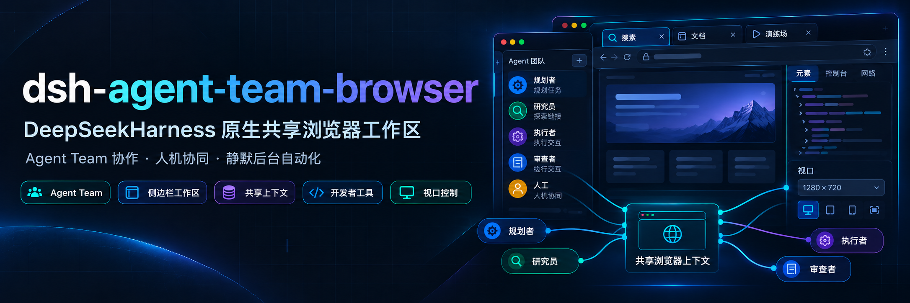
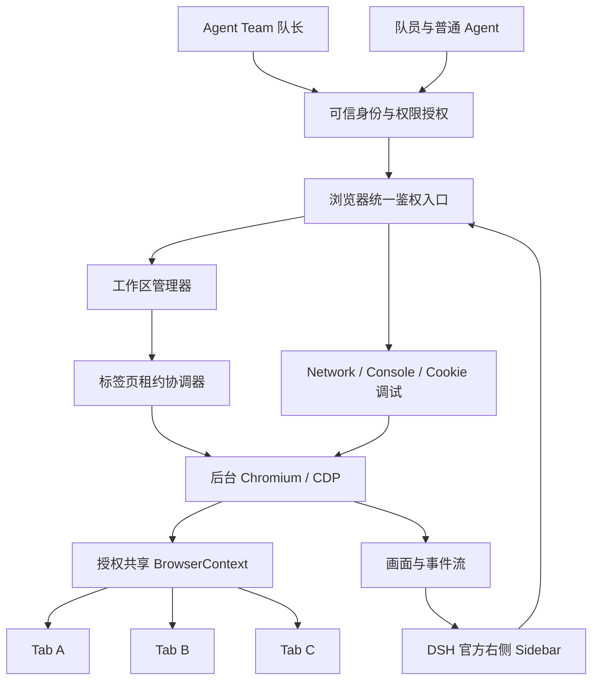

# dsh-agent-team-browser

[English](README.md) | **中文**

> **状态：架构设计 / 预发布阶段。** 本项目正在设计与开发中。上方 Banner 是概念设计图，**不是已经发布的软件界面截图**。下文标注为「规划」的功能代表目标要求，**不表示已实现或通过测试**。正式安装命令、受支持版本范围、发行标签会在实现并完成验收后公布。请勿仅凭相似名称安装其他社区软件包并将其视为本项目。

## 概述

**dsh-agent-team-browser** 是面向 **DeepSeekHarness（DSH）** 的原生**共享浏览器工作区**插件，计划直接集成在 DSH 官方右侧 Sidebar 中，供**普通 Agent、Agent Team 与人类用户**共同使用，无须为了自动化操作把外部浏览器窗口切到前台。

一个持久化浏览器工作区可以包含多个标签页。经过授权的多个 Agent 可以并行操作不同标签页，有选择地共享登录上下文；当多个执行者需要操作**同一个标签页**时，通过明确的控制权租约交接。侧边栏相当于监视器：切换当前观看的标签，不会切换、暂停或重新创建其他 Agent 的后台浏览器任务。

**设计原则：队长决定「谁应该做什么」，插件强制执行「谁有权在什么时候操作哪个浏览器资源」。**

## 项目介绍

> 一个浏览器工作区，多个智能体协作，人工随时可控。

本项目延续 [bloodarea/dsh-agent-team-presets](https://github.com/bloodarea/dsh-agent-team-presets) 的 `dsh-agent-team-*` 命名系列。名称突出 Agent Team 协作，**并不意味着只有创建 Agent Team 后才能使用**：独立 Agent 和用户直接在侧边栏操作的场景也是基本使用方式。

架构上，刻意将三个经常被耦合在一起的对象分开：

| 层次 | 职责 | 生命周期归属 |
| --- | --- | --- |
| **DSH Agent Session** | 谁在调用工具，包括队长和队员 | DSH 官方运行时 |
| **Browser Workspace** | BrowserContext、标签页、授权与可保留状态 | 本插件 |
| **Sidebar Viewer** | 用户当前观看或控制哪个标签页 | DSH 前端界面 |

关闭侧边栏**不应**关闭真实浏览器标签页；进入队员自己的 DSH 聊天会话，**不应**仅因 Session ID 发生变化就重新创建浏览器；团队任务结束后，则根据工作区的保留与权限策略决定是否继续保存，而不是简单跟随团队聊天的生命周期销毁。

## 为什么开发这个插件？

许多浏览器 MCP、Wrapper 或桌面自动化方案以「一个 Agent 控制一个可见浏览器」为中心设计。本项目希望解决六个典型问题：

1. **抢占宿主机焦点。** 浏览器自动化不应挪动系统鼠标、劫持键盘输入或频繁切换活动窗口。
2. **多智能体缺少统一归属。** 多个 Agent 应安全复用同一工作区，而不是重复启动浏览器，或同时把同一页面导航到不同地址。
3. **网页分辨率受侧边栏影响。** 侧边栏变窄不应把原本 `1920 × 1080` 的桌面端测试错误变成移动端布局。
4. **人机协同不足。** 用户应当能实时观看、接管某个标签页、处理困难交互，再把控制权还给 Agent。
5. **开发调试能力不足。** 请求、响应、Console 日志、Cookie 等数据应可查看，且受权限与隐私保护。
6. **生命周期绑定错误。** 队员 Session 销毁或侧边栏隐藏，不应该连带销毁浏览器标签页。

**设计原则：官方 DSH Sidebar 管理显示层；本插件管理浏览器资源、身份授权与并发安全。浏览器执行与前端显示彻底解耦。**

## 规划功能

以下为**目标功能规范**，不是已经完成的功能清单。

| 功能 | 目标行为 |
| --- | --- |
| **原生 Sidebar 工作区** | 在 DSH 官方右侧侧边栏注册新的 Browser Workspace 标签，不覆盖官方内置浏览器。 |
| **静默后台运行** | Headless Chromium + Chrome DevTools Protocol（CDP），自动化不操作宿主机真实鼠标、键盘或前台窗口。 |
| **多 Agent 共享** | 通过可信 Team/成员身份，让不同 DSH Session 访问同一个已授权 Browser Workspace。 |
| **共享登录态** | 同一个已授权 `BrowserContext` 内的标签页共享适用的 Cookie 和同源存储。 |
| **标签页级协同** | 不同标签页允许并行；同一标签页跨多步写操作必须持有独占租约。 |
| **人工接管** | 人与 Agent 观察同一页面，人工可以请求接管、操作后归还控制权，无须复制页面。 |
| **分辨率独立控制** | 每个标签页独立设置 CSS 视口、DPR 与触控/移动端模拟；侧边栏宽度只影响显示缩放。 |
| **开发者调试** | 检查 Fetch/XHR、响应状态及按需响应体、Console、运行时错误，并在受控权限下管理 Cookie。 |
| **工作区存续** | 隐藏窗口和切换会话不影响标签页；重启后恢复可恢复的浏览器状态。 |
| **单 Agent 模式** | 无须启用 Agent Team，也无须安装 `dsh-agent-team-presets` 即可使用。 |

### 侧边栏是监视器，不是浏览器进程

可以把 Sidebar 理解为电视，把后台运行的 Chromium 标签页理解为多个独立频道。点击其他频道只会改变**当前观看的标签页**；其他标签页仍在后台执行各自任务，其页面、分辨率和操作者都不会因此改变。在权限允许时，用户可直接接管当前观看的页面。

### 共享登录态，不等于共享页面状态

同一 `BrowserContext` 的多个标签页通常共享 Cookie，同源下的 `localStorage`、IndexedDB 等也可共享。但每个标签页有自己的 **DOM、URL、滚动位置**，而 `sessionStorage` 通常按顶层页面隔离。一些网站还存在设备绑定或服务端会话约束，因此**共享 Cookie 不保证所有网站都能自动共享登录状态**。不同工作区、不同团队默认隔离，跨界共享必须经过明确授权。

### 网页逻辑视口与侧边栏宽度解耦

例如，网页实际设置为 `1920 × 1080`，但用户的 DSH 侧边栏只有 `420px` 宽。Chromium 仍按照 1920 CSS px 左右的布局视口渲染（具体还受页面与浏览器环境影响），Sidebar 只是把画面等比例缩小显示或允许滚动查看。用户点击缩放后的画面时，插件会将坐标映射回真实的浏览器视口，再由 CDP 发送输入事件。

规划预设包括 `390 × 844`、`768 × 1024`、`1280 × 720`、`1920 × 1080`；自定义视口和 DPR 分别配置。**拖动 DSH 侧边栏宽度，绝不能暗中触发 CDP 的网页视口修改。**

## 使用本插件

### 发布状态与安装

**目前尚无经过验证的公开安装命令或正式发布版本。** 计划使用的仓库身份是 `bloodarea/dsh-agent-team-browser`；GitHub Release、npm 包以及插件兼容范围需等可测试构建完成后再确认。

首个可用版本发布时，本节将补充：

1. 受支持的 DSH 版本或 commit、兼容范围与 Chromium 运行环境要求。
2. 精确到**固定 Release 标签**的安装命令，以及如何选择 DSH profile。
3. Host/Client 插件配置、启动、卸载及升级迁移步骤。
4. 插件名称、版本号、Sidebar 入口与浏览器运行时的实际验证方法。

**不要照抄 `dsh-agent-team-presets` 的安装命令**：它们是独立项目，版本周期不同。

### 预期操作流程：单 Agent

1. 在 DSH 官方右侧 Sidebar 打开规划中的 **Browser Workspace** 标签。
2. 新建或选择一个工作区，并打开浏览器标签页。
3. 选择预设或自定义视口，拖动侧边栏验证网页视口没有跟着改变。
4. 让 Agent 在后台执行浏览或页面测试，用户可以继续正常使用电脑。
5. 必要时观看页面、人工接管，再归还操作权。

### 预期操作流程：Agent Team

假设队长向三个队员分配了响应式测试、登录测试和 API 调试任务：

| 执行者 | 浏览器资源 | 任务 |
| --- | --- | --- |
| 前端 Agent | Tab A，`390 × 844` | 检查移动端布局 |
| 测试 Agent | Tab B，`1920 × 1080` | 验证登录流程 |
| 后端 Agent | Tab C，`1280 × 720` | 监听与检查 Fetch/XHR |
| 人类用户 | Sidebar Viewer | 随时切换观看的标签，必要时接管指定标签 |

三个标签页可根据授权选择同一个 `BrowserContext`，共享兼容的登录态。三个队员虽然对应三个独立的 DSH Session，但通过**服务端验证过的**团队身份与授权，找到同一浏览器工作区。队长无须审批每一次点击：只需分配任务范围，由插件强制执行权限。

如果需要把**同一个标签页**交给另一个 Agent，必须先释放或撤销已有的写租约，再授予新执行者。租约保护的是一次连续的多步操作，而不只是单次点击。

### 预期操作流程：人工介入

当 Agent 遇到 CAPTCHA、敏感操作确认，或者无法自行完成的浏览器交互时，应暂停受影响任务并请求用户介入。用户在**侧边栏内部**接管页面，完成必要操作后再交回 Agent。插件不得偷偷切换系统窗口、把凭据暴露给其他 Agent，或绕过网站防护。

## 理解实现

### 总体技术架构

**统一浏览器资源管理，统一权限边界。** Agent 工具、Sidebar 输入、调试命令、人工接管等所有浏览器控制入口，都必须经过同一鉴权与协调层。项目不是同时运行三套互不相干的社区浏览器插件。

### 浏览器归属与生命周期

- `WorkspaceId` 由插件生成，**不等于** DSH `SessionId`、`TeamId` 或 Sidebar Tab ID。
- 通过 DSH Team 成员身份，把符合条件的队长、队员 Session 映射到已授权工作区；普通 Subagent 不自动继承权限。
- 一个 Workspace 可包含多个 Chromium 标签页和多个 Sidebar Viewer；每个 Viewer 可独立选择观看的标签。
- 隐藏侧边栏或进入队员聊天，仅断开或重新绑定 Viewer，**不会**关闭 Chromium 页面。
- 任务完成会收回租约；Team 结束会撤销相关团队授权，但不会自动销毁按策略保留的个人工作区。
- DSH 重启后，可以恢复**可恢复状态**，例如保存的 URL、视口及允许持久化的认证信息；无法保证还原全部 JavaScript 堆、动态 DOM 状态或尚未提交的表单内容。

### 并发控制模型

| 操作 | 调度与安全规则 |
| --- | --- |
| 读取标签元数据、观看画面 | 在 ACL 允许下并发进行 |
| 多 Agent 写入不同标签页 | 允许并行 |
| 多 Agent 写入同一个标签页 | 持有独占的连续操作租约 |
| 人工接管一个标签页 | 暂停/撤销原写入者，再授予有界人工租约 |
| 修改共享 Cookie / Context 设置 | 要求更高的 Context 级权限，可能影响所有标签页 |
| Agent 断连或租约超时 | 撤销租约，通过版本栅栏拒绝过期操作 |

Agent Team 队长负责**策略与任务分配**；插件以确定性的代码落实**权限、互斥、等待/超时、异常回收与审计**。

### 浏览器渲染与输入

- 使用 Chromium/CDP 渲染真实网页并执行自动化，不依赖系统级前台鼠标/键盘模拟。
- 向 Sidebar 推送指定标签页的画面或快照；只缩放**显示图像**，不随意修改网页实际视口。
- 按画面缩放比例和边距将 Sidebar 指针坐标还原为 **CSS 视口坐标**，明确处理 DPR、留黑边、滚动与触控模式。
- Sidebar 切换标签、隐藏或网络断连后，后台浏览器任务仍能正常执行。
- 对 Chromium 后台节流、权限对话框、下载、Headless 差异等问题开展实测，并明确兼容性边界。

### 开发者调试与隐私

Network / Console 事件属于真实的 Chromium Tab / Workspace，不取决于当前打开的是哪个 DSH 聊天会话。调试记录及导出应具备容量限制、独立权限和默认脱敏机制。请求/响应体采集必须由用户或获授权操作**显式开启**。Cookie、Authorization 请求头、密码、会话令牌及其他团队的数据不得无差别暴露给模型或侧边栏。

## 模型体验

### Agent 将看到什么

完成开发后，Agent 应获得**小而结构化**的浏览器工具，例如列出工作区与标签、页面导航、DOM 检查、调整视口、查询 Console/Network 事件、申请操作租约和释放控制权。**这些仅是工具能力示例，不代表已经发布的 API 名称。** 身份及授权必须来自 DSH 的可信运行时，不能让模型通过自填 `agentId` 或 `teamId` 来获取他人的访问权。

### Token 开销

截图、页面正文、Network 响应等内容应当**按需返回**，并受到长度或数量限制，而不是持续追加进模型上下文。只有需要时才请求截图、DOM 片段或者详细请求体，能避免不必要的 Token 消耗；但按需方式也可能漏掉关联信息，因此应允许 Agent 在任务确有需要时主动获取更详细的内容。

### 提示词与 KV Cache 影响

插件不应在每轮系统提示词里不断追加标签页历史或浏览器凭据。稳定的工具 Schema 有利于维持提示词前缀稳定，但具体缓存收益取决于模型提供商与 DSH 集成方式。**浏览器工作区的持久化，不等于 LLM 对话记忆的持久化。**

## 与 `dsh-agent-team-presets` 的关系

| 项目 | 核心职责 |
| --- | --- |
| [`dsh-agent-team-presets`](https://github.com/bloodarea/dsh-agent-team-presets) | 复用团队预设、角色、模型路由、提示词与工具策略 |
| **`dsh-agent-team-browser`** | 浏览器工作区、标签权限、后台运行、人工接管与调试 |

两者延续同一个命名体系，适合配合安装，但**不应构成强制依赖**。即使团队预设允许使用浏览器工具，也必须由本插件继续校验浏览器资源的访问权。

## 开发路线与验收

以下代表**计划实施并验证的工作**，不是已经交付的功能：

- [ ] **R0：** 审查 DSH 与上游插件接口、版本和许可证；验证 Sidebar 与 Headless 实时画面可行性。
- [ ] **R1：** 建立 Workspace / Context / Tab 生命周期与统一 Chromium 运行时。
- [ ] **R2：** 实现 Agent Team 可信身份、跨 Session 绑定、ACL 与标签页租约。
- [ ] **R3：** 接入官方 Sidebar，完成频道切换，Viewer 断开时保持后台运行。
- [ ] **R4：** 实现独立视口 / DPR 模拟、适应/1:1 显示及正确的输入坐标转换。
- [ ] **R5：** 实现人工接管及不抢焦点的浏览器工具能力。
- [ ] **R6：** 实现受权限保护的 Network、Console、响应体及 Cookie 调试。
- [ ] **R7：** 完成鉴权、隐私、崩溃恢复、性能与 Windows/Linux 跨平台测试。
- [ ] **R8：** 完成可复现构建、验收记录、第三方版权信息及社区发布。

关键发布门槛包括：**三个 Agent / 三个 DSH Session / 一个授权 Workspace**；后台运行期间不得抢占系统前台焦点；共享 Context 与隔离 Context 测试；同 Tab 独占租约确实生效；Sidebar 宽度不会改变网页视口；人工接管准确可靠。失败或尚未运行的测试不能标记为通过。

## 已知限制与延期工作

- **尚在预发布阶段：** 目前没有声称已完成的可安装构建、通过验证的兼容矩阵或最终产品真实截图。
- **DSH 实验接口可能变化：** Agent Team 与 Sidebar 的插件接入 API 仍需针对实际 DSH 版本审查，并锁定目标版本。
- **网站登录态存在差异：** `BrowserContext` 可以共享适用的浏览器存储，**但不保证**共享所有与标签页或服务端绑定的登录状态。
- **Headless 兼容性有限制：** 系统文件选择器、某些权限弹窗、反自动化验证、音视频/GPU 行为可能需要受控处理或安全降级。
- **重启恢复有边界：** 恢复浏览器元数据，不代表原样还原所有瞬时 DOM/JS 状态。
- **安全隔离要求：** 共享 Context 本质上也意味着共享部分认证凭据；不同团队、工作区默认隔离，跨界共享必须明确授权。
- **焦点保护尚待实测：** 不抢宿主机焦点是必须通过 Windows/Linux 测试验证的验收要求，并非已经验证完成的事实。

## 开发参考与社区协作

实施思路是**择优复用，独立实现集成层**：

- [wqty123/dsh-browser](https://github.com/wqty123/dsh-browser) —— 审查并择优复用浏览器服务、现有工具及会话/标签页基础能力。
- [try-works/dsh-browser-agent](https://github.com/try-works/dsh-browser-agent) —— 参考 CDP 画面传输与 Web 人工交互实现。
- [stuarthu/dsh-chrome](https://github.com/stuarthu/dsh-chrome) —— 参考 Network 抓包与敏感信息脱敏思路。
- [DeepSeekHarness 官方 Sidebar 设计](https://github.com/deepseek-ai/deepseek-harness/blob/master/docs/subsystems/sidebar-right.md) —— 右侧栏集成接口参考。
- [DeepSeekHarness 官方 Agent Team 设计](https://github.com/deepseek-ai/deepseek-harness/blob/master/docs/subsystems/agent-team.md) —— 队员身份、Roster 与生命周期参考。
- [Chrome DevTools Protocol](https://chromedevtools.github.io/devtools-protocol/) —— 浏览器控制协议参考。

这些仓库是**设计参考或潜在代码来源，并不一定都是本项目的依赖项**。实际引用的源码必须保留对应许可证、版权声明与必要的间接上游 NOTICE。最终源码目录、构建和测试命令将在上游接口审计后确定，并以真实实现为准。

### 参与贡献

首个可用版本发布前，欢迎提交可重现的 DSH 接口兼容性验证、Headless/CDP 测试用例、授权威胁模型，以及 Sidebar / 分辨率测试场景。提交 Issue 时请附上 DSH 版本或 Commit、操作系统、重现步骤、预期结果与实际结果。请勿在日志或截图中公开真实 Cookie 和凭据。

## 许可证与致谢

**本独立仓库尚未最终确定许可证。** 请勿因为配套的 presets 插件使用了某种许可证，就推断浏览器插件必然相同。移植或分发上游代码前，应审查相关 MIT/ISC 组件和额外 `NOTICE` 文件，保留必要署名，并为本项目提供自己的许可证文件和第三方声明。

感谢 DeepSeekHarness 维护者与社区浏览器插件作者提供的设计与工程基础。实际引入的上游代码将按要求明确标注来源。

---

**项目：** `dsh-agent-team-browser` · **维护者：** [bloodarea](https://github.com/bloodarea) · **配套插件：** [dsh-agent-team-presets](https://github.com/bloodarea/dsh-agent-team-presets)
