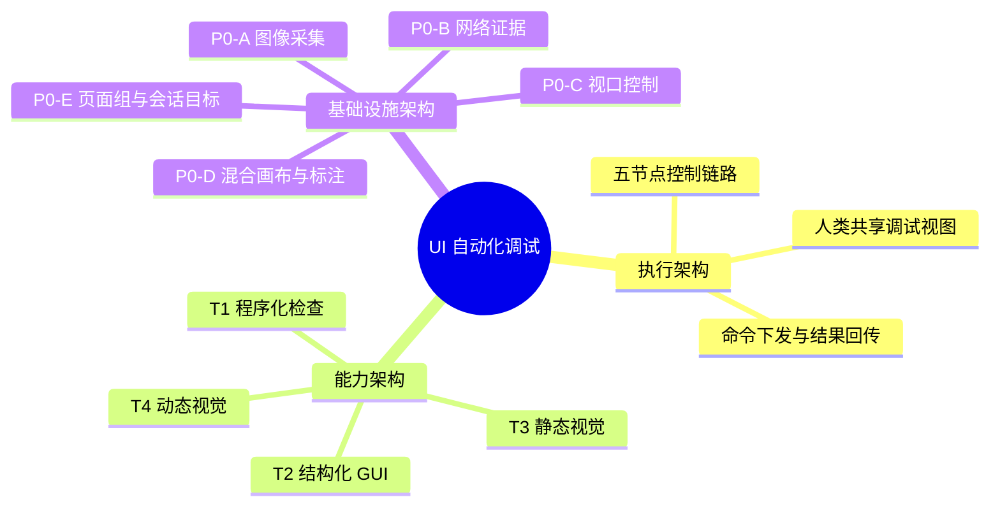
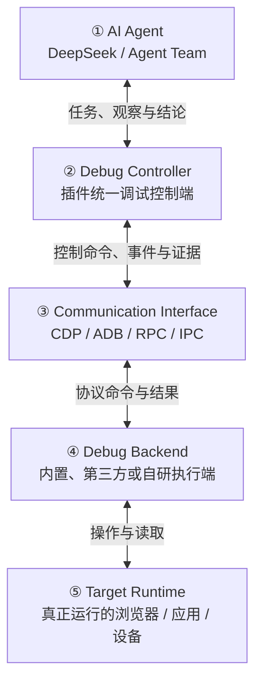
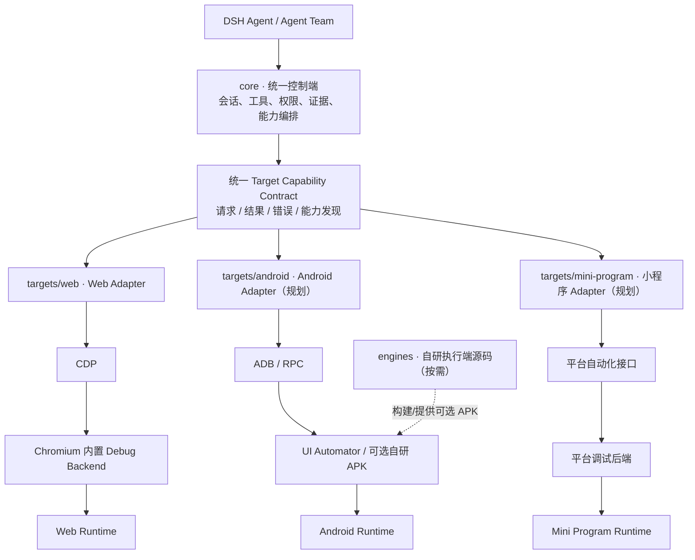
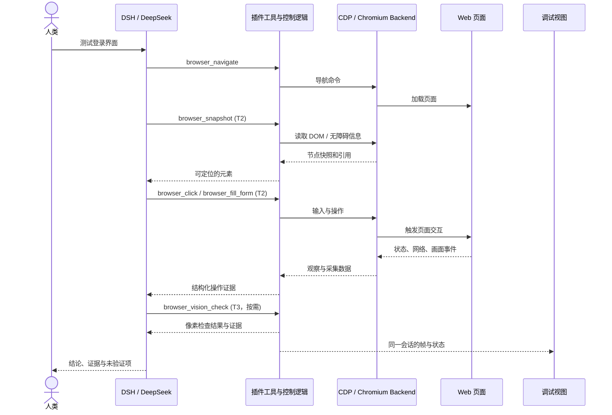

# dsh-agent-team-ui-testing


**面向 DeepSeekHarness 的 AI 原生前端 GUI 测试能力。**

让 AI Agent 真正操作、检查、测试并验证用户界面，并留下人类可复核的证据。

[English](README.md) | **简体中文**

<p>
  <a href="https://www.npmjs.com/package/dsh-agent-team-ui-testing"></a>
  <a href="https://github.com/bloodarea/dsh-agent-team-ui-testing/stargazers"></a>
  <a href="LICENSE"></a>
  <a href="https://nodejs.org/">= 22"></a>
  <a href="docs/getting-started.md"></a>
  <a href="docs/tools.md"></a>
  <a href="https://github.com/deepseek-ai/deepseek-harness"></a>
  <a href="https://github.com/bloodarea/dsh-agent-team-ui-testing/releases"></a>
</p>

> **状态：预发布。** Web / Chromium 通道四个层级均已实现：37 个 Agent 工具 + 调试面板，覆盖程序化检查、结构化 GUI 操作、静态视觉分析、动态帧/时序分析、网络抓包、多标签页页面组、共享视口控制、混合画布、选元素与客户端标注。其他运行环境仍在规划中，运行时选择器保持禁用。**安装：** `dsh plugin --profile web add dsh-agent-team-ui-testing`。能力、限制与验证方式见 [docs/capability-tiers.md](docs/capability-tiers.md) 与 [docs/verification.md](docs/verification.md)。

## 这是什么项目？

**dsh-agent-team-ui-testing** 是 [DeepSeekHarness（DSH）](https://github.com/deepseek-ai/deepseek-harness) 的 UI 测试基础设施插件。它让一个 AI Agent——或一组协作的 Agent Team——操作真实应用、读取应用暴露的状态、验证预期行为、采集可复核的证据，并报告可执行的缺陷。

运行时围绕一个共享 Chromium 实例构建：每个 DSH 工作区拥有独立页面，插件提供类型化的工具面和面向人类的调试面板。同一个会话既可以做程序化检查，也可以通过结构化 DOM/无障碍数据操作、截图采集或视觉分析来验证。

项目由早期的 `dsh-agent-team-browser` 演进而来。共享浏览器工作区仍是当前第一个适配器，未来会扩展到更完整的、按能力分层的 UI 测试运行时。

## 为什么开发它？

写代码的 Agent 可以产出 UI 代码，却不一定能回答：**“这个应用真的能正常工作、外观也正确吗？”** HTTP 200、进程启动或一张截图，都不能证明用户旅程真的通过。

这个项目关注：

- **真实 UI 反馈**——在渲染后的界面上跑用户旅程，而不只看源码。
- **结构化优先**——优先使用 API、DOM 和无障碍信息；结构不足时再使用视觉。
- **证据化结论**——记录执行了什么、观察到了什么、什么通过、什么失败、什么仍未验证。
- **人类可控**——授权访问、限定会话范围，并保留人类观察或接管的入口。
- **低干扰**——优先后台浏览器操作，不抢占桌面前台输入。

## 当前已实现

- **共享浏览器运行时**——每台主机、每个运行环境（provider）一个浏览器（使用系统安装的 Chrome/Chromium 或 Edge，插件不自带、也不会自动安装）；默认无头，Web 视图可切有头（离屏隐藏窗口 + 持久 profile）。每个 DSH 工作区拥有独立的页面、URL、视口、历史、网络缓冲与租约；Cookie 和存储由当前 provider 的 profile 共享。
- **运行环境（provider）**——Web 目标环境下默认 `chrome`，另有已接入的 `edge`：独立可执行文件候选、独立覆盖变量 `DSH_UI_TESTING_EDGE`、独立 profile 与启动后产品身份校验，复用同一套 CDP 实现。**Edge 真机拉起未实测**：Edge 未启用时依赖轴是「未探测」（未启用不探测）；在装有 Edge 二进制的环境之外启用它，卡片上依赖轴会报 `failed / executable-missing`，且不会打开任何页面。设置页里分组头是目标环境总开关、卡片是运行环境分开关，关闭总开关会置灰分开关但保留已保存值。
- **37 个 Agent 工具**，覆盖程序化调试、结构化 GUI、静态视觉、动态行为、网络调试、按工作区的多标签页管理与标注读写。
- **多标签页页面组（P0-E）**——每个工作区一个 primary 槽位 + 最多 3 个 child 标签，每个标签独立租约；每个执行会话独立保存 selectedTab，popup 接管与页面隔离沿用同一套规则。
- **动态行为（T4）**——真实 CDP screencast 与 screenshot-loop 两条帧源、带完整性计数的有界帧存储、七类确定性运动分析、WAAPI 运动控制与恢复、只交付指定区域的帧，以及六向「帧↔网络」事件关联。
- **调试面板**——实时预览、响应式尺寸控制、共享视口状态、混合画布，以及 Agent 可读回的客户端标注层。
- **选元素加入聊天框**——在面板预览里选中页面元素，把节点描述以 `@` 元素引用 chip 追加到聊天框；模型收到完整文本块，页面不被修改。
- **证据与安全**——类型化错误、结构化操作证据、经过校验的 PNG 截图、受管视觉基线、网络证据，以及共享状态的乐观并发控制。

### Agent 工具

37 个工具的分组、参数与错误见[工具参考](docs/tools.md)；T1–T4 的定义、选路、证据要求与 Chrome 接入统一见[能力分层](docs/capability-tiers.md)。

### 调试面板

面板是人类观察同一运行时的窗口。

- **实时预览**：通过 screencast 显示工作区页面，WebSocket 优先、HTTP 轮询兜底。
- **尺寸栏**：宽屏 / 横屏 / 平板 / 手机 四个预设以分页选择器呈现，另有 X/Y 画布位置、宽 × 高、显示比例和 `拖拽 | 适应窗口 | 默认` 模式选择。点击预设会重置 X/Y，并保持当前显示模式；选中预设显示绿色小球，且与拖拽模式互斥。
- **混合画布**：视口可以像画布一样定位——带符号的原点、负坐标和空白区域；面板用深色棋盘格表示空白（截图与 T3 中为纯白），支持拖拽平移和以屏幕光标为锚点的滚轮缩放。
- **标注模式**：圆形/椭圆、矩形、线段、箭头、画笔、文字六种形状，以及橡皮擦、选择/框选（点选、实时框选、Shift 框选加选 / Alt 减选、拖动移动与 Shift 锁轴、方向键微调、Delete 删除；选中图形有蓝色光晕与行进蚂蚁框，详见[标注操作](docs/viewport-control.md#标注)）、填充/外框、颜色、粗细和清除画布等控件。标注锚定在画布坐标中，模式内页面不接收输入。用户提到标注、画、圈、框、箭头或笔迹等指代面板标注时，Agent 先读 `browser_state.annotations`，再用 `browser_screenshot {includeAnnotations:true}` 查看叠加像素。截图仅渲染已提交且经 Host 接受的文档，形状语义及 region/scale 映射与面板一致；不含未提交草稿、工具栏和选中控件。`includeAnnotations` 为 boolean，默认 false；默认截图、T3 原始源及 T4 帧源不含面板标注，详见[截图与标注边界](docs/capture-p0.md)。
- **共享状态**：Agent 与面板读取同一份视口；写入使用 `expectedRevision`，冲突会明确报告，不会静默覆盖。

### 证据与安全

- 结构化操作可返回证据：目标身份、前后状态、派发事实、网络增量和类型化错误。
- 截图是经过校验的 PNG，支持显式比例和画布空间区域；可暂存，也可持久化到受控根目录。
- 视觉基线是不可变 revision，使用 HEAD 比较交换和墓碑机制。
- 网络证据支持 JSONL（无损）和 HAR 1.2 导出，默认脱敏并显式统计截断。
- 帧证据保留原始 `sourceTimestamp`、编码与 RGBA 两套 hash，以及 dropped/evicted/gap 计数；运动分析是确定性的，预算耗尽或超时会如实返回 `BLOCKED`，不会假装通过。
- 运行时访问按 DSH 工作区隔离；页面写操作通过租约和串行队列串行化。
- 导航限制在授权目标内（默认允许 loopback，私网需显式放开），并校验 DNS、重定向和弹窗。

## 架构设计理念

> **一句话理解：** AI Agent 决定「测什么、如何判断」，插件负责「连接目标、执行调试、采集证据」，目标运行时负责「真正运行应用」。当前可用的实现是 **Web / Chromium**（Web 目标环境下有两个已接入的运行环境：`chrome` 与 `edge`）；下文的跨环境接口与 `core/`、`targets/`、`engines/` 划分是**下一阶段的设计目标**，不是声称已经完成的重构。

### 三个维度，看懂同一次调试



| 维度 | 回答的问题 | 在已实现 Web 通道中的体现 |
| --- | --- | --- |
| **执行架构（Execution）** | 谁发出命令、谁执行、结果怎么回来？ | DSH Agent → 插件 → CDP → Chromium → 页面；结果反向返回 |
| **能力架构（Capabilities）** | 面对不同问题，采用哪种测试方法？ | T1 程序化、T2 结构化 GUI、T3 单帧视觉、T4 时序/帧视觉 |
| **基础设施架构（Infrastructure）** | 截图、网络、视口、证据与协作状态如何可靠共享？ | P0-A～P0-E，以及工作区会话、租约、安全与证据机制 |

这三个维度**不是三套独立程序，也不是按顺序经过的三层网络**。一次 `browser_click` 同时穿过执行链路、使用 T2 能力，并依赖 P0 或其他公共机制保存可复核信息。

### 五节点调试链路：从 Agent 到真实程序



1. **AI Agent**：理解测试意图、选择 T1～T4、判断证据是否满足验收标准。它可以是 DSH 中的 DeepSeek，也可以是 Agent Team。
2. **Debug Controller（调试控制端）**：插件管理工具入口、权限、工作区、目标、会话、并发、状态和证据。它不要求自己实现所有平台的底层操作。
3. **Communication Interface（通信接口）**：CDP、ADB、RPC、IPC 等，承载命令和事件。**不同平台可以使用不同协议；统一的是插件上层的能力契约。**
4. **Debug Backend（调试执行端）**：将命令真正落实到目标运行时。它可以是 Chromium 自带的 DevTools 后端、系统现成的自动化服务，也可以是未来自研的辅助程序。
5. **Target Runtime（目标运行时）**：真正承载被测试应用的 Chromium、Android、桌面系统、游戏等；通常是插件之外的环境。

这五个节点是**逻辑职责**，不是必须分别部署的五个进程。命令向下，观察、帧、日志和错误向上。人类的**调试视图是旁路观察与交互界面**：它连接同一个受控会话，并不会再启动一套独立的被测试网页。

### 跨环境复用：`core`、`targets`、`engines`

五节点链路描述「运行时谁与谁通信」；下面三个模块描述「插件源码如何组织和复用」，两者不是逐项一一对应。



| 模块（建议的源码边界） | 责任 | 与五节点的关系 |
| --- | --- | --- |
| **`core/`** | 统一工具入口、会话/租约、能力选择、P0 公共处理、证据、错误、权限与调试视图状态 | 主要承载第②节点 |
| **`targets/`** | 各环境 Adapter：把公共能力请求翻译成 CDP/ADB 等调用，再将结果标准化；声明环境支持和不支持的能力 | 连接第②节点与第③～⑤节点，封装环境差异 |
| **`engines/`** | **仅存放自研**、需要单独构建或部署的执行端，例如未来 Android 无障碍 Companion APK | 在需要时提供第④节点的一种实现；没有也完全正常 |

`targets/web` 不表示把 Chrome/Playwright 的源码复制进仓库，`engines/android` 也不意味着 Android 必须安装 APK：ADB / UI Automator 可先作为现成执行路径。**`core/` 与 `targets/` 已作为实际目录落地**：`core/` 承载契约、配置、身份/几何/时钟、证据与六轴就绪，`targets/web` 是真实 Web 适配器，`targets/fake` 是 test-only 契约夹具；`engines/` 仍是未来自研执行端的预留边界。Web 的 CDP 接入与 37 个工具实现仍集中在 `index.js`（组合根/Web 实现），但工具准入、配置与执行均已通过 adapter 边界。

### 能力架构

T1–T4 按问题所需的观察和操作分类，通过 CapabilityAdapter 声明和执行。四层的抽象接口职责、选路规则、证据判读与 Web / Chrome 实现集中在[能力分层文档](docs/capability-tiers.md)，具体对象接口见[适配器文档](docs/adapters.md)。

### 基础设施架构：P0 是跨能力的公共底座

P0 服务于多种 T 层级；例如 T3/T4 共用图像采集，T1/T4 可以共同利用网络事件。**P0-A～P0-E 是当前 Web 实现的设施名称，后续跨平台复用时，需要区分通用模型和 Web 专属语义。**

| 基础设施 | 已实现的 Web 形式 | 可复用的抽象 / 不能直接照搬之处 |
| --- | --- | --- |
| **P0-A · 图像采集** | CDP 截图、有效 PNG 校验、画布区域、尺寸与证据存储 | 通用 `capture`/Frame 与坐标映射；采集指令由目标适配器提供 |
| **P0-B · 网络证据** | CDP 网络事件、时间线/链路、JSONL/HAR、限速/Mock 等 | 通用网络事件和证据模型；真机或其他进程不一定可抓取同等数据 |
| **P0-C · 视口控制** | 共享视口尺寸、显示缩放、版本冲突与输入坐标约束 | 通用显示空间/坐标变换；物理屏幕通常不能像浏览器视口一样自由调整 |
| **P0-D · 混合画布与标注** | 预览画布、拖拽/缩放、坐标标注、Agent 读取标注 | 人类与 Agent 的共享观察/标注模型；必须维护采集图像到输入坐标的映射 |
| **P0-E · 页面组管理** | 工作区 primary + 最多 3 个 child 标签、独立租约及 `selectedTab` | 抽象为受控目标/窗口/会话选择；其他平台未必有浏览器标签页 |

此外，工作区授权、写操作串行化、证据校验、错误分类、状态版本与人类可复核性属于贯穿能力与执行链路的公共约束。

### 用一个已经实现的 Web 测试走完链路

例子：用户请 DeepSeek「检查登录表单是否可操作、提交后是否产生预期反馈，并保留证据」。以下是**调用路径示意**，不是声称一次真实测试已通过。



对照三个维度看：**执行架构**负责把 `browser_*` 调用送到 Chromium 并带回结果；**能力架构**在这里选用 T2，必要时补充 T1 网络检查、T3 单帧视觉或 T4 时序分析；**基础设施架构**保存截图、网络与共享状态，面板则让人类观察同一浏览器会话。实际实现中，`browser_http_request` 是独立 HTTP 路径，并非所有 T1 操作都经过 CDP；面板预览经 screencast 和 WebSocket 推送，HTTP 轮询兜底。

### 为下一个目标环境保留哪些不变量？

- **保持上层接口稳定**：Agent 面向通用的操作、观察、截图、事件和证据语义；Web 特有功能可作为环境扩展。
- **适配器负责翻译，不能虚报能力**：未来 Android 可以通过 ADB / UI Automator 或可选辅助 APK，Mini Program 可以通过平台开发者工具和自动化接口；缺失能力应明确标记为不支持。
- **公共算法复用，采集手段各异**：T3 像素比较、T4 帧分析、P0 证据模型尽量复用；CDP 截图与 Android 截屏是不同采集实现。
- **区分源码组织与部署形态**：`targets/` 是宿主侧适配器，`engines/` 是可选自研执行端源码，真实 Chrome / Android / 小程序运行时在仓库之外。
- **按环境启用工具与 Skill**：未来应避免把未启用目标环境的专用工具 schema、Skill 内容和运行依赖无谓加载进 Agent 上下文。

**实现状态边界：** Web / Chromium 的 37 个工具、T1～T4 及 P0 相关能力已有实现，但验证与覆盖范围仍以 [能力文档](docs/capability-tiers.md)、[架构文档](docs/architecture.md) 和 [验证记录](docs/verification.md) 为准；T4 仍有未完成验收。三类 adapter 契约（`TargetAdapter` / `CapabilityAdapter` / `P0Provider`）、`core/` + `targets/` 分层、Host 权威配置、逐 step 工具准入与按环境 Skill 发现已对 Web 落地，并有 test-only 假适配器契约测试；真实桌面、Android、小程序等平台适配器与 `engines/` 仍属后续演进方向。

## 快速开始

**要求：** 已安装 DSH，并有本地 Chrome/Chromium。插件不自带浏览器、也不会在安装时自动下载，运行时启动的是系统里解析到的可执行文件（见[浏览器运行配置](docs/browser-runtime.md)）；有头模式在 POSIX 宿主上还需要 `DISPLAY` 或 `WAYLAND_DISPLAY`，Windows 宿主自带窗口系统、无需该变量。插件自身要求 Node.js 22+（原生 `WebSocket`）；当前 DSH 发行版要求 Node.js 24.9+，实际以更严格的一项为准。

插件以 DSH 插件 bundle 的形式提供，npm 包名为 `dsh-agent-team-ui-testing`；除上文的 Node.js 与 DSH 要求外，没有额外的兼容性矩阵。

```sh
# npm 形式（推荐）：按 semver 走，dsh-market 可以提示更新
dsh plugin --profile web add dsh-agent-team-ui-testing

# 浮动 GitHub 形式：也能收到更新，但只有 package.json 的 version 变化时才提示
dsh plugin --profile web add github:bloodarea/dsh-agent-team-ui-testing

# 固定 tag 形式：精确复现某一个版本，但永远不会收到更新提示
dsh plugin --profile web add github:bloodarea/dsh-agent-team-ui-testing#vX.Y.Z
```

1. 把包安装进要使用的 DSH profile。
2. 首次安装后重启 DSH，让插件 bundle 完成注册。
3. 从 **更多 → 调试视图** 打开调试面板，或从右侧边栏的插件卡片进入。**第一次用先看[图文教程](docs/tutorial.md)**：从打开面板到让 Agent 完成一次可复核的操作，七步走完。
4. 只改 `client.js` 时刷新面板即可；改 `index.js`、工具面或内置 Skill 需要重启 DSH。

开发插件时改为把本仓库链接或复制进 profile，不必安装 npm 包。

安装与首次操作见[快速开始](docs/getting-started.md)。详细说明按需查阅：[浏览器运行配置](docs/browser-runtime.md)、[环境设置](docs/settings.md)、[调试面板](docs/debug-panel.md)。

首次调用见[快速开始](docs/getting-started.md#第一次调用)，按问题选路见[能力分层](docs/capability-tiers.md#22-选路与回退)。

## 当前限制

- **仅 Web 目标环境。** Web / Chromium 是唯一实现的目标环境，可运行在 Linux、macOS 与 Windows 宿主上。桌面应用、Android、Mini Program（小程序）、TUI、HarmonyOS、游戏和 3D 是规划中的目标环境，运行时选择器保持禁用。
- **视觉与动态结论有范围限制。** 确定性算法、采样分辨率、控制与关联的边界，以及未验证场景统一见[能力分层文档](docs/capability-tiers.md#web-chrome)；结果按实际证据与未运行项判读。
- **共享浏览器 profile。** Cookie 和存储由 Chromium profile 共享；只有页面、URL、视口、历史、网络缓冲和租约按工作区隔离。
- **截图不脱敏。** 分享前请检查截图内容。
- **附件不等于 provider 可见。** 返回图片附件不代表模型一定以原始分辨率收到了它。
- **网络采集在边界上不完整。** 同页 iframe 和专用 Worker 已覆盖；OOPIF 为部分覆盖；共享 Worker 和 Service Worker 不采集；HAR 是 1.2 子集；正文/头脱敏不是通用密钥检测器。
- **视口显示是 1× screencast。** 显示比例超过 100% 是对位图的放大，不是增加像素密度；需要分辨率时请显式指定截图比例。尺寸变化后的输入屏障是尽力而为，画布偏移则使用 fail-closed 屏障。
- **共享状态是乐观并发。** `browser_viewport get` 是缓存诊断；`stale` 表示“最近没有观测”，`expectedRevision` 竞争失败会返回 `VIEWPORT_CONFLICT`，不会自动重放 patch。

## Roadmap

- 加固 Web 通道，补齐动态行为的真实场景验证。
- 在保持现有 Web 工具兼容的前提下，逐步提取统一能力契约和 `core/targets/engines` 模块边界，建设跨环境测试核心（类型化会话、观察、断言与报告）。
- 按需求和平台可行性验证桌面（Windows/Linux/macOS）、Android、Mini Program（小程序）、TUI、HarmonyOS、游戏和 3D 适配器。
- 增加多 Agent 调度、人类接管与发布加固。

## 文档

| 文件 | 内容 |
| --- | --- |
| [docs/index.md](docs/index.md) | 文档索引 |
| [docs/tutorial.md](docs/tutorial.md) | **新手图文教程**：打开面板、加载页面、观察与操作、选元素、标注与取证 |
| [docs/getting-started.md](docs/getting-started.md) | 安装要求、接入、调试面板与首次调用 |
| [docs/tools.md](docs/tools.md) | 37 个工具、参数与错误分类 |
| [docs/capability-tiers.md](docs/capability-tiers.md) | T1–T4 通用接口及各目标环境、执行端的实现、协议与调用 |
| [docs/viewport-control.md](docs/viewport-control.md) | 共享视口、混合画布与标注 |
| [docs/capture-p0.md](docs/capture-p0.md) | 截图、图片交付与文件生命周期 |
| [docs/multi-tab.md](docs/multi-tab.md) | 每工作区标签组、每标签租约与 Agent selectedTab |
| [docs/element-picker.md](docs/element-picker.md) | 面板选元素与 `@` 元素引用 chip |
| [docs/network-p0.md](docs/network-p0.md) | 网络采集、链路、控制与证据 |
| [docs/architecture.md](docs/architecture.md) | 运行时、模块职责与扩展点 |
| [docs/verification.md](docs/verification.md) | 可复现测试、结果判读与贡献方式 |


## 与配套项目的关系

| 项目 | 角色 |
| --- | --- |
| [`dsh-agent-team-presets`](https://github.com/bloodarea/dsh-agent-team-presets) | 可复用的团队/角色配置、模型路由与工具策略 |
| **`dsh-agent-team-ui-testing`** | UI 测试目标、会话、自动化、证据，以及受治理的人机协作控制 |

两者互补，但不互相依赖；运行时支持单个 DSH Agent 在没有 presets 插件的情况下使用。

## 贡献

最有价值的贡献包括：可复现的 DSH 接入结论、平台可行性测试、无障碍/DOM 回退案例、安全威胁模型，以及具体的 UI 验收场景。

提交 issue 时请附上 DSH 版本/commit、平台与运行时版本、复现步骤、预期结果、实际结果和脱敏后的证据。不要上传凭据、个人设备数据或未脱敏的认证流量。

## 许可证

本项目采用 [MIT 许可证](LICENSE)。Copyright (c) 2026 bloodarea。后续引入的第三方代码必须保留其适用的声明。

---

**仓库：** [bloodarea/dsh-agent-team-ui-testing](https://github.com/bloodarea/dsh-agent-team-ui-testing) · **维护者：** [bloodarea](https://github.com/bloodarea) · **状态：** 预发布
