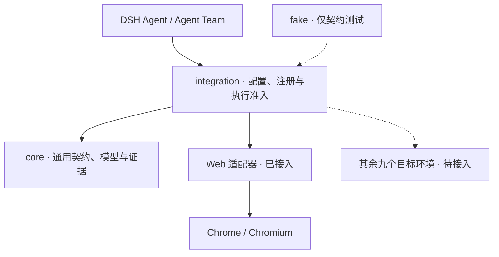

# dsh-agent-team-ui-testing


[English](README.md) | **简体中文**

**面向十个目标环境的 AI 原生 UI 调试与自动化测试基础设施。**

为 [DeepSeekHarness（DSH）](https://github.com/deepseek-ai/deepseek-harness) 中的单个 Agent 或 Agent Team 提供统一的目标接入、能力调用、人机协作与证据模型，让 Agent 操作真实界面、观察结果，并给出人类可复核的结论。

**进一步了解：[完整文档与帮助（docs/index.md）](docs/index.md)**

[快速开始（getting-started.md）](docs/getting-started.md) · [新手图文教程（tutorial.md）](docs/tutorial.md) · [开发者进阶（tutorial-advanced.md）](docs/tutorial-advanced.md) · [架构（architecture.md）](docs/architecture.md)

<p>
  <a href="https://www.npmjs.com/package/dsh-agent-team-ui-testing"></a>
  <a href="https://github.com/bloodarea/dsh-agent-team-ui-testing/stargazers"></a>
  <a href="LICENSE"></a>
  <a href="https://nodejs.org/">= 22"></a>
  <a href="docs/browser-runtime.md"></a>
  <a href="docs/tools.md"></a>
  <a href="https://github.com/deepseek-ai/deepseek-harness"></a>
  <a href="https://github.com/bloodarea/dsh-agent-team-ui-testing/releases"></a>
</p>

> **当前进展：预发布。跨环境公共底座已落地，Web / Chromium 是首个已接入的真实目标环境。** 其余九个目标环境的真实适配器待接入；当前可用功能与验证范围见[能力分层（capability-tiers.md）](docs/capability-tiers.md)和[验证与贡献（verification.md）](docs/verification.md)。

## 项目愿景与目标环境

项目面向 Web、桌面、移动端、终端、小程序、游戏与三维应用，逐步将不同平台接入同一套调试与测试体系。上层统一描述目标、操作、观察和证据，各适配器提供对应平台的真实能力。

| 目标环境 | 接入方向 | 当前真实适配器 |
| --- | --- | --- |
| Web | 浏览器页面与 Web 应用 | 已接入 Chrome / Chromium，提供 37 个 `browser_*` 工具 |
| Linux | Linux 原生桌面、Electron、Tauri 等 | 待接入 |
| Windows | 原生桌面、.NET、WinUI、Electron、Tauri 等 | 待接入 |
| macOS | 原生桌面、Electron、Tauri 等 | 待接入 |
| Android | 原生应用、WebView、Flutter、React Native 等 | 待接入 |
| TUI | 终端交互应用 | 待接入 |
| HarmonyOS | 鸿蒙应用及相应容器 | 待接入 |
| 小程序 | 各平台小程序容器 | 待接入 |
| 游戏 | Unity、Unreal、Godot、Cocos 等 | 待接入 |
| 3D | 三维应用与编辑工具 | 待接入 |

这里的 Linux、Windows、macOS 指原生桌面测试目标；当前 Web 适配器已经可以运行在这三类宿主系统上。Web 下还接入了 Edge 驱动，真实 Edge 启动尚未验证；Firefox 尚未支持，详见[浏览器运行配置（browser-runtime.md）](docs/browser-runtime.md)。

## 已落地的跨环境基础架构

项目已从早期的 `dsh-agent-team-browser` 演进为按目标环境、能力和公共基础设施组织的插件。公共契约、配置、调度与数据模型已从 Web 实现中拆出：

| 已实现部分 | 职责与边界 |
| --- | --- |
| 三类适配器契约 | `TargetAdapter` 管理目标会话与生命周期，`CapabilityAdapter` 声明并执行能力，`P0Provider` 提供公共数据服务 |
| 环境中立核心 | `core/` 承载身份、几何、时钟、证据、错误、适配器注册和配置模型，不依赖浏览器实现 |
| Host 配置与调度 | `integration/` 解析全局、工作区与会话配置，通过注册表选择适配器，并校验配置版本与执行准入 |
| 工具与 Skill 按配置隔离 | 注册面决定工具声明范围，执行时检查当前会话的环境与能力；环境专用 Skill 按环境发现 |
| P0-A～E 公共模型 | 图像与帧、网络、显示空间、画布与标注、目标与租约使用公共模型；具体采集和控制由环境实现 |
| 六轴就绪诊断 | 分别报告工程支持、用户启用、依赖可用、连接可信、目标绑定和能力就绪 |
| 独立算法与契约夹具 | 图像、网络与动态分析保留可独立测试的逻辑模块；`targets/fake` 用于公共契约验证，不是真实平台适配器 |

Web 的 CDP 接入、页面队列与工具处理仍有实现在 Host 入口中，`engines/` 仍是未来可选自研执行端的预留边界。新增目标环境还需要完成平台适配、执行接线与真实验收。

### 公共底座怎样连接目标



Agent 负责理解目标、选择方法和判断结果；插件负责连接、执行、观察与保存证据；目标运行时实际运行应用。不同环境可以使用不同协议，上层保持共同的能力与证据语义。通信接口、执行后端与运行时的职责见[调试执行链路（architecture.md）](docs/architecture.md#调试执行链路)，三种适配器的完整接口见[适配器接口与接入（adapters.md）](docs/adapters.md)。

### 统一的能力分类

| 能力层级 | 回答的问题 |
| --- | --- |
| T1 · 状态与接口调试 | 当前状态是什么，接口或运行环节在哪里出错？ |
| T2 · 结构与交互调试 | 操作哪个对象，能否操作，操作后发生了什么？ |
| T3 · 输出与呈现调试 | 布局、颜色、形状或图像差异是否符合预期？ |
| T4 · 过程与行为调试 | 状态如何随时间变化，过渡、运动和流程是否满足条件？ |

T1–T4 按问题选用，可以组合，不要求每个环境提供 DOM、JavaScript 或浏览器标签页。P0 是跨层共享的数据基础，三类适配器是接入职责。定义、选路与当前实现见[能力分层（capability-tiers.md）](docs/capability-tiers.md)。

## 当前可以使用的 Web 能力

- **37 个 Agent 工具**：覆盖状态读取、结构化交互、静态视觉、动态行为、网络调试、标签页与标注。参数见[工具参考（tools.md）](docs/tools.md)。
- **人机共享调试面板**：实时预览、尺寸控制、画布平移缩放、选元素加入聊天框，以及双方共享的标注。操作见[调试面板（debug-panel.md）](docs/debug-panel.md)。
- **团队页面协作**：页面组按工作区、provider、团队根划分；支持每个 Agent 的工作／观察选页、页面归属与队长接管、归还和转交。边界见[多标签页（multi-tab.md）](docs/multi-tab.md)。
- **截图与视觉证据**：校验 PNG、显式区域和比例、标注叠加、像素比较与受管基线。见[截图交付（capture-p0.md）](docs/capture-p0.md)和[Chrome T3（capability-tiers.md）](docs/capability-tiers.md#web-chrome-t3)。
- **网络与动态调试**：请求、WebSocket、SSE、链路与证据导出；有界帧采集、七类动态分析、WAAPI 控制与恢复、视觉和网络事件关联。见[网络调试（network-p0.md）](docs/network-p0.md)和[Chrome T4（capability-tiers.md）](docs/capability-tiers.md#web-chrome-t4)。

当前 Web 实现默认无头，也可使用有头模式。浏览器依赖、执行端选择与 profile 行为见[浏览器运行配置（browser-runtime.md）](docs/browser-runtime.md)，启用与诊断见[环境设置（settings.md）](docs/settings.md)。

## 开始使用

使用当前 Web 适配器需要 DSH、Node.js 24.9+ 和本地 Chrome / Chromium。插件自身要求 Node.js 22+；运行 DSH 时采用更严格的要求。

```sh
dsh plugin --profile web add dsh-agent-team-ui-testing
```

安装到要使用的 profile 后重启 DSH。首次练习推荐从当前会话右侧边栏打开调试视图，让聊天框同时可见。

- **普通用户**：跟随[新手图文教程（tutorial.md）](docs/tutorial.md)，用对话完成订单查询、选元素、圈图和保存结果；教程附可运行的本地演示。
- **开发者**：看[开发者进阶（tutorial-advanced.md）](docs/tutorial-advanced.md)，了解工具调用、结果验证及网络、视觉和动态调试。
- **查阅全部帮助**：打开[文档索引（docs/index.md）](docs/index.md)，按安装、面板、能力、诊断或架构查找。

其他安装来源与固定版本方式见[浏览器运行配置（browser-runtime.md）](docs/browser-runtime.md#其他安装方式)。

## 使用与验证边界

- **支持与可用分别判断**：公共底座已实现；真实目标适配器和现场依赖决定当前能执行什么。能力声明、配置启用和实际测试通过是不同结论。
- **视觉与动态验证有范围**：当前 T3/T4 使用确定性算法，未提供内置 VLM/OCR；采样不足和未覆盖场景需要明确保留，见[能力与限制（capability-tiers.md）](docs/capability-tiers.md#web-chrome)。
- **页面隔离与登录态不同**：Web 页面状态按 Runtime 管理，同一浏览器 profile 的 Cookie 与存储共享。截图和采集内容分享前应检查，不能假定已去除所有敏感信息。
- **证据需要独立核对**：输入已派发、接口返回成功或图片附件已交付，都不自动证明业务结果、视觉断言或模型接收完整分辨率图像。测试入口与报告判读见[验证与贡献（verification.md）](docs/verification.md)。

## 后续方向

- 为其余九个目标环境逐步接入真实适配器，补齐各自的执行端、观察和真实验收。
- 在现有公共契约上继续拆分 Web 专属实现，减少 Host 入口中的平台耦合；需要自研执行端时再扩展 `engines/`。
- 加固 Web 通道，补齐动态行为、真实浏览器和长期运行场景的验证。
- 在现有团队页面归属和控制权机制上，完善多 Agent 协作、人类接管与发布质量。

## 与配套项目的关系

| 项目 | 角色 |
| --- | --- |
| [`dsh-agent-team-presets`](https://github.com/bloodarea/dsh-agent-team-presets) | 可复用的团队／角色配置、模型路由与工具策略 |
| **`dsh-agent-team-ui-testing`** | UI 测试目标接入、能力执行、证据与人机协作 |

两者互补，插件也可由单个 DSH Agent 独立使用。

## 贡献

欢迎针对公共契约、真实环境适配器、可复现的 UI 场景和证据边界贡献代码与验证。提交问题时请附 DSH 与目标运行时版本、复现步骤、预期和实际结果，以及脱敏后的证据。参与开发前请阅读[验证与贡献（verification.md）](docs/verification.md)。

## 许可证

采用 [MIT 许可证](LICENSE)。Copyright (c) 2026 bloodarea。引入的第三方代码须保留适用声明。

---

**仓库：** [bloodarea/dsh-agent-team-ui-testing](https://github.com/bloodarea/dsh-agent-team-ui-testing) · **维护者：** [bloodarea](https://github.com/bloodarea) · **状态：** 预发布
