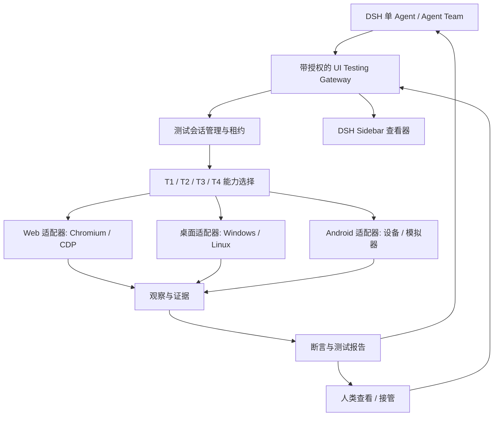

# dsh-agent-team-ui-testing

**面向 DeepSeekHarness 的 AI 原生跨平台 UI 测试基础设施。**  
让 AI Agent 操作、观察、测试并验证 Web、桌面、Android、TUI 与 3D 应用的真实界面，并提供可供人类审查的证据。

[English](README.md) | **简体中文**

> [!IMPORTANT]
> **项目状态：架构设计 / 预发布。** Web 通道——**T1 程序化、T2 结构化 GUI 与 T3 静态视觉**（共 22 个 Agent 工具）——已实现，并由驱动真实 Chromium 的验收套件覆盖；其余 8 个规划中的运行环境尚未实现，界面选择器里保持置灰。插件目前以本地 link 方式安装，未发布到 npm：仍没有已发布的安装包、兼容性矩阵或正式 Release。验收状态、计数与未完成项见 [docs/status.md](docs/status.md)。

## 这是什么项目？

**dsh-agent-team-ui-testing** 是面向 [DeepSeekHarness（DSH）](https://github.com/deepseek-ai/deepseek-harness) 的 UI 测试基础设施插件。它让一个 AI Agent，或者多个协作中的 Agent，直接操作真实软件界面、检查状态、验证预期行为、采集证据，并把可复现的问题反馈给开发 Agent。

项目从原来的 **`dsh-agent-team-browser`** 共享 Chromium 浏览器工作区设计演进而来。**原有浏览器工作区不会被废弃**，它将作为跨平台测试运行时中的一个适配器继续保留。

## 为什么开发它？

AI 编程 Agent 可以生成界面代码，却很难可靠地回答：**最终交付的软件是否真的能用、界面是否符合预期？** 一次返回 200、进程成功启动或一张截图，都不能证明用户流程可用。本项目希望提供：

- **真实界面反馈：** 在实际渲染出来的应用上执行用户操作，而不只是阅读源码。
- **结构化优先：** 在可靠时优先使用 API、DOM 与无障碍接口，必要时再使用视觉方法。
- **有证据的结论：** 记录做了什么、观察到什么、哪些通过、哪些失败、哪些仍未验证。
- **跨平台会话：** 对 Agent 提供一致的测试语义，同时保留各平台特有的能力与限制。
- **多 Agent 协作与人工接管：** 在授权范围内并行测试；需要时由人类查看或接管目标。
- **尽量不打断用户：** 平台允许时优先在后台执行；确实需要前台焦点的操作必须明确说明并协调。

## 核心设计原则

1. **以测试结果为中心。** 操作界面的最终目的是验证一个有明确预期的行为，结论必须带有证据和明确的适用范围。
2. **结构化数据优先。** 尽量利用稳定的应用接口、事件接口、DOM 或无障碍树，而不是脆弱的屏幕坐标。
3. **不得虚报测试通过。** API 调用成功不能自动证明界面渲染正确，截图存在也不等于用户流程验收通过。
4. **执行与展示解耦。** 关闭 DSH 侧边栏只影响查看，不应销毁测试目标或中断允许继续执行的后台任务。
5. **默认隔离、显式授权。** 浏览器上下文、桌面会话和 Android 设备都有明确的访问范围，由运行时校验身份与权限。
6. **人类界面保持简洁。** Agent 内部可以处理复杂的适配器与证据；人类主要看到结论、问题定位和可复查的证据。

## 已实现：Web 通道（Chromium）

同一个插件在每台主机上运行一个共享的无头 Chromium，并为每个 DSH 工作区提供独立的 page、URL、视口、历史、网络缓冲和租约；Cookie 与存储按 Chromium profile 共享。Agent 可用的是 **22 个工具**，分属三层能力：

| 层级 | 工具 | 能力 |
| --- | --- | --- |
| **T1** 程序化 | `browser_navigate` `browser_eval` `browser_screenshot` `browser_input` `browser_network` `browser_computed_style` `browser_http_request` `browser_state` `browser_capabilities` | 导航、执行 JavaScript、Console/Network 检查、独立 HTTP 请求、计算样式、截图、原始鼠标/滚轮/键盘事件、能力探测 |
| **T2** 结构化 GUI | `browser_snapshot` `browser_click` `browser_type` `browser_scroll` `browser_fill_form` `browser_node_state` `browser_wait_for` | snapshot → ref 定位、真实 CDP 操作、表单、节点状态与等待；每次调用都返回结构化证据与分类错误 |
| **T3** 静态视觉 | `browser_vision_image` `browser_vision_find` `browser_vision_compare` `browser_vision_act` `browser_vision_baseline` `browser_vision_check` | 截图裁剪/缩放/预处理/标注、颜色/连通域/边缘/模板确定性识别、YIQ 差异、坐标交互、受管基线、回归与布局/遮挡/溢出/截断/颜色/组件缺失断言 |

T3 是自研、零第三方依赖的纯 JavaScript 实现（自带 PNG 编解码、YIQ 差异与识别算法，不依赖 Sharp、Pixelmatch、Argos）。`browser_capabilities` 报告宿主实际提供的能力——6 项 `web.t3.*` 与聚合 `web.t3.static-vision`；`web.t4.*` 仍为 `unsupported`。

### 截图与证据文件

`browser_screenshot` 支持可选的连续 `scale`（1–4）与**文档 CSS 像素**的 `region`。默认把 PNG 暂存到插件实例目录（权限 0600、不覆盖同名文件），插件销毁时清理；显式传入 `out`、`persist:true` 或设置 `DSH_UI_TESTING_CAPTURE_DIR` 才会持久到指定根目录。截图不做脱敏，分享前请自行检查内容。T3 基线存放在 `<root>/output/vision-baselines/<scopeHash>/`，使用不可变 revision、HEAD CAS 与墓碑删除。

### 当前限制

- **只做静态判断。** T3 用确定性像素算法处理单张 PNG：没有 VLM/OCR 或语义命名，也不能证明动画、闪烁或中间帧是否正确（T4 未实现）。
- **共享 profile。** 同一个 Chromium profile 内 Cookie 与存储共享；按工作区隔离的只有 page、URL、视口、历史、网络缓冲与租约。
- **附件不等于模型可见。** 工具返回图像附件，不代表 provider 以原始分辨率把图像交给了模型。
- **有些检查不可观测。** Blink 会把 CDP 鼠标坐标截断为整数、inert 子树不参与 hit-test，因此这两类子项记为 NOT_APPLICABLE 而不是通过。
- **仅 Web。** 桌面、Android、TUI、HarmonyOS、游戏与 3D 仍为规划，运行环境选择器里保持置灰。

仓库还提供在进程内驱动真实 Chromium 的验收套件（`tests/acceptance/`），以及针对 PNG 编解码、YIQ 差异与基线的纯算法单测。当前结果与未完成项见 [docs/status.md](docs/status.md)。

## 规划支持范围

共规划 9 个运行环境；目前只实现了 Web。

| 运行环境 | 当前状态 | 候选技术路线 | 目标能力 |
| --- | --- | --- | --- |
| **Web**（Chromium） | **T1 + T2 + T3 已实现**；T4 未实现（面板可用） | Chromium、Chrome DevTools Protocol（CDP）、DOM/Accessibility API | 页面导航、表单、响应式布局、Console/Network、截图、交互、静态视觉分析与坐标输入 |
| **Windows 桌面** | 规划中，未实现（置灰） | Windows UI Automation（UIA）及系统允许的输入/采集接口 | 原生控件、窗口状态、界面流程和截图 |
| **Linux 桌面** | 规划中，未实现（置灰） | 无障碍接口及桌面环境适配能力 | 原生控件、GUI 流程；实际支持范围受 X11/Wayland 与权限影响 |
| **macOS 桌面** | 规划中，未实现（置灰） | macOS Accessibility（AXUIElement）及系统截屏/输入接口（需 TCC 授权） | 原生控件、窗口状态、界面流程和截图；初期不承诺完整无人值守自动化 |
| **Android** | 规划中，未实现（置灰） | ADB、UI 层级/UiAutomator 类能力、设备截图与输入 | Activity、导航、控件、受权限约束的设备操作 |
| **TUI** | 规划中，未实现（置灰） | 伪终端（PTY/termios）与终端缓冲区采集（待验证） | 终端会话、按键输入、屏幕内容断言 |
| **HarmonyOS** | 规划中，未实现（置灰） | HDC 及平台 UI 检查/输入接口（待评估） | 应用/元服务界面、导航、控件、设备操作 |
| **游戏** | 规划中，未实现（置灰） | 游戏引擎/平台调试与输入接口（按引擎分别评估） | 运行时状态、输入、场景与画面证据 |
| **3D** | 规划中，未实现（置灰） | WebGL/图形 API 与场景状态读取（待评估） | 视角/场景断言、画面证据 |

以上是**候选方案，不等于已选定依赖或已完成集成**。目前只有 Web 定义了能力分层（T1–T4），其他运行环境尚无分层方案；各适配器必须主动报告自己支持的操作，不得假装所有平台能力一致。

**初期不承诺：** iOS 自动化、macOS 完整无人值守自动化（受辅助功能/TCC 权限限制）、无限制操作系统控制、绕过 CAPTCHA 或安全限制、所有原生应用都能完全后台无焦点运行，以及游戏/3D 的通用自动化（按引擎与图形栈分别评估）。

## 目标能力（规划）

除已实现的 Web 通道外，以下模块描述目标能力集：

| 模块 | 目标行为 |
| --- | --- |
| **测试会话管理** | 创建、选择、在可行时恢复或终止目标会话；与 DSH 对话 Session 解耦 |
| **操作与观察工具** | 提供启动、查找、点击、输入、检查、等待和证据采集等小而明确的类型化操作 |
| **断言和测试报告** | 关联期望、实测结果、通过/失败/阻塞/未验证状态和对应证据 |
| **多 Agent 协作** | 不同目标并行执行；同一目标上的冲突写入通过控制权/租约串行化 |
| **人类查看与接管** | 在授权的 DSH 界面查看目标状态，并在平台允许时在 Agent 与人类之间交接控制权 |
| **共享浏览器工作区** | 多标签页、显式访问权限与写入租约；同一授权上下文内可选的 Cookie 共享 |
| **响应式测试** | 每个标签页独立设置 CSS 视口与 DPR，不受侧边栏宽度影响 |
| **调试能力** | 受权限保护地查看 Console、运行时错误、Network 与应用日志；保护敏感数据 |
| **视觉验证** | 在受控条件下对比界面状态或截图；明确报告不确定性而不是隐瞒 |
| **动画验证** | 按时间采集帧与状态，针对过渡、时长和布局稳定性等明确条件进行验证 |
| **可复现性** | 记录环境、步骤、测试产物、失败证据和回放限制 |

## T1–T4：按能力选择与逐级回退

**T1–T4 是选择与回退层级，不是必须依次走完的四段流水线。** 它们是本插件自己的**调试能力分级**，不是业界标准：每一级都可以独立调用，也可以作为上一级的回退来源。这四层目前**只针对 Web** 定义；桌面、Android、TUI、HarmonyOS、游戏与 3D 尚无约定的分层模型。

| 层级 | 正式名称 | 核心技术 | 主要调试能力 | 触发与升级条件 | 相对成本 |
| --- | --- | --- | --- | --- | --- |
| **T1** | 程序化调试 | CDP、HTTP、Fetch、JavaScript、Network、Console | 接口请求、网络抓包、JS 执行、异常检测、资源加载、状态检查、性能数据 | 默认优先；需要操作页面元素时进入 T2 | 低 |
| **T2** | 结构化 GUI 调试 | DOM、Accessibility Tree、ARIA、Snapshot、Locator、Ref | 元素定位、点击、输入、滚动、表单、交互测试、节点状态、结构化证据 | 无法通过可靠的结构化定位完成操作，或需要视觉判断时进入 T3 | 低～中 |
| **T3** | 静态视觉调试 | Screenshot、Computer Vision、坐标操作、图像差异分析 | UI 布局、颜色、遮挡、样式缺陷、Canvas、图表、静态截图操作 | 需要连续动作、动画或时间状态判断时进入 T4 | 高 |
| **T4** | 动态视觉调试 | Screencast、帧序列、时间戳、视觉推理、鼠标键盘事件 | 动画、拖拽、复杂动态组件、过渡状态、连续画面分析 | 最高级：失败后输出诊断结果，交由 Agent 或人类裁决 | 最高 |

每一级的实现范围与完成门槛（“主要参考”是选型对照，不代表已选定依赖）：

| 层级 | 主要参考 | 实现策略 | 完成门槛 |
| --- | --- | --- | --- |
| **T1** | [Playwright](https://playwright.dev/) MCP、agent-browser、[Chrome DevTools MCP](https://github.com/ChromeDevTools/chrome-devtools-mcp) | 直接复用 | 能够独立完成不依赖视觉理解的页面与接口诊断，并向 T2 提供同一浏览器会话 |
| **T2** | ego-lite、agent-browser、[Playwright MCP](https://github.com/microsoft/playwright-mcp) | 复用 + 统一节点协议 | 对常规 Web 页面实现可靠的结构化发现、定位、操作、验证闭环，并明确识别何时需要视觉能力 |
| **T3** | Playwright MCP Vision、agent-browser、[Sharp](https://sharp.pixelplumbing.com/)、[Pixelmatch](https://github.com/mapbox/pixelmatch)、[Argos](https://argos-ci.com/) | 纯 JS 自研实现（PNG + YIQ + 确定性识别）；上述参考仅作对比 | 能够对静态画面完成视觉定位与操作，并准确验证前后状态；需要连续时间信息时升级 T4 |
| **T4** | agent-browser 视频录制机制、自研动态视觉调度、CDP Animation、[rrweb](https://www.rrweb.io/)、按需 FFmpeg / [OpenCV](https://opencv.org/) | 复用采集，自研时序验证 | 可以根据连续帧判断动态交互的结果，并输出带时间戳的可复现证据 |

回退链：Agent 接收调试任务后选择成本最低的适用层级；经**操作验证 + 缺陷归因 + 证据输出**后，当前层级无法获得必要证据时按需升级或跳转。回退策略遵守四条规则：

1. **按需选择。** 网络异常优先 T1，按钮交互优先 T2，布局错误可以直接进入 T3。
2. **逐级升级是默认策略，允许跳级。** 已明确需要连续动态画面时，可以直接进入 T4。
3. **区分工具失败和产品缺陷。** 定位器失效可以重试或升级；业务断言失败应记录为缺陷，不能通过回退掩盖。
4. **证据跨层级复用。** T1 的 Network 数据、T2 的元素 Ref、T3 的截图与 T4 的关键帧都属于同一次调试任务。

T1 调用成功不会被当成视觉验收通过：涉及界面外观与交互的验收，仍然必须取得相应的 UI 观察证据。

## 从测试需求到验证结果

1. **定义预期：** 说明测试对象、用户操作流程、运行环境和验收标准。
2. **准备环境：** 启动或连接经过授权的浏览器、桌面或 Android 测试会话。
3. **执行操作：** 优先通过稳定的结构化通道执行，必要时回退到视觉方法。
4. **采集观察：** 按断言需要采集 UI 状态、DOM/无障碍节点、日志、截图或带时间戳的帧。
5. **执行断言：** 优先确定性判断；主观视觉结果保留容差、不确定性与人工审查要求。
6. **输出报告：** 明确通过、失败、阻塞和未验证项目，给出可复现的问题描述。
7. **修复回归：** 开发 Agent 修改代码后重新执行相关测试，检查是否引入其他回归。

**示例测试目标（仅用于说明需求，不代表已发布的工具语法）：**

> 启动应用，进入设置页面，切换深色模式，检查配置持久化和实际渲染效果；离开页面后再返回，确认状态保留。记录真实执行的检查、截图、相关日志、出现的差异以及未能完成的验证项。

### 测试证据与结论

测试记录包含：目标与环境标识、测试用例与步骤、操作来源、时间、预期结果、实际观察、测试状态以及相关证据引用。确定性断言、人工审查证据和平台限制必须能够区分：模型的置信度分数本身不是测试通过的证明。截图是显式采集请求且不做脱敏，分享前请检查内容。

### 动画与视觉效果如何验证？

单张静态截图无法证明动画是否正确。在平台允许的情况下，应采集有边界的连续帧或多次状态观察，附带时间戳，并根据明确标准检查起止状态、时长区间、异常布局偏移、过渡是否缺失等。还要考虑渲染差异、系统“减少动画”设置、录帧缺失与设备性能，并如实记录。无法可靠判断时标记为**未验证 / 需要复核**，不能假装通过。

## 目标架构（规划中）



### 保留原来的共享浏览器能力

- 一个经过授权的 **Browser Workspace** 可以管理多个标签页，支持明确的标签页访问权限与写入租约。
- 同一个经过授权的 `BrowserContext` 内，标签页可以共享适用的 Cookie 和同源存储；不同上下文默认隔离。共享 Cookie 不保证所有网站都能自动登录。
- **DSH Agent Session、真实浏览器运行时、Sidebar 查看器有各自的生命周期。** 切换所观看的标签页不应切换、暂停或重新创建后台浏览器任务。
- 每个标签页的实际视口独立存在。例如网页按 `1920 × 1080` 逻辑视口渲染，DSH 侧边栏缩窄时只能调整显示比例或裁切方式，不能暗中把它变成移动端布局；人类点击位置需要正确映射回目标坐标。
- 浏览器后台操作尽量使用 CDP，不抢占宿主机真实鼠标、键盘与活动窗口。

桌面和 Android 适配器遵循同样的**授权、会话管理与证据原则**，但不会被错误地要求复用 Chromium 的 Cookie、DOM 能力或无焦点运行保证。

### 多 Agent 协作与权限边界

- 在授权范围内，多个 Agent 可以并发进行只读观察。
- 不同测试目标可以按机器/设备资源情况并行执行。
- 对**同一个测试目标**的冲突写入需要通过独占控制权或租约协调；过期执行者不能继续写入。
- 人工接管前先暂停或撤销冲突的 Agent 控制权，再授予有限的人类操作范围。
- Agent 与 Team 身份来自 DSH 可信运行时，不直接相信模型传入的 `agentId` 字符串。
- 工具可用不等于资源已授权：预设可以允许某个工具，但运行时仍要校验对具体目标的访问权。

## 安全与隐私

测试运行时可能接触到已登录页面、私人界面、开发者工具或设备数据，因此遵循最小权限、显式授权、有限采集和安全默认值：

- 默认不导出 Cookie、访问令牌、Authorization 头、密码或私有请求体。
- 敏感的界面/设备操作或侵入式调试必须获得明确授权。
- 在可行范围内对测试日志和截图做脱敏，并说明脱敏缺口。
- 不静默绕过系统保护、应用安全校验、CAPTCHA 或知情同意。
- 避免录制无关的宿主窗口或跨团队数据。
- 回放与恢复能力必须有边界，不承诺重建任意内存状态。

## Roadmap

以下是**规划中的工作项**，不代表已完成。排序可能随 DSH 与平台可行性评估调整。

- [ ] **R0 — 可行性：** 审计 DSH 插件/Sidebar 接口、上游许可证、目标平台能力与安全边界。
- [ ] **R1 — Web 基础：** 保留工作区/上下文/标签页管理、后台 Chromium 执行与查看器解耦。
- [ ] **R2 — 测试核心：** 实现类型化测试会话、T1–T4 能力选择、操作、观察、断言与证据报告。_（已交付 Web T1–T3：程序化通道、结构化 GUI 与静态视觉，各自带验收套件；T4 与跨运行环境测试核心仍未完成。）_
- [ ] **R3 — 协作控制：** 实现单/多 Agent 授权、目标归属、人工接管与并发测试协调。
- [ ] **R4 — 桌面应用：** 验证 Windows/Linux 的无障碍、输入、截图、权限与焦点约束。
- [ ] **R5 — Android：** 验证设备/模拟器生命周期、UI 节点、交互、截图与错误报告。
- [ ] **R6 — 视觉测试：** 验证响应式界面、状态对比、时序动画观察与不确定性处理。
- [ ] **R7 — 加固：** 执行安全、隐私、资源、崩溃恢复与跨平台回归测试。
- [ ] **R8 — 发布：** 提供可复现构建、固定 DSH 兼容范围、经过验证的安装说明与验收证据。

其余规划环境（macOS 桌面、TUI、HarmonyOS、游戏、3D）暂不单列里程碑，按需求与平台可行性评估后排序，当前在运行环境选择器中保持置灰。里程碑只有在实现与测试可公开复现后才算完成。

## 安装与开发

**当前暂无已发布的安装命令或正式版本。** 插件目前以本地 link 方式接入 DSH，打包方式、DSH 兼容范围与安装说明将在验证后补充。集成注意事项与踩坑记录见 [docs/dsh-integration.md](docs/dsh-integration.md)。

开发阶段使用的验收套件是驱动本机真实 Chrome/Chromium 的 Node 脚本，请串行执行：

```bash
node tests/acceptance/run.mjs            # T1 程序化
node tests/acceptance/t2-structured.mjs  # T2 结构化 GUI
node tests/acceptance/t3-vision.mjs      # T3 静态视觉
node tests/acceptance/capture-p0.mjs     # 截图采集基础设施
```

仓库不含产品截图；旧版 `banner.png` / `banner_zh.png` 已移除，仓库内容不应被当作能力演示。

### 已知约束

- DSH 插件 API 与扩展点可能变化，必须固定并验证兼容版本。
- Windows 与 Linux 的 GUI 自动化机制差异很大；Wayland 权限与焦点机制可能限制无人值守运行。
- Android 测试依赖设备/模拟器可用性、调试权限、平台 API 级别与应用安全设置。
- 自动化视觉判断需要明确的验收标准，部分结论仍可能需要人工复核。
- 浏览器标签页、操作系统窗口与 Android Activity 的能力不可互换。

## 文档

| 文件 | 内容 |
| --- | --- |
| [docs/index.md](docs/index.md) | 项目记忆索引 |
| [docs/status.md](docs/status.md) | 当前实现状态、验收证据与未完成项 |
| [docs/capability-tiers.md](docs/capability-tiers.md) | T1–T4 分层、完成门槛与选择策略 |
| [docs/t1-m0-m2-contract.md](docs/t1-m0-m2-contract.md) | T1 工具、租约、错误与证据契约 |
| [docs/t2-structured-gui.md](docs/t2-structured-gui.md) | T2 契约、Ref 协议与工具语义 |
| [docs/t3-vision.md](docs/t3-vision.md) | T3 契约、算法与判定规则 |
| [docs/capture-p0.md](docs/capture-p0.md) | 截图采集契约 |

## 与配套项目的关系

| 项目 | 作用 |
| --- | --- |
| [`dsh-agent-team-presets`](https://github.com/bloodarea/dsh-agent-team-presets) | 可复用的团队/角色配置、模型路由与工具策略 |
| **`dsh-agent-team-ui-testing`** | UI 测试目标、会话、自动化、证据、验证与受控的人机协作 |

两个项目互补，但**互不依赖**。UI 测试运行时面向普通单 Agent 场景设计，不要求安装 Agent Team 插件。

## 贡献与反馈

现阶段最有价值的贡献是：可复现的 DSH 集成结论、平台可行性验证、无障碍/DOM 回退案例、安全威胁模型，以及具体的 UI 验收场景。

提交 Issue 时请附带 DSH 版本/commit、平台与运行时版本、复现步骤、期望结果、实际结果和已脱敏的证据。请勿上传凭据、个人设备数据或未脱敏的已登录流量。

## 许可证与致谢

**当前公开材料中尚未确认仓库许可证。** 二次使用或分发前请先查看仓库实际的 `LICENSE` 文件；后续引入的第三方代码必须保留相应的声明与许可条款。

感谢 DeepSeekHarness 生态以及浏览器/UI 自动化社区提供的先行实践。候选参考包括 [Chrome DevTools Protocol](https://chromedevtools.github.io/devtools-protocol/) 与现有 DSH 浏览器集成；这些参考不自动成为运行时依赖。

---

**仓库：** [bloodarea/dsh-agent-team-ui-testing](https://github.com/bloodarea/dsh-agent-team-ui-testing) · **维护者：** [bloodarea](https://github.com/bloodarea) · **状态：** 架构设计 / 预发布
