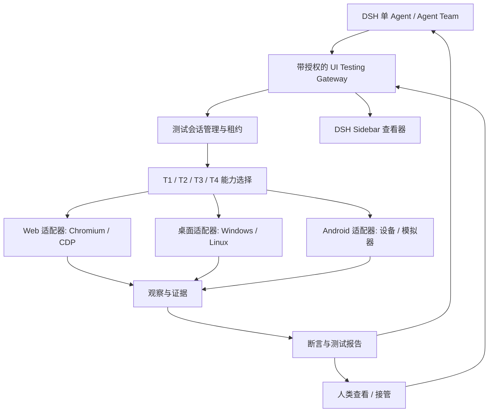

# dsh-agent-team-ui-testing

**面向 DeepSeekHarness 的 AI 原生跨平台 UI 自动化测试基础设施。**  
让 AI Agent 操作、观察、测试并验证 Web、桌面、Android、TUI 与 3D 应用的真实界面，并提供可供人类审查的证据。

[English](README.md) | **简体中文**

> [!IMPORTANT]
> **项目状态：架构设计 / 预发布。** 当前仓库已包含可运行的 **Web T1 + T2 调试视图插件**（本地 link 安装、未发布 npm；验收状态见 [docs/status.md](docs/status.md)），其余运行环境仍为规划。下文除非明确说明，否则均为**规划能力**；仍没有已发布的安装包、兼容性矩阵或正式 Release。请勿将设计目标当作已经通过的测试结果。

## 这是什么项目？

**dsh-agent-team-ui-testing** 是面向 [DeepSeekHarness（DSH）](https://github.com/deepseek-ai/deepseek-harness) 的 UI 测试基础设施插件，目标是让一个 AI Agent，或者多个协作中的 Agent，直接操作真实软件界面、检查状态、验证预期行为、采集证据，并将问题反馈给开发 Agent。

项目从原来的 **`dsh-agent-team-browser` 共享 Chromium 浏览器工作区** 设计演进而来。**原有浏览器工作区不会被废弃**，它将作为跨平台测试运行时中的 Web 适配器及共享浏览器能力继续保留。

**规划中的调试运行环境（共 9 个）：** Web、Windows 桌面、Linux 桌面、macOS 桌面、Android、TUI、HarmonyOS、游戏与 3D。当前 **Web 的 T1 程序化通道与 T2 结构化 GUI 通道**已实现（T1 在隔离 DSH 实例完成验收；T2 由进程内真实 Chromium 验收套件验证，真实宿主会话仍为 NOT_RUN）。其余 8 个运行环境均为**规划中、未实现**，界面选择器里保持置灰。

`dsh-agent-team-*` 是项目系列命名，**不意味着必须安装 Agent Team 或 [`dsh-agent-team-presets`](https://github.com/bloodarea/dsh-agent-team-presets)**。普通单 Agent 也应该能独立调用 UI 测试能力。

## 为什么开发它？

AI 编程 Agent 可以生成页面和界面代码，但仅凭代码、程序成功启动或一张静态截图，很难可靠地确认：**最终的软件界面是否真的能用、操作是否符合预期、视觉与动画是否正确。**

本项目希望实现：

- **真实界面测试：** 在实际渲染出来的应用上执行用户操作，验证功能和交互。
- **结构化优先：** 在适合的情况下优先使用应用 API、事件接口、DOM 或无障碍节点，降低依赖视觉坐标的成本与不确定性。
- **跨平台统一入口：** 对 Agent 提供尽量一致的测试语义，同时尊重各操作系统和设备的差异。
- **有证据的测试结论：** 清楚记录做了什么、观察到什么、哪些通过、哪些失败、哪些没有验证。
- **多 Agent 协作与人工接管：** 在授权范围内并行测试；需要时由人类查看或接管目标。
- **尽量不打断用户：** 平台允许时优先在后台执行；确实需要前台焦点的操作必须明确说明并协调。

## 规划支持范围

| 运行环境 | 当前状态 | 候选技术路线 | 目标能力 |
| --- | --- | --- | --- |
| **Web**（Chromium） | **T1 + T2 已实现**；T3–T4 未实现（面板可用） | Chromium、Chrome DevTools Protocol（CDP）、DOM/Accessibility API | 页面导航、表单、响应式布局、Console/Network、截图与交互 |
| **Windows 桌面** | 规划中，未实现（置灰） | Windows UI Automation（UIA）及系统允许的输入/采集接口 | 原生控件、窗口状态、界面流程和截图 |
| **Linux 桌面** | 规划中，未实现（置灰） | 无障碍接口及桌面环境适配能力 | 原生控件、GUI 流程；实际支持范围受 X11/Wayland 与权限影响 |
| **macOS 桌面** | 规划中，未实现（置灰） | macOS Accessibility（AXUIElement）及系统截屏/输入接口（需 TCC 授权） | 原生控件、窗口状态、界面流程和截图；初期不承诺完整无人值守自动化 |
| **Android** | 规划中，未实现（置灰） | ADB、UI 层级/UiAutomator 类能力、设备截图与输入 | Activity、导航、控件、受权限约束的设备操作 |
| **TUI** | 规划中，未实现（置灰） | 伪终端（PTY/termios）与终端缓冲区采集（待验证） | 终端会话、按键输入、屏幕内容断言 |
| **HarmonyOS** | 规划中，未实现（置灰） | HDC 及平台 UI 检查/输入接口（待评估） | 应用/元服务界面、导航、控件、设备操作 |
| **游戏** | 规划中，未实现（置灰） | 游戏引擎/平台调试与输入接口（按引擎分别评估） | 运行时状态、输入、场景与画面证据 |
| **3D** | 规划中，未实现（置灰） | WebGL/图形 API 与场景状态读取（待评估） | 视角/场景断言、画面证据 |

以上是**候选方案，不等于已选定依赖或已完成集成**；除 Web T1/T2 外，其余运行环境尚未定义能力分层（T1–T4 目前只针对 Web）。各运行环境适配器需要主动报告自己支持的操作，不得假装所有平台都有一样的能力。

**初期不承诺：** iOS 自动化、macOS 完整无人值守自动化（受辅助功能/TCC 权限限制）、无限制操作系统控制、绕过 CAPTCHA 或安全限制、所有原生应用都能完全后台无焦点运行，以及游戏/3D 的通用自动化（按引擎与图形栈分别评估）。

## 已实现的 Web P0 采集基础设施

已有 `browser_screenshot` 增加可选的连续 `scale` 1–4、**文档CSS像素** `region:{x,y,width,height}` 、`persist:boolean=false`和持久根相对`.png`路径`out`。单次CDP PNG clip、DSF固定1，输出逐轴 `round(css×scale)`，上限1600万像素。PNG结构/CRC、尺寸、全量均匀/透明统计、JSON坐标映射、安全文件发布和附件metadata比较记录在 `capture.version=1`。均匀内容只警告，不自动判视觉失败。工具仍为16个，T3/T4视觉判断未实现。默认暂存修订Lead最终串行 **14/14、142/142**（[报告](tests/acceptance/runs/capture-p0-2026-11-01T05-52-05-302Z-104057/report.json)）；T1 22/22、324/324（[报告](tests/acceptance/runs/2026-11-01T05-49-22-590Z-100191/run-report.json)），仅persist描述文案不同的后续代码复跑为 **21 PASS/1 FAIL、323/324必需项通过/1失败、exit1**（[05-59-53](tests/acceptance/runs/2026-11-01T05-59-53-185Z-105978/run-report.json)）。唯一失败为P21 loadingFailed快照检查，actual仅3条成功网络记录，与[04-30-43基线](tests/acceptance/runs/2026-11-01T04-30-43-916Z-53146/run-report.json)同项。Lead归类既有环境随机flake、非P0回归，但失败仍记FAIL；验收需串行，串行也不能保证消失。最终代码T2仍 **37 PASS/1 NOT_RUN、260/260、exit0**（[06-01-14](tests/acceptance/runs/2026-11-01T06-01-14-788Z-107358/run-report.json)）。暂存修订前历史：Lead两次 **13/13、117/117**（[首轮](tests/acceptance/runs/capture-p0-2026-11-01T05-15-01-055Z-85097/report.json)、[第二轮](tests/acceptance/runs/capture-p0-2026-11-01T05-15-05-476Z-85616/report.json)），下方早期计数保留为历史。权威说明见 [采集契约](docs/capture-p0.md)。

原始PNG/base64字节与hash保留。`persist:boolean`默认false；默认写插件实例级 `<tmp>/dsh-ui-testing-capture-*` 暂存，绝对路径、0600、no-clobber，正常插件dispose清理。只有out/persist:true/非空DSH_UI_TESTING_CAPTURE_DIR才持久到绝对env根或可信cwd根，非法env不回退；持久路径相对根、dispose不删除。file新增pathKind/persistence/root/ephemeral区分模式；capabilities.observed.file仅persistence与relativePath（暂存null），不公开绝对路径。legacy无cwd也默认暂存，持久请求无根报OUTPUT_PATH_INVALID(root_unknown)。暂存失败仍交付图片，file=null+capture_file_unavailable；真实tmp不可写与SIGKILL残留尚未验证。附件metadata不能证明provider最终分辨率或可见性。

真实Chromium+fake ctx三次连续各 **13/13探针、115/115必需项、0失败**（[末次报告](tests/acceptance/runs/capture-p0-2026-11-01T04-58-32-550Z-66980/report.json)）；T1回归 **22/22、324/324**（[报告](tests/acceptance/runs/2026-11-01T04-59-29-531Z-68121/run-report.json)）。公开 `capture.anomaly.maxDelta` 增量后通过 **13/13、117/117**（[报告](tests/acceptance/runs/capture-p0-2026-11-01T05-09-04-665Z-79630/report.json)），此前115项为增量前证据。P0真实宿主重启后加载、provider视觉仍 **NOT_RUN**。高密度不增加canvas/WebGL源位图细节；C13只证视口、滚动与fixture目标（含fixed）前后未变，不排除瞬时布局影响，也不解决本地文件系统TOCTOU。

## 核心设计原则

1. **以测试结果为中心。** 操作界面的最终目的是验证一个有明确预期的行为，结论必须有证据。
2. **结构化数据优先。** 尽量利用稳定的 API、事件接口、DOM、无障碍树，必要时再使用视觉定位。
3. **不得虚报测试通过。** API 调用成功不能自动证明界面渲染正确，截图存在也不等于交互验收通过。
4. **执行与展示解耦。** 关闭 DSH 侧边栏，只影响查看，不应该直接销毁测试目标或中断允许继续执行的后台任务。
5. **默认隔离、显式授权。** 浏览器上下文、桌面应用会话和 Android 设备都有明确的访问范围与归属。
6. **人类界面保持简洁。** Agent 内部可以处理复杂的适配器和测试证据；人类主要看到问题、结论、定位和必要证据。

## 规划功能

下表是**目标功能规范**，并非已经完成的功能列表。

| 模块 | 目标行为 |
| --- | --- |
| **测试会话管理** | 创建、选择、在可行时恢复或终止目标会话；与 DSH 对话 Session 解耦 |
| **操作与观察工具** | 向 Agent 提供启动、查找、点击、输入、检查、等待和证据采集等结构化能力 |
| **断言和测试报告** | 关联期望、实测结果、通过/失败/阻塞/未验证状态和对应证据 |
| **多 Agent 协作** | 不同目标并行执行；同一目标存在冲突的写入操作使用控制权租约协调 |
| **人类查看与接管** | 在授权的 DSH 界面查看目标状态，并在平台允许时交接操作权 |
| **共享浏览器工作区** | 保留 Chromium 工作区、多标签页、授权上下文中的登录态共享与标签页级控制权 |
| **响应式测试** | 每个浏览器标签页独立设置 CSS 视口与 DPR，不受侧边栏宽度影响 |
| **调试能力** | 受权限保护地查看 Console、运行时错误、Network 和应用日志 |
| **视觉验证** | 在受控条件下对比界面状态或截图；明确记录不确定性 |
| **动画验证** | 按时间采集帧与状态，针对时长、过渡、布局稳定性等明确条件进行验证 |
| **可复现性** | 记录环境、步骤、测试证据、失败原因和回放限制 |

## T1–T4：按能力选择与逐级回退

这是我们计划采用的结构化优先策略。**T1–T4 是选择及回退层级，不要求每一步都依次执行四层。** 这套分层是本插件的**调试能力分级**，不代表业界现成的统一标准：每一级都可以独立调用，也可以作为下一级的回退来源。目前**只针对 Web 运行环境**定义了这四层；桌面、Android、TUI、HarmonyOS、游戏与 3D 等其他运行环境的分层方案尚未确定，不能照搬这套技术栈去推断它们的实现路径。

| 层级 | 正式名称 | 核心技术 | 主要调试能力 | 触发与升级条件 | 相对成本 |
| --- | --- | --- | --- | --- | --- |
| **T1** | 程序化调试 | CDP、HTTP、Fetch、JavaScript、Network、Console | 接口请求、网络抓包、JS 执行、异常检测、资源加载、状态检查、性能数据 | 默认优先；需要操作页面元素时进入 T2 | 低 |
| **T2** | 结构化 GUI 调试 | DOM、Accessibility Tree、ARIA、Snapshot、Locator、Ref | 元素定位、点击、输入、滚动、表单、交互测试、节点状态、结构化证据 | 无法通过可靠的结构化定位完成操作，或需要视觉判断时进入 T3 | 低～中 |
| **T3** | 静态视觉调试 | Screenshot、Computer Vision、坐标操作、图像差异分析 | UI 布局、颜色、遮挡、样式缺陷、Canvas、图表、静态截图操作 | 需要连续动作、动画或时间状态判断时进入 T4 | 高 |
| **T4** | 动态视觉调试 | Screencast、帧序列、时间戳、视觉推理、鼠标键盘事件 | 动画、拖拽、复杂动态组件、过渡状态、连续画面分析 | 最高级：失败后输出诊断结果，交由 Agent 或人类裁决 | 最高 |

每一级的实现范围与完成门槛（“主要参考”是选型对照，不代表已选定依赖或已完成集成）：

| 层级 | 主要参考 | 实现策略 | 完成门槛 |
| --- | --- | --- | --- |
| **T1** | [Playwright](https://playwright.dev/) MCP、agent-browser、[Chrome DevTools MCP](https://github.com/ChromeDevTools/chrome-devtools-mcp) | 直接复用 | 能够独立完成不依赖视觉理解的页面与接口诊断，并向 T2 提供同一浏览器会话 |
| **T2** | ego-lite、agent-browser、[Playwright MCP](https://github.com/microsoft/playwright-mcp) | 复用 + 统一节点协议 | 对常规 Web 页面实现可靠的结构化发现、定位、操作、验证闭环，并明确识别何时需要视觉能力 |
| **T3** | Playwright MCP Vision、agent-browser、[Sharp](https://sharp.pixelplumbing.com/)、[Pixelmatch](https://github.com/mapbox/pixelmatch)、[Argos](https://argos-ci.com/) | 复用算法，自研判定 | 能够对静态画面完成视觉定位与操作，并准确验证前后状态；需要连续时间信息时升级 T4 |
| **T4** | agent-browser 视频录制机制、自研动态视觉调度、CDP Animation、[rrweb](https://www.rrweb.io/)、按需 FFmpeg / [OpenCV](https://opencv.org/) | 复用采集，自研时序验证 | 可以根据连续帧判断动态交互的结果，并输出带时间戳的可复现证据 |

回退链的执行逻辑：Agent 接收调试任务后，根据任务目标选择成本最低的适用层级；经**操作验证 + 缺陷归因 + 证据输出**后，当前层级无法获得必要证据时按需升级或跳转。回退策略遵守四条规则：

1. **按需选择。** 网络异常优先 T1，按钮交互优先 T2，布局错误可以直接 T3。
2. **逐级升级是默认策略，允许跳级。** 已明确需要连续动态画面时，可以直接进入 T4。
3. **区分工具失败和产品缺陷。** 定位器失效可以重试或升级；业务断言失败应当记录缺陷，不能通过回退掩盖。
4. **证据跨层级复用。** T1 的 Network 数据、T2 的元素 Ref、T3 的截图及 T4 的关键帧都应该归属于同一次调试任务。

适配器先报告可用能力；Agent 选取**足以满足当前断言、且成本较低的可靠路径**。操作失败或信息不足时再切换/回退。涉及实际界面外观和交互的验收，仍然必须取得相应的 UI 观察证据，不能把 T1 接口调用成功误报成 UI 测试成功。

## 从测试需求到验证结果

规划中的完整工作流：

1. **定义预期：** 说明测试对象、用户操作流程、运行环境和验收标准。
2. **准备环境：** 启动或连接经过授权的浏览器、桌面或 Android 测试会话。
3. **执行操作：** 优先通过稳定的结构化通道执行，必要时回退到视觉方法。
4. **采集观察：** 按断言需要采集 UI 状态、DOM/无障碍节点、日志、截图或带时间戳的帧。
5. **执行断言：** 优先确定性判断；主观视觉结果保留容差、不确定性与人工审查要求。
6. **输出报告：** 明确通过、失败、阻塞和未验证项目，给出可复现的问题描述。
7. **修复回归：** 开发 Agent 修改代码后重新执行相关测试，检查是否引入其他回归。

**示例测试目标（仅用于说明需求，不代表已发布的工具语法）：**

> 启动应用，进入设置页面，切换深色模式，检查配置持久化和实际渲染效果；离开页面后再返回，确认状态保留。记录真实执行的检查、截图、相关日志、出现的差异以及未能完成的验证项。

### 测试证据与结论

测试记录计划包含：目标与环境标识、测试用例、步骤、操作来源、时间、预期结果、实际观察、测试状态以及相关证据引用。这是规划中的证据策略。当前Web P0截图是显式采集请求，保留未自动脱敏的PNG内容，默认暂存，仅out/persist:true/非空env显式持久；分享前需检查敏感内容。

视觉模型可以提供判断和置信度，但**置信度分数本身不是测试通过的证明**。确定性断言、人工审查证据、平台限制必须能够区分。

### 动画与视觉效果如何验证？

单张截图无法证明动画是否正确。在平台允许的情况下，应采集有边界的连续帧或多次状态观察，附带时间戳，并根据明确标准检查起止状态、时长区间、异常布局偏移、过渡是否缺失等。还要考虑低性能设备、录帧缺失、动态内容和系统减少动画设置。无法可靠判断时应标记为**未验证 / 需要复核**，不能假装通过。

## 目标架构（规划中）

### 保留原来的共享浏览器能力

原来的浏览器工作区设计依然是重要基础。**本轮已实现的是「按 DSH 工作区隔离 page」**：同一时刻一个 Chromium/profile、每个工作区独立 page/URL/viewport/history/网络缓冲/租约；多标签页、独立 BrowserContext 与跨工作区 Cookie/存储隔离仍是规划，不在本轮实现。

- 一个经过授权的 **Browser Workspace** 可以管理多个标签页，支持明确的标签页访问权限与写入租约。
- 同一个经过授权的 `BrowserContext` 内，标签页可以共享适用的 Cookie 和同源存储；不同上下文默认隔离。共享 Cookie 不保证所有网站都能自动登录。
- **DSH Agent Session、真实浏览器运行时、Sidebar 查看器有各自的生命周期。** 切换所观看的标签页不应切换、暂停或重新创建后台浏览器任务。
- 每个标签页的实际视口独立存在。例如网页按 `1920 × 1080` 逻辑视口渲染，DSH 侧边栏缩窄时只能调整显示比例或裁切方式，不能暗中把它变成移动端布局；用户点击位置需要正确映射回目标坐标。
- 浏览器后台操作尽量使用 CDP，不抢占宿主机真实鼠标、键盘与活动窗口。

桌面和 Android 适配器遵循同样的**授权、会话管理和证据原则**，但不会被错误地要求复用 Chromium 的 Cookie、DOM 能力或无焦点运行保证。

### 多 Agent 协作与权限边界

- 在授权范围内，多个 Agent 可以并发进行只读观察。
- 不同测试目标可以按机器/设备资源情况并行执行。
- 对**同一个测试目标**的冲突写入需要通过独占控制权或租约协调；过期执行者不能继续写入。
- 人工接管前先暂停或撤销冲突的 Agent 控制权，再授予有限的人类操作范围。
- Agent 和 Team 身份来自 DSH 可信运行时，不直接相信模型传入的 `agentId` 字符串。
- 工具允许调用，不等于允许访问任意测试资源。即使 Team Preset 放行了测试工具，本插件仍需对具体目标执行授权检查。

## 安全与隐私

测试系统可能接触真实账号、私密页面、开发调试接口和设备数据，应坚持最小权限、明确授权与有界采集：

- 默认不导出 Cookie、访问令牌、Authorization Header、密码及私密请求正文。
- 高风险设备操作、敏感应用数据和深度调试需要明确授权。
- 尽可能对日志、截图和测试证据脱敏，并说明无法保证脱敏的情况。
- 不得暗中绕过操作系统保护、应用安全检查、CAPTCHA 或用户确认。
- 不应采集无关的宿主机窗口或跨团队数据。
- 恢复与回放必须说明边界，不能承诺恢复任意应用内存状态。

## Roadmap

以下是**规划任务**，并非已完成清单。实施次序可根据 DSH 和各平台可行性调整。

- [ ] **R0 — 可行性验证：** 审计 DSH 插件/Sidebar 接口、上游许可证、目标平台能力与安全边界。
- [ ] **R1 — Web 基础：** 保留工作区/上下文/标签页管理、后台 Chromium 执行及查看器解耦。
- [ ] **R2 — 测试核心：** 实现结构化测试会话、T1–T4 能力选择、操作、观察、断言和证据报告。_（已交付子范围：P0采集基础设施（连续密度、文档裁剪、PNG校验、安全证据落盘；默认暂存/显式持久；14/14探针与142/142必需项）+ Web T1 程序化 + Web T2 结构化 GUI（snapshot/ref、点击、输入、滚动、表单、节点状态、等待、结构化证据）与 38 条 T2 验收；T3–T4 与跨运行环境测试核心仍未完成。）_
- [ ] **R3 — 协作控制：** 实现单/多 Agent 授权、目标归属、人工接管和并发测试协调。
- [ ] **R4 — 桌面应用：** 验证 Windows/Linux 的无障碍、输入、截图、权限和焦点约束。
- [ ] **R5 — Android：** 验证设备/模拟器生命周期、UI 节点、交互、截图和错误报告。
- [ ] **R6 — 视觉测试：** 验证响应式布局、界面状态对比、动画时间序列和不确定性处理。
- [ ] **R7 — 稳定性：** 完成安全、隐私、资源、崩溃恢复与跨平台回归测试。
- [ ] **R8 — 正式交付：** 发布可复现构建、固定 DSH 兼容范围、经过验证的安装指南和验收证据。

其余规划运行环境（macOS 桌面、TUI、HarmonyOS、游戏、3D）暂不单列里程碑，按实际需求与平台可行性评估后排序；它们当前均为**未实现**，界面保持置灰。

只有实现和验收证据都可核实，才应将里程碑标记为完成。未执行的测试不能报告为通过。

## 安装与开发

**当前暂无经过验证的公开安装命令或正式版本。** 源码构建命令、DSH 兼容范围、运行时依赖、支持的操作系统版本和发布包格式，将在实际实现并通过测试后补充。

仓库里可能仍有旧版 `banner.png` 与 `banner_zh.png`，它们来自最初的共享浏览器概念，**不是新跨平台 UI 测试系统的真实截图**。建议在新的视觉设计完成后再更新宣传图，不应把原概念图当成已完成能力的证明。

### 已知约束

- DSH 插件 API、Sidebar 接口可能变化，必须固定并验证兼容版本。
- Windows 与 Linux 的 GUI 自动化机制不同；Wayland 权限与焦点机制可能限制无人值守运行。
- Android 测试依赖设备或模拟器、调试权限、平台 API 等级和目标应用安全策略。
- 视觉判断需要明确的验收标准，部分结果可能仍需人工复核。
- 浏览器标签页、桌面程序和 Android Activity 不具备完全相同的控制能力。

## 与配套项目的关系

| 项目 | 职责 |
| --- | --- |
| [`dsh-agent-team-presets`](https://github.com/bloodarea/dsh-agent-team-presets) | 复用小队与角色配置、模型路由、提示词及工具权限策略 |
| **`dsh-agent-team-ui-testing`** | UI 测试目标、会话、自动化、证据、验证以及人类/Agent 的受控操作 |

两个项目可以协同，但**互不强制依赖**。没有 Agent Team 插件时，普通 DSH Agent 仍是目标支持对象。

## 贡献与反馈

项目初期更需要：可复现的 DSH 接入发现、各平台 GUI 可行性实验、DOM/无障碍回退案例、安全威胁分析，以及具有明确预期的 UI 测试场景。

提交 Issue 时，请附 DSH 的精确版本/commit、平台与运行时版本、复现步骤、预期与实际结果以及脱敏证据。不要上传真实凭据、个人设备数据或未经脱敏的登录流量。

## 许可证与致谢

**目前可获取的仓库资料还不能确认最终许可证。** 复用或分发代码前请以仓库实际的 `LICENSE` 文件为准；以后引入第三方代码，需要保留适用的许可证及版权声明。

感谢 DeepSeekHarness 生态以及浏览器、GUI 自动化社区提供的设计经验。候选技术参考包括 [Chrome DevTools Protocol](https://chromedevtools.github.io/devtools-protocol/) 等；列为参考不代表它们已经成为本项目的运行时依赖。

---

**仓库：** [bloodarea/dsh-agent-team-ui-testing](https://github.com/bloodarea/dsh-agent-team-ui-testing) · **维护者：** [bloodarea](https://github.com/bloodarea) · **状态：** 架构设计 / 预发布
