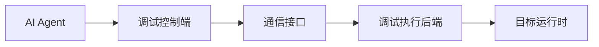

# 架构

插件由 Host 半边、客户端面板、纯逻辑模块和内置 Skill 组成，全部以 DSH bundle 形式分发。

## 调试执行链路

一次调试由五种逻辑职责协作完成。命令沿链路下发，状态、画面、事件与错误反向返回：

| 职责 | 负责什么 |
| --- | --- |
| AI Agent | 理解任务、选择能力、判断证据是否满足预期 |
| 调试控制端（Debug Controller） | 工具入口、配置、目标选择、权限、会话、并发与证据编排 |
| 通信接口（Communication Interface） | 传送命令、响应与事件，使用目标支持的协议 |
| 调试执行后端（Debug Backend） | 实际执行调试命令并观察目标 |
| 目标运行时（Target Runtime） | 运行被测应用 |

通信协议与执行后端分别承担传输和执行职责。各目标适配器可以使用平台已有的自动化后端、第三方后端，或按需实现自研执行端；并不要求每个平台都自带一套执行程序。

这五种职责不要求部署为五个独立进程，也不与 `core/`、`targets/`、`integration/` 等源码边界逐项对应。未来需要单独构建或部署的自研执行端可放入预留的 `engines/`，目标浏览器、操作系统或设备运行时本身通常在插件之外。

人类调试面板是同一受管会话的观察与交互入口，展示目标的画面和状态，并提供输入、选元素及标注；它不会为预览再运行一份独立的被测应用。具体操作可以走链路中的部分环节，离线图像分析等操作也不要求启动目标。

## 模块

| 模块 | 职责 |
| --- | --- |
| `core/` | 公共身份、几何、时钟、证据、错误、P0 模型、配置与适配器注册接口 |
| `integration/` | 解析权威配置、选择适配器、工具准入、逐次派发与 Skill 发现 |
| `targets/` | 各目标环境的具体适配器及平台接线 |
| [`client/`](../client/) | 调试面板源码，按公共外壳、Web、Blender、标注和设置划分 |
| `skills/` | 公共操作规则、各目标环境的 Agent 操作手册及测试专用规则 |

`core/` 不依赖平台实现。环境专有的运行时模块与协议见[目标环境架构](#目标环境架构)。

## 跨环境契约

三类 adapter 是调用方向不同的契约，源码目录 `core / targets / engines` 只是责任边界，不等同于三类 adapter。接口形状、接入步骤与完整坑点见 [三类 adapter：契约、接入与坑点](adapters.md)；下面只是摘要：

| 类型 | 职责 | 所有权 |
| --- | --- | --- |
| **TargetAdapter** | 环境入口：声明工程支持、发现/绑定/关闭目标、生命周期、生成 TargetSession、汇总就绪 | 连接、后台任务、目标 generation |
| **CapabilityAdapter** | 按能力层声明操作清单与现场可用性；执行操作并返回标准化观察+证据 | 操作准入、证据 envelope；不拥有目标 |
| **P0Provider** | 跨能力提供 P0-A～E：帧/图像、网络、显示空间、画布/标注、目标模型与租约原语 | 数据模型与平台转换；P0-E 只提供只读投影与租约，不 bind/close |

- 三类适配器消费不可变的 `ConfigSnapshot`。`invoke` 校验本次会话与快照的 revision，一旦不一致就报 `CONFIG_STALE`。
- `executionClass`（`page|readOnly|hostOnly|networkRead|diagnostic|independentHttp|tabs`）由组合根决定是否进串行队列/ensure；adapter 不得改变该分支。
- P0-E 多标签页是跨环境的多目标管理能力。[公共管理接口](../core/target-tabs.js) 由 TargetAdapter 的可选 `tabs` 服务实现；Web 经 [Web 多目标服务](../targets/web/tabs.js) 连接现有 RuntimeRegistry，其他环境留空。目标发现/绑定与生命周期仍归 TargetAdapter；P0-E provider 的 `targets` 仅 `list/leaseAcquire/leaseRelease/leaseStatus`，不另建生命周期。
- 面板标签栏是公共 `shellTabsBar(model, visible)`，环境通过内部 `ENV_TABS` 提供展示模型和操作回调；当前只有 Web provider，未接入环境不能借用 Web 的目标或操作。Blender 等未来实现可以把一个标签映射为一个实例及资产，见[公共接口与环境实现](multi-tab.md)。
- 平台协议（CDP、DOM、WAAPI 等）只出现在 `targets/web/` 或对应平台目录，不泄漏到 `core/`。

## 配置驱动执行与上下文

- **环境词表单源**：id、显示名与实现状态只在 `core/config.js` 的 `environmentCatalog()` 定义，经 `GET /config` 的 `catalog` 字段提供给面板与设置页。客户端不得维护自己的环境清单——面板曾因此宣告了 Host 从未登记的环境 id（`tests/contracts/environment-catalog.test.mjs` 是这条的门禁）。
- **配置真值在 Host**：设置页只提交意图，Host 校验、CAS 写入并返回权威 `revision`。默认文件为 `${DSH_HOME}/ui-testing/config.json`，可用 `DSH_UI_TESTING_CONFIG_DIR` 覆盖；原子写、0600、跨进程锁与损坏回退。
- **作用域全序**：session 自身 > 继承父的有效快照（`parentSession`，≤8）> workspace > global；只暴露当前环境的专用 schema/Skill，`enabledEnvironments` 只决定“允许启用”。
- **工具准入**：`ctx.tools.register(definition, { when })` 在 step 组装时排除非当前环境/未启用能力的工具；执行入口与 GUI 页面写路由再次校验，旧调用与面板旁路不能绕过。
- **Skill 隔离**：`ctx.skills.registerProvider` 的 `list()` 与 `get()` 都按环境过滤；公共规则在 `ui-testing-common`，Web 扩展在 `ui-testing-web`，test-only 假环境在 `ui-testing-fake`。已注入历史的正文不会被开关自动移除，切换只对后续轮次生效。
- **六轴就绪**：`support / enabled / dependency / connection / target / capability` 独立返回，带 `checkedAt`、`configRevision`、`reason`、`target`、`evidence`；冷态目标为 `unbound`、能力为 `not-probed`，不伪造版本或连接。各轴按实际探测结果报告状态，能力明细在 `evidence.checks` 中记录。被禁用或未选择的环境不做探测（依赖/连接/能力为 `not-probed/environment-disabled`），因此打开设置页不会扫描未启用的环境。
- **声明面按注册范围隔离**：插件的工具声明由注册面决定（已启用环境的并集 + 中立诊断），逐 Agent 的 `when` 是第二道闸门。实测按 step 准入不改变当前组合的模型请求声明，因此“某环境被禁用后其 schema 不再出现在请求里”由注册范围保证，而不是靠 `when` 隐藏。

## 目标环境架构

- [Web 运行时架构](web/architecture.md)

## 扩展点

新增一个运行环境适配器时，需要提供：

1. 三类适配器及[能力状态与证据约束](capability-tiers.md#21-支持可用执行和通过分别判断)。
2. 该环境自己的操作语义、能力声明和执行接线，缺失能力如实报告。
3. 独立的验收套件与确定性靶机。

不要照搬 Web 的技术栈去假设其他平台的实现路径；也不要让适配器假装支持同样的操作。

## 相关文档

- [能力分层与限制](capability-tiers.md)
- [验证与贡献](verification.md)
- [工具准入与参考索引](tools.md)
