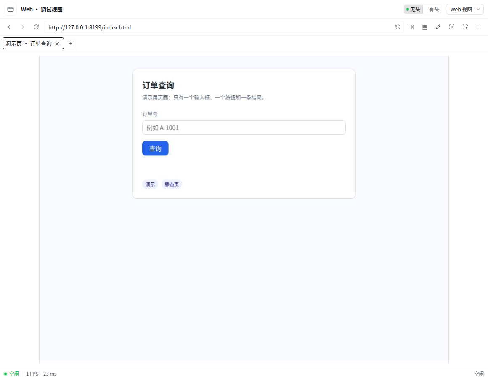
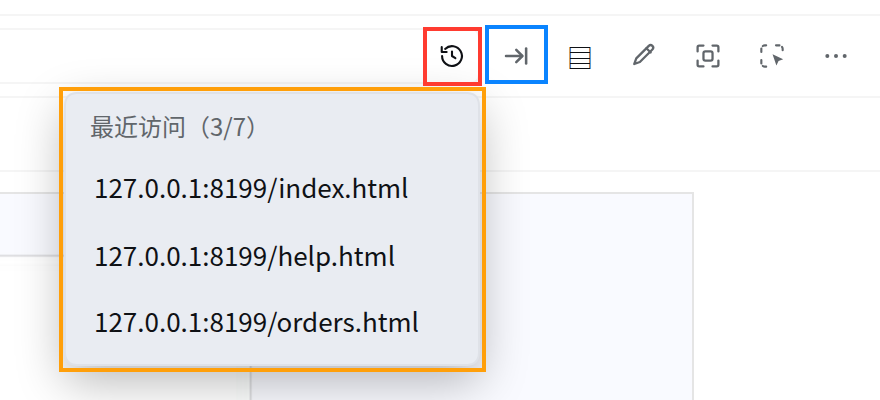
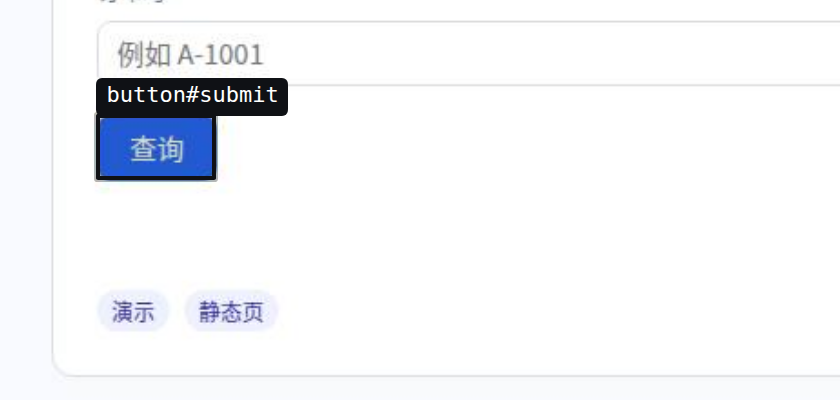
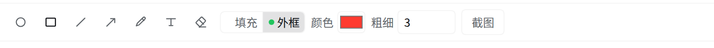

# 新手图文教程：从打开调试视图到让 Agent 真正动手

这篇教程只用**一个本地静态页**演示完整闭环：打开调试视图 → 加载页面 → 让 Agent 看见并操作 → 拿到可复核的证据。全程不需要写代码，也不需要配置模型。

> 截图来自一个**只装了本插件**的隔离 DSH 实例（独立 `DSH_HOME`、临时端口、一次性 Chromium），所以画面里没有其它插件的影响。

## 0. 前置条件（一次性）

1. 已安装 DSH，并且本机有 Chrome / Chromium（插件不自带浏览器）。
2. 把插件装进要用的 profile，然后**重启一次 DSH**：

   ```sh
   dsh plugin --profile web add dsh-agent-team-ui-testing
   ```

3. 确认工具面在：随便开一个会话，问 Agent「你现在有哪些 browser_ 工具」，应能列出 37 个（T1 程序化、T2 结构化 GUI、T3 静态视觉、T4 动态行为、网络 P0、多标签页、标注）。

## 1. 打开调试视图

两个入口，效果相同：

- 左侧 **更多 → 调试视图**；
- 右侧边栏的插件卡片。



从上到下依次是：

| 区域 | 用途 |
| --- | --- |
| 顶部一行 | 后退 / 前进 / 刷新、**地址栏**、最近访问、转到、标签页、标注、尺寸调整、选元素、更多 |
| 标签栏 | 一个标签一个页面；真人点击页面里的 `target=_blank` 会在这里新开一个 |
| 预览区 | 目标页的实时画面，鼠标键盘都可以直接操作 |
| 底部状态栏 | 空闲 / Agent 操作中、帧率、帧间隔 |

## 2. 在地址栏打开要调试的页面

把地址粘进地址栏按 <kbd>Enter</kbd>，或点它右边的 **转到** 按钮（等价于回车）。这里用 `http://127.0.0.1:8199/index.html` 这个演示页。



- **红色框 = 最近访问**：点开下拉，按栈展示最近 7 条访问过的地址（最近的在上，重复访问只置顶）。历史**按工作区隔离**，换个工作区就是另一份记录；点任意一条直接跳过去。
- **蓝色框 = 转到**：等同回车提交地址栏里的内容，校验与报错跟回车完全一致。
- **橙色框 = 下拉展开后的样子**：标题里的 `3/7` 表示已有 3 条、上限 7 条。

页面加载后，预览区就是**真的**那个页面的实时画面：在这里点击、输入、滚轮滚动，页面收到的都是真实事件。

## 3. 让 Agent 先「看」，再「动」

新手最容易犯的错是让 Agent 直接点。正确顺序是**先观察、再定位、最后动作**，典型对话：

```text
你：打开 http://127.0.0.1:8199/index.html，看看页面上有哪些控件
Agent：browser_navigate { url }  →  browser_snapshot
       （拿到 ref 列表：textbox "订单号" [ref=e2]、button "查询" [ref=e3] …）
你：在订单号里填 A-1001，然后点查询
Agent：browser_fill_form { fields: [{ ref: "e2", type: "textbox", value: "A-1001" }] }
       browser_click { ref: "e3" }
       browser_node_state / browser_eval 回读结果
```

三条经验：

1. **先 snapshot 拿 ref**：ref 形如 `e2`，每次导航或刷新都会失效，失效就重新 snapshot。
2. **动作后必须回读**：`browser_click` 返回 `dispatched:true` 只说明事件发出去了，页面是否真的变了要自己再读一次。
3. **点不动是结论，不是障碍**：元素被遮挡、持续运动、在 iframe 里，工具会明确报 `NOT_INTERACTABLE`，不要换个坐标硬点。

## 4. 把元素直接发给 Agent：选元素

不知道元素叫什么、又不想手写 selector 时，用工具栏的**选元素**：



1. 点工具栏的准星图标进入选元素模式（页面零输入，滚轮仍可滚动）；
2. 鼠标划过预览，被命中的元素会出现蓝框与 `标签#id` 标签；
3. 点一下，元素信息会作为 `@` 引用塞进聊天框，直接继续提问即可；
4. <kbd>Esc</kbd> 退出。

## 5. 画标注、截图给 Agent

需要指位置时别用文字描述——直接画：



- 最左侧的**选择**与**框选**用来改已画的标注：点选、Shift 点击切换多选，空白处拖框时实时高亮；`Shift` 框选加选、`Alt` 减选、`Shift+Alt` 取交集。选中后拖动整体移动，`Shift` 拖动锁定水平/垂直，`Esc` 取消当前手势，`Delete` 删除。画布获得焦点后，`V` / `M` 切换选择 / 框选，方向键微调（`Shift` 为 10 像素）。选中图形有品牌色光晕和包围框，多选还有整体边界框；底部状态栏在延迟后面显示「已选 N 个」，完整操作见[视口、画布与标注](viewport-control.md#标注)；
- 标注按**画布坐标**锚定，可以画在画面外的空白带上；
- 标注模式下页面不接收指针与键盘输入，<kbd>Esc</kbd> 退出；
- 工具条最后的**截图**按钮，会把「当前画面 + 已提交标注」合成一张 PNG **直接放进聊天框**，Agent 立刻能看到你圈的是哪块；
- Agent 也能反过来读/写这份标注文档（`browser_annotation`），但只有你正在调试视图里看着这个标签页时才允许写。

## 6. 需要证据时

| 你想要 | 用哪个 |
| --- | --- |
| 一张可复核的截图 | `browser_screenshot { out: "output/capture/step1.png" }` |
| 断言颜色/位置/差异 | T3：`browser_vision_image` / `browser_vision_compare` / `browser_vision_check` |
| 接口为什么 404/500、请求发了几次 | 网络 P0：`browser_network_session start` → `browser_network_events` / `browser_network_detail` |
| 动画卡不卡、有没有闪烁 | T4：`browser_dynamic_session` → `browser_motion_observe` → `browser_motion_analyze` |
| 页面变了什么 | `browser_snapshot` 前后对比，`browser_state` 看 URL/标题/视口 |

## 7. 常见问题

**点了页面没反应？**
先看工具栏：**标注**、**选元素**、**尺寸调整**三者互斥，任一开启时页面不接收普通输入。<kbd>Esc</kbd> 或再点一次按钮退出。

**画面提示「画面同步中，暂时无法操作」？**
视口刚改过尺寸，面板在等新帧对齐（最长约 1 秒），等下或点「重试同步」。这期间工具会拒绝派发，而不是点到错的位置。

**地址栏历史里没有我刚在别的窗口访问的地址？**
历史按工作区隔离，不同工作区各有一份，这是设计行为。

**改了 `client.js` 没生效？**
面板要刷新一次；改 `index.js`、工具 schema 或内置 Skill 则需要重启 DSH。

**面板里看不到原生弹窗（alert / 文件选择器）？**
它们由浏览器 UI 层绘制，不在页面画面里，面板无法显示也无法操作。

**Agent 说页面在「别的标签页」？**
每个 Agent 会话有自己的选中标签，互不抢占；用 `browser_tabs` 查看和切换，真人切标签不会改变 Agent 的选择。

## 下一步

- [快速开始（getting-started.md）](getting-started.md)：安装与首次操作
- [环境设置（settings.md）](settings.md)：环境启用、选择与诊断
- [调试面板（debug-panel.md）](debug-panel.md)：地址栏、页面输入与 DevTools
- [工具参考](tools.md)：37 个工具的参数与错误分类
- [能力分层](capability-tiers.md)：T1–T4 抽象定义、选路、Chrome 实现与证据边界
- [选元素加入聊天框](element-picker.md)、[视口与标注](viewport-control.md)、[网络调试](network-p0.md)
