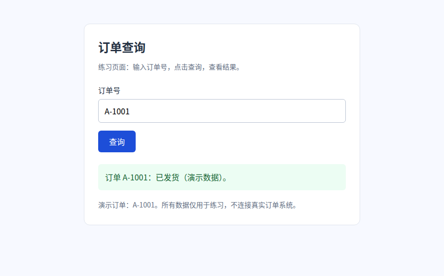

# 图文教程：让 Agent 帮你操作网页

这篇教程带你完成一次订单查询，再试试选元素、圈图和保存截图。你只需要点击界面、向 Agent 描述需求；工具调用和开发验证放在[开发者进阶（tutorial-advanced.md）](tutorial-advanced.md)。

| 你现在想做什么 | 从哪里开始 |
| --- | --- |
| 第一次使用，跟着做一遍 | 从下面第 1 步开始 |
| 已有自己的网页 | 跳到第 2 步，使用你自己的地址 |
| 想了解工具、排查接口或编写测试 | 看[开发者进阶（tutorial-advanced.md）](tutorial-advanced.md) |

开始前，确认 DSH 中已有能正常聊天的 Agent 会话、本机装有 Chrome / Chromium，并已安装本插件。安装方法见[快速开始（getting-started.md）](getting-started.md)。

## 1. 准备一个练习页面

没有现成网页时，可以使用随教程提供的[订单查询演示页（index.html）](examples/order-query/index.html)和[启动脚本（serve.mjs）](examples/order-query/serve.mjs)。它们只提供本地练习，不连接真实订单系统。

把下面这段话发给 Agent：

> 请使用本插件 docs/examples/order-query/ 中的演示页和启动脚本，复制到当前工作区一个新的练习目录，启动订单查询演示。只在本机提供访问，把实际网址告诉我，并保留启动终端供练习结束后关闭。

如果 Agent 找不到材料，可以从上面的链接保存两个文件，放在同一文件夹中，再把文件夹位置告诉它。开发者也可以按[手动启动说明（tutorial-advanced.md）](tutorial-advanced.md#1-手动启动演示页)运行。

**你应看到：** Agent 返回一个可访问的网址，例如 `http://127.0.0.1:8199/index.html`。端口被占用时脚本会换一个空闲端口，后续始终使用实际返回的地址。

## 2. 打开调试视图并加载网页

1. 回到刚才聊天的会话，**优先从当前会话右侧边栏的插件卡片打开调试视图**，让聊天框同时可见。这样后面的选元素和截图才能写入这个会话。
2. 把实际网址粘到地址栏，按 Enter，或点右侧「转到」。

左侧 **更多 → 调试视图** 也能查看页面；若后面提示「当前面板未绑定会话」，回到聊天会话，从右侧入口重新打开。

上图帮助你认识面板位置。练习页面应有「订单查询」标题、「订单号」输入框和「查询」按钮；第 4 步会展示查询成功后的页面。

红框中的时钟可以找回最近访问过的页面，蓝框是「转到」按钮。需要换页面时，直接在地址栏输入新地址即可。

## 3. 先让 Agent 看看页面

在聊天框里说：

> 请查看我在调试视图里打开的订单查询页，告诉我页面标题，以及有哪些可以操作的控件。

**你应看到：** Agent 提到「订单查询」、订单号输入框和查询按钮。

如果它描述的是另一个页面，把实际网址发给它，并说「请切换到这个网址对应的标签页」。确认双方看到同一个页面后，再继续。

## 4. 完成一次订单查询

接着说：

> 在订单号里填入 A-1001，然后点击查询。请读取查询后的结果，告诉我页面实际显示了什么。

**成功时应看到：** 输入框中出现 `A-1001`，结果区显示「订单 A-1001：已发货（演示数据）。」，Agent 的回答与页面一致。

这是练习页的成功结果，仅包含页面内容。确认结果真的出现后，就完成了第一次 Agent 操作。

## 5. 用「选元素」告诉 Agent 你指的是哪个按钮

当页面上有多个相似按钮，或者你不知道该怎么描述位置时：

1. 点工具栏的「选元素」；鼠标停在图标上可以查看名称。
2. 把鼠标移到页面中的「查询」按钮上，确认边框圈住它。
3. 点一下按钮，元素引用会加入聊天框；这次点击用于选取，不会执行查询。
4. 在引用后面写问题并发送，例如「请检查这个按钮点击后，结果区有没有变化」。

**你应看到：** 聊天框里出现一个 `@` 元素引用，Agent 能根据它定位你指的对象。还停留在选元素模式时，可按 Esc 退出。

## 6. 圈出位置，再把截图发给 Agent

想讨论一块区域的布局或外观时，可以直接圈图：

1. 点工具栏的「标注」。
2. 选矩形工具，在「查询」按钮周围拖出一个框。
3. 点标注工具条里的「截图」。
4. 确认图片附件出现在聊天框，输入问题后发送，例如「看我圈的按钮，文字是否清楚，和输入框的间距是否合适？」

上图展示绘制与样式区域。第一次练习只需矩形和截图；移动、多选和快捷键可在熟悉后查看[标注操作（viewport-control.md）](viewport-control.md#标注)。

**你应看到：** 聊天框中的图片带着刚画的框。标注模式下页面不会接收普通点击，操作完可按 Esc 退出。圈图用于指出位置，是否存在问题还要结合页面实际情况判断。

## 7. 保存结果，换成自己的网页

需要留存时，告诉 Agent：

> 请把查询成功后的页面截图保存到当前工作区，并给我可打开的文件链接，同时说明这次输入的订单号和查询结果。

**你应看到：** 一张可打开的截图，以及与页面一致的结果说明。想保留圈图时，再补一句「截图请包含我的标注」。

随后把地址栏换成你自己的网页地址，继续按「说明目标 → 让 Agent 操作 → 检查页面结果」使用。练习完成后，可以关闭演示服务所在的终端。

## 遇到问题时

| 现象 | 可以怎么做 |
| --- | --- |
| 练习网址打不开 | 确认启动终端仍在运行，使用它实际返回的网址；本机地址指向运行 DSH 的那台机器 |
| Agent 无法操作网页 | 请它检查本插件是否启用、浏览器依赖是否可用；安装与诊断见[快速开始（getting-started.md）](getting-started.md)和[环境设置（settings.md）](settings.md) |
| 点页面没反应 | 先退出标注、选元素或尺寸调整模式；若显示「画面同步中」，等待画面稳定或点「重试同步」 |
| Agent 看到的页面和我不同 | 把网址发给它，请它核对并切换标签页；真人切页与 Agent 选页分别管理 |
| 选元素或截图提示「未绑定会话」 | 回到要接收内容的聊天会话，从它右侧边栏的插件卡片重新打开调试视图 |
| 截图里没有我的框 | 确认框已画完，并使用标注栏的截图按钮，或明确要求 Agent「截图包含标注」 |
| 原生弹窗没有出现在预览里 | 浏览器的文件选择器、alert 等不属于页面画面，详见[调试面板（debug-panel.md）](debug-panel.md) |

## 下一步

- 想让 Agent 检查布局、接口或动画：看[开发者进阶（tutorial-advanced.md）](tutorial-advanced.md#3-按问题选择观察方法)。
- 想熟悉界面：看[调试面板（debug-panel.md）](debug-panel.md)、[选元素（element-picker.md）](element-picker.md)、[视口与标注（viewport-control.md）](viewport-control.md)。
- 想查工具参数与支持范围：看[工具参考（tools.md）](tools.md)、[能力分层（capability-tiers.md）](capability-tiers.md)。
